# Lec 10 对偶理论 II：Farkas 引理、分离超平面定理与强对偶性证明 (Duality Theory II: Strong Duality)

> MIT 15.081J / 6.251J 数学规划导论 · 讲义 10 · 授课教师：Prof. Dimitris Bertsimas / John Tsitsiklis

## TL;DR

- 法卡斯引理（Farkas' Lemma）刻画了线性多面锥无解与严格分离超平面的二分对立性。
- 强对偶定理（Strong Duality Theorem）证明线性规划不存在对偶间距：原对偶最优值完全相等。
- 线性规划的四种结局：双可行双最优、一无界一不可行、或双方均不可行。

## 1. 凸集严格分离超平面定理与 Farkas 引理

在前一讲中我们确立了弱对偶性 $p^T b \le c^T x$。然而，关键疑问依然悬而未决：这个对偶下界能否完全闭合？原问题与对偶问题之间是否存在一个无法跨越的“间隙”？

为了攻克强对偶性，凸分析必须搬出最锋利的几何公理——**分离超平面定理（Separating Hyperplane Theorem）**。

::: theorem 闭凸集与点的严格分离定理
设 $C \subset \mathbb{R}^n$ 为非空闭凸集，向量 $y \notin C$ 是位于该集合之外的点。
则存在一个非零超平面法向量 $a \in \mathbb{R}^n \setminus \{0\}$ 和实数 $\alpha \in \mathbb{R}$，能够将点 $y$ 与凸集 $C$ 严格分开：
$$a^T x \ge \alpha > a^T y, \quad \forall x \in C$$
:::

利用这一几何投影与分离性质，匈牙利数学家朱利叶斯·法卡斯（Gyula Farkas）在 1902 年提出了著名的**法卡斯引理（Farkas' Lemma）**。这是定理证明界最经典的“备选选择公理（Theorem of Alternatives）”：

::: theorem 法卡斯引理 (Farkas' Lemma)
设 $A \in \mathbb{R}^{m \times n}$ 为矩阵，$b \in \mathbb{R}^m$ 为向量。以下两个线性系统**有且仅有一个**存在可行解：
1. 存在 $x \in \mathbb{R}^n$ 满足：
$$A x = b, \quad x \ge 0$$
2. 存在 $p \in \mathbb{R}^m$ 满足：
$$p^T A \ge 0, \quad p^T b < 0$$
:::

法卡斯的几何图像无比震撼：向量 $b$ 要么落在由矩阵 $A$ 的列向量张成的有限凸锥（Finitely Generated Cone）之内（系统 1 成立）；要么 $b$ 位于凸锥之外，此时必然存在一个过原点的超平面，其法向量为 $p$，该超平面将整个凸锥全部压在一侧（$p^T A_j \ge 0$），而向量 $b$ 孤零零地掉在严格对侧（$p^T b < 0$）！

```mermaid
flowchart TD
    subgraph Space [空间几何分流]
        direction TB
        B_vec[目标资源向量 b]
        Cone[矩阵列向量张成的凸锥 Cone A]
    end
    B_vec -->|判断是否属于| Branch{b 是否属于 Cone A?}
    Branch -- 是 --> S1[系统 1 可行: 存在 x >= 0 使得 Ax = b]
    Branch -- 否 --> S2[系统 2 可行: 存在分离超平面 p 使得 p^T A >= 0 且 p^T b < 0]
```

## 2. 强对偶定理（Strong Duality Theorem）的终极证明

借助法卡斯引理，我们终于可以为线性规划的皇冠明珠——**强对偶定理**给出无可争议的严谨证明！

::: theorem 强对偶定理 (Strong Duality Theorem)
若原问题 $P$ 存在有限最优解 $x^*$，则对偶问题 $D$ 也必然存在有限最优解 $p^*$，且两者的最优目标函数值**严格相等**：
$$c^T x^* = p^{*T} b$$
:::

**证明概要（利用单纯形构造法）**：
设单纯形法终止于最优基本可行解 $x^*$，对应基矩阵为 $B$。
由于当前解最优，所有非基变量的检验数全部非负：
$$\bar{c}^T = c^T - c_B^T B^{-1} A \ge 0$$
令候选向量 $p^{*T} = c_B^T B^{-1}$。
检验数非负条件立即转化为：
$$c^T - p^{*T} A \ge 0 \iff A^T p^* \le c$$
这直接证明了 $p^*$ 严格满足对偶问题的约束条件，即 $p^*$ 是一个**对偶可行解**！
进一步计算对偶目标函数在 $p^*$ 处的取值：
$$p^{*T} b = (c_B^T B^{-1}) b = c_B^T (B^{-1} b) = c_B^T x_B^* = c^T x^*$$
根据弱对偶推论 1，当原可行解与对偶可行解的目标函数值完全重合时，两者必然同时达到全局最优！
因此，$p^*$ 必为对偶最优解，且强对偶性 $c^T x^* = p^{*T} b$ 获证。

## 3. 线性规划的全局四种终局态

综合弱对偶与强对偶定理，一个线性规划及其对偶规划的全部可能结局，被严密限定在下表所示的四种可能之中：

| 原问题 $P$ \ 对偶问题 $D$ | 有有限最优解 | 目标无界 ($+\infty$) | 不可行 (Infeasible) |
| :---: | :---: | :---: | :---: |
| **有有限最优解** | **强对偶成立 ($c^T x^* = p^{*T} b$)** | 不可能 | 不可能 |
| **目标无界 ($-\infty$)** | 不可能 | 不可能 | **必然成立** |
| **不可行 (Infeasible)** | 不可能 | **必然成立** | **可能成立（双方皆空）** |

::: pitfall 双方均不可行的病态案例
初学者常误以为“原问题不可行，对偶问题就必然无界”。
这是不对的！存在双方同时不可行的反例：
例如原问题：$\min 2 x_1 - x_2$，约束为 $x_1 - x_2 = 1, -x_1 + x_2 = 1, x_1, x_2 \ge 0$。明显 $1 = -1$ 矛盾不可行。
其对偶规划同样包含矛盾的超平面系统，导致对偶可行域亦为空集。
:::

::: insight 几何对称性与世界秩序
强对偶定理不仅是运筹学定理，更蕴含着深刻的哲学之美。
从物理生产视角看，我们在多维空间中搬运物资、装配产品，受制于机械维度的等式约束；而从金融经济视角看，资源影子价格在完全竞争市场中做自由寻优。强对偶定理证明：**物理工程师在约束可行域中的极致精益生产，与金融市场对所有底层生产要素的最高理性估值，在数学的终点精确无误地重合在同一点上**。这就是应用数学揭示的宇宙内在秩序。
:::
