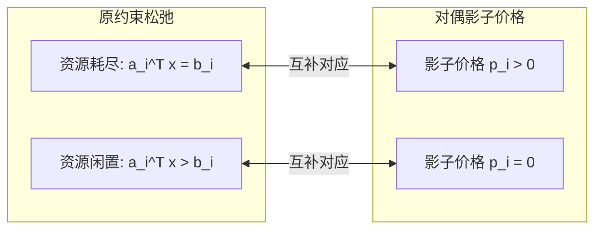

# Lec 11 对偶理论 III：互补松弛定理与对偶单纯形法 (Complementary Slackness & Dual Simplex)

> MIT 15.081J / 6.251J 数学规划导论 · 讲义 11 · 授课教师：Prof. Dimitris Bertsimas / John Tsitsiklis

## TL;DR

- 互补松弛定理（Complementary Slackness）建立了原变量正值与对偶约束紧致的零和乘积链。
- 对偶单纯形法（Dual Simplex）保持对偶可行性（检验数非负），在原不可行点上逐步消减负基解。
- 动态添加割平面或收紧约束后，对偶单纯形法无需重新求解即可热启动（Warm Start）秒级恢复。

## 1. 互补松弛定理（Complementary Slackness Theorem）

强对偶定理确立了最优目标函数值的相等性 $c^T x^* = p^{*T} b$。如果我们将这个宏观等式拆解到每一个变量分量与每一条约束的微观层面，会得到极其精妙的代数正交性：

::: theorem 互补松弛定理 (Complementary Slackness)
设 $x^*$ 为原问题（标准型）可行解，$p^*$ 为对偶问题可行解。
则 $x^*$ 和 $p^*$ 分别为原问题和对偶问题的最优解，当且仅当对于所有 $j = 1, \dots, n$，满足：
$$x_j^* \cdot \left( c_j - p^{*T} A_j \right) = 0$$
:::

将该定理推广到通用不等式形式的原问题（$\min c^T x$ s.t. $A x \ge b, x \ge 0$），互补松弛条件呈现为经典的“双侧互补对”：
1. **原松弛与对偶变量互补**：$p_i^* \cdot (a_i^T x^* - b_i) = 0, \quad \forall i = 1, \dots, m$
   - 经济学解释：若第 $i$ 种资源在最优生产中存在闲置剩余（$a_i^T x^* > b_i$），则该资源的影子价格必然为零（$p_i^* = 0$）。只有当资源完全耗尽、构成生产瓶颈时（$a_i^T x^* = b_i$），企业才愿意支付正向影子价格购买更多配额！
2. **对偶松弛与原决策变量互补**：$x_j^* \cdot (c_j - p^{*T} A_j) = 0, \quad \forall j = 1, \dots, n$
   - 经济学解释：若某产品 $j$ 的名义生产成本高于其消耗资源的市场公允影子价值（即 $c_j > p^{*T} A_j$），则理性企业绝不生产该产品，其产量必然为零（$x_j^* = 0$）。企业只生产那些“边际成本恰好等于影子收入”的零超额利润产品！

## 2. 对偶单纯形法（Dual Simplex Method）

乔治·丹齐格的标准单纯形法（原单纯形法）的策略是：**始终保持原问题可行性（$x_B \ge 0$），在迭代中逐步消除负检验数，直至对偶可行（$\bar{c} \ge 0$）**。

莱姆克（Carlton Lemke）在 1954 年提出了颠倒视角的**对偶单纯形法（Dual Simplex Method）**：
**始终保持对偶可行性（$\bar{c} = c^T - c_B^T B^{-1} A \ge 0$ 恒成立），在迭代中逐步消除负的原变量（$x_{B(i)} < 0$），直至原问题可行（$x_B \ge 0$）！**

::: definition 对偶单纯形法迭代步
1. **出基变量选取（确定负解）**：
   扫描当前基解向量 $x_B = B^{-1} b$。若所有 $x_{B(i)} \ge 0$，算法终止，当前解已原可行且对偶可行，即为全局最优解！
   若存在负分量，选定最负的基变量出基：
   $$l = \arg\min_i \{x_{B(i)} < 0\}$$
2. **进基变量选取（对偶最小比值测试）**：
   考察第 $l$ 行在各非基列上的元素 $v_j = (B^{-1} A)_{l, j}$。
   若对所有非基列 $j \in N$，均有 $v_j \ge 0$，则说明对偶问题无界，原问题**不可行**，算法终止。
   若存在 $v_j < 0$，进基变量由对偶最小比值严格锁定：
   $$j^* = \arg\min_{\{j \in N \mid v_j < 0\}} \frac{\bar{c}_j}{|v_j|}$$
3. **主元消元**：以 $(B^{-1} A)_{l, j^*}$ 为主元执行高斯消元，更新单纯形表。
:::

## 3. 工业求解器中的杀手锏：热启动（Warm Start）

为什么现代整数规划与组合优化求解器（如 Gurobi, CPLEX）将对偶单纯形法作为默认引擎？

在分支定界法（Branch and Bound）或割平面法（Cutting Planes）中，我们在求解完一个松弛 LP 后，常常需要向系统中添加一条新的约束（例如 $x_1 \le 2$ 或 Gomory 割平面）。
- 如果使用原单纯形法：新约束一旦加入，当前的最优解直接违反新约束变为不可行（$x_{B(i)} < 0$），原可行性被暴力破坏！原单纯形法必须重新运行两阶段法，从零开始耗费上千步迭代。
- 如果使用对偶单纯形法：添加新约束仅仅是增加了一个负的松弛变量，原问题的检验数向量 $\bar{c} \ge 0$ 依然完全保持非负（对偶可行性完好无损）！
此时，对偶单纯形法可以直接从当前基状态**热启动（Warm Start）**，通常只需 2~5 步对偶主元迭代，即可秒级恢复新的全局最优解！

::: insight 对偶性的双向奔赴
原单纯形法像一位谨慎的工程师：每一步都严守所有现实约束（可行性），然后努力寻找利润更高的改进；
对偶单纯形法像一位雄心勃勃的投资人：心中时刻揣着最完美的商业估值（对偶最优），每一步都在设法平抑违规赤字，直到现实终于能够承载这一完美估值。
互补松弛定理是这两种视角的握手协议，证明了通向真理的两条截然相反的道路最终必然殊途同归。
:::
