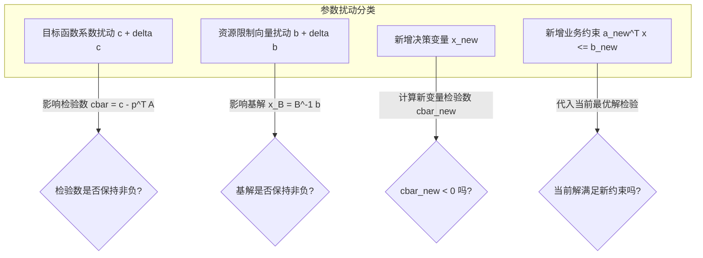

# Lec 12 灵敏度分析与参数规划：右端项与目标系数扰动 (Sensitivity Analysis)

> MIT 15.081J / 6.251J 数学规划导论 · 讲义 12 · 授课教师：Prof. Dimitris Bertsimas / John Tsitsiklis

## TL;DR

- 灵敏度分析量化了技术系数矩阵 $A$、目标成本 $c$ 与资源配额 $b$ 扰动下的基稳定性。
- 最优基不变的容许变动范围（Allowable Range）由检验数与基解非负性直接给出。
- 引入新变量与新约束可通过单步检验数计算或对偶单纯形法实现秒级增量再优化。

## 1. 现实世界的不确定性与最优基的耐受边界

在经典的线性规划求解中，我们假设模型参数——产品单价 $c$、资源消耗定额 $A$ 与库存上限 $b$ 是完全确定且精确已知的常数。然而在现实企业运营中，原材料价格瞬息万变、汇率与通胀波动剧烈、机器故障导致工时缩水。

决策者最迫切的问题往往不是“当前的最优方案是什么”，而是：
1. **目标成本波动**：产品市场售价波动多大以内，我们依然无需调整现有的生产排产计划？
2. **资源边际追加**：如果能够从现货市场溢价采购一批额外钢材（即增大 $b_i$），企业最多愿意出多高的溢价？在多大采购量内该影子价格保持不变？
3. **新产品研发**：研发部门推出了一款新产品，需要消耗现有产能，是否值得将它投入量产？

这一系列量化评估构成了运筹学中的**灵敏度分析（Sensitivity Analysis / Post-Optimality Analysis）**。

## 2. 目标系数 $c$ 与右端项 $b$ 的容许范围（Allowable Range）

设最优基矩阵为 $B$。当前最优解为 $x_B = B^{-1} b \ge 0, x_N = 0$，检验数为 $\bar{c}^T = c^T - c_B^T B^{-1} A \ge 0$。

### 2.1 非基变量目标系数 $c_j$ 的变动（$j \in N$）
由于非基变量并未进入基矩阵，$B^{-1}$ 和 $c_B$ 均保持不变。因此其成本变动 $\Delta c_j$ 仅影响该变量自身的检验数：
$$\bar{c}_j(\Delta c_j) = (c_j + \Delta c_j) - c_B^T B^{-1} A_j = \bar{c}_j + \Delta c_j$$
为了保持当前最优解不变，只需检验数非负：
$$\bar{c}_j + \Delta c_j \ge 0 \implies \Delta c_j \ge -\bar{c}_j$$
即只要生产成本增加，或降价幅度不超过其检验数 $\bar{c}_j$，该非基变量就依然没有生产价值，当前最优解完全不变！

### 2.2 基变量目标系数 $c_{B(k)}$ 的变动
由于 $c_B$ 发生了变动，单纯形乘子 $p^T = c_B^T B^{-1}$ 会整体改变，进而联动影响**所有非基变量**的检验数：
$$\bar{c}_j(\Delta c_{B(k)}) = c_j - (c_B + \Delta c_{B(k)} e_k)^T B^{-1} A_j = \bar{c}_j - \Delta c_{B(k)} (B^{-1} A_j)_k \ge 0, \quad \forall j \in N$$
这给出了一组关于 $\Delta c_{B(k)}$ 的联立线性不等式，其交集定义了该基变量成本变动的**容许上升与下降区间（Allowable Range）**。

### 2.3 资源限制 $b$ 的变动与影子价格有效区间
右端项扰动 $b + \Delta b$ 丝毫不影响检验数 $\bar{c}$（对偶可行性不受任何影响），它仅仅改变基变量的取值：
$$x_B(\Delta b) = B^{-1} (b + \Delta b) = x_B^* + B^{-1} \Delta b$$
只要满足非负性：
$$x_B^* + B^{-1} \Delta b \ge 0$$
当前基 $B$ 就依然是最优基！
在此区间内，目标函数的最优值随着资源量的增加严格呈线性变化：
$$\Delta z^* = c_B^T B^{-1} \Delta b = p^{*T} \Delta b$$
这意味着：**在容许范围内，资源影子价格 $p^*$ 是一个严格恒定的边际常数！**

::: definition 参数线性规划（Parametric Programming）
若参数沿着固定射线连续变化，即考察 $c(\theta) = c + \theta d$ 或 $b(\theta) = b + \theta h$（$\theta \ge 0$），最优目标函数值 $z^*(\theta)$ 表现为一个**分段线性凸函数（对于 $b$ 扰动）**或**分段线性凹函数（对于 $c$ 扰动）**。在每一个线性区间内对应一个固定基，当 $\theta$ 越过临界断点时，系统通过一次主元变换平滑切换到相邻的最优基。
:::

::: insight 灵敏度是决策弹性的度量衡
在商业竞争中，没有哪个企业的参数是绝对静止的。如果一个优化模型给出的最优解虽然理论利润极高，但其容许范围极其狭窄（原材料价格上涨 $0.1\%$ 就会导致解失效），这种脆弱的解在工程上是极其危险的。
真正的顶级运筹建模，必须结合灵敏度分析报告，寻找那些位于多面体宽阔平坦“高原”上的鲁棒解，为企业的实际战略执行预留足够的安全边际。
:::
