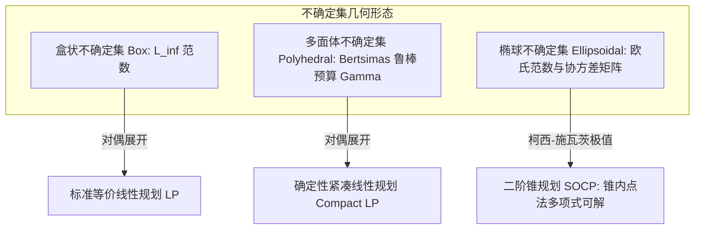

# Lec 13 鲁棒线性优化：多面体与椭球不确定集对偶等价 (Robust Optimization)

> MIT 15.081J / 6.251J 数学规划导论 · 讲义 13 · 授课教师：Prof. Dimitris Bertsimas / John Tsitsiklis

## TL;DR

- 传统敏感性分析仅能事后检验，鲁棒优化（Robust LP）在建模之初便为最坏情况筑底。
- 多面体不确定集通过对偶变换可精确重构为等价的确定性线性规划（Robust Counterpart）。
- 椭球不确定集将矩阵参数扰动映射为优雅的二阶锥规划（SOCP），平衡保守度与鲁棒预算。

## 1. 传统优化的脆弱性与最坏情况免疫建模

由 Dimitris Bertsimas 教授与 Aharon Ben-Tal 等学者奠基的**鲁棒优化（Robust Optimization, RO）**，是 21 世纪应用数学与运筹学最重大的一场范式革命。

在传统的线性规划约束中：
$$a_i^T x \le b_i$$
我们假定技术消耗系数 $a_i$ 是固定常数。然而在实际工程中（如土木结构应力、药物生物半衰期、供应链海运延误），参数往往在某个不确定性集合 $\mathcal{U}$ 中随机漂移。
如果优化模型忽略了这种扰动，求出的最优解通常会紧紧贴着多面体的棱角与边界。一旦外部世界发生极其微小的摄动（比如 $a_i$ 增加了 $0.5\%$），原本的最优解就会大规模违反物理约束，引发灾难性后果！

鲁棒优化的核心理念是：**不假设参数服从先验概率分布（克服传统随机规划对精确概率测度的过度依赖），而是要求决策变量 $x$ 针对不确定性集合内所有可能出现的最坏情况（Worst-case Realization）全部免疫可行！**

$$\max_{a_i \in \mathcal{U}_i} a_i^T x \le b_i, \quad \forall i = 1, \dots, m$$

## 2. 多面体不确定集与 Bertsimas 鲁棒预算模型

最直接的不确定性是独立区间扰动（盒状不确定集 Box Uncertainty）：每个参数 $a_{ij}$ 在区间 $[\bar{a}_{ij} - \hat{a}_{ij}, \bar{a}_{ij} + \hat{a}_{ij}]$ 内变化。
然而，要求所有参数同时取到最恶劣的最坏情况，在统计上是极其罕见的极端事件，这会导致优化方案**过度保守（Over-conservatism）**，丧失商业可行性。

为了化解过度保守，Bertsimas 与 Simchi-Levi 提出了里程碑式的**鲁棒预算不确定集（Budget of Uncertainty）**：
假设在第 $i$ 条约束中，至多只有 $\Gamma_i$ 个参数同时恶化到极值边界（$\Gamma_i \in [0, n]$ 称为鲁棒控制参数 / 鲁棒预算）：

$$\mathcal{U}_i = \left\{ a_i \in \mathbb{R}^n \;\middle|\; a_{ij} = \bar{a}_{ij} + z_{ij} \hat{a}_{ij}, \; |z_{ij}| \le 1, \; \sum_{j=1}^n |z_{ij}| \le \Gamma_i \right\}$$

将该最坏情况保护代入约束：
$$\bar{a}_i^T x + \max_{\{z_i \mid |z_{ij}| \le 1, \sum |z_{ij}| \le \Gamma_i\}} \sum_{j=1}^n z_{ij} \hat{a}_{ij} x_j \le b_i$$

中间的保护子问题（Protection Function）本身是一个关于 $z$ 的线性规划！
利用我们在第 9 讲学到的对偶理论，为子问题的约束引入对偶变量 $p_i$ 与 $q_{ij}$。由于强对偶定理，子问题的最大值严格等于其对偶问题的最小值。
将对偶系统的最小化并入外层主问题，我们奇迹般地得到了一个**完全确定性、尺寸仅线性增加的等价线性规划（Robust Counterpart LP）**：

$$\begin{aligned}
\bar{a}_i^T x + \Gamma_i p_i + \sum_{j=1}^n q_{ij} &\le b_i \\
p_i + q_{ij} &\ge \hat{a}_{ij} |x_j|, \quad \forall j \\
p_i, q_{ij} &\ge 0
\end{aligned}$$

无需任何概率假设，仅通过引入几个对偶变量，多面体扰动就被彻底驯服为标准线性规划！

## 3. 椭球不确定集与二阶锥规划（SOCP）

如果参数的不确定性来自多元正态分布置信椭球，集合表述为：
$$\mathcal{U} = \left\{ a \in \mathbb{R}^n \mid a = \bar{a} + P u, \; \|u\|_2 \le 1 \right\}$$
其中 $P \in \mathbb{R}^{n \times k}$ 为协方差形状矩阵。

在此椭球集合上寻找内积最大值：
$$\max_{\|u\|_2 \le 1} (\bar{a} + P u)^T x = \bar{a}^T x + \max_{\|u\|_2 \le 1} u^T (P^T x)$$
根据柯西-施瓦茨不等式，线性泛函在欧氏单位球上的最大值精确等于其对偶欧氏范数：
$$\max_{\|u\|_2 \le 1} u^T (P^T x) = \|P^T x\|_2$$

因此，椭球鲁棒对应约束精确等价为：
$$\bar{a}^T x + \|P^T x\|_2 \le b$$

::: definition 二阶锥约束（Second-Order Cone）
不等式 $\|P^T x\|_2 \le b - \bar{a}^T x$ 属于标准的**二阶锥约束（SOCP Constraint / Lorentz Cone）**。二阶锥规划虽然具有非线性凸外壳，但在现代凸优化中拥有极其高效的多项式时间自协调障碍函数内点算法。
:::

::: insight 鲁棒性作为一等公民建模原则
过去很多工程师把“最优化”与“风险管理”割裂开来：先跑出一个理想最优解，再做应力仿真；一旦通不过，就凭拍脑袋人工加安全系数（Safety Factors）。
鲁棒优化将“不确定性抵抗力”直接写进了目标函数与可行域的代数公理之中。通过调节预算参数 $\Gamma$，决策者能够精准绘制出“确定性收益”与“鲁棒免疫成本”之间的帕累托前沿曲线（Pareto Frontier）。运筹学自此从象牙塔的静态推导，真正蜕变为支撑高风险工业实战的钢铁护甲。
:::
