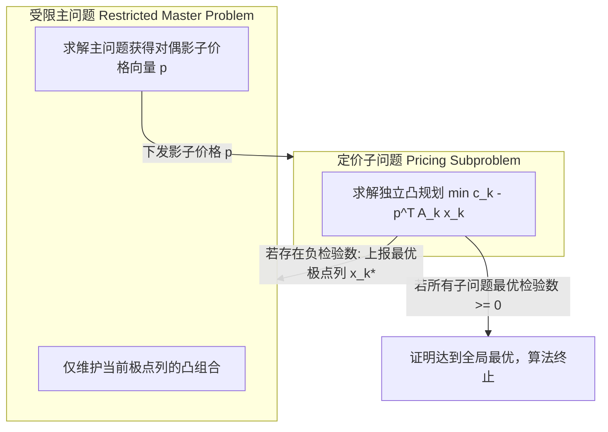

# Lec 14 大规模优化 I：Dantzig-Wolfe 分解原理与延迟列生成 (Dantzig-Wolfe Decomposition)

> MIT 15.081J / 6.251J 数学规划导论 · 讲义 14 · 授课教师：Prof. Dimitris Bertsimas / John Tsitsiklis

## TL;DR

- 块角形结构（Block-Angular Structure）解耦了企业全局共用资源与各独立子系统。
- 魏尔-闵可夫斯基定理将子多面体极点映射为主问题（RMP）的潜在指数级生成列。
- 延迟列生成（Column Generation）通过子问题检验数定价，仅在需要时物化最优进基列。

## 1. 块角形结构与分布式解耦的物理动机

在跨国制造集团、大型电网调度与全球航运网络中，系统的约束矩阵往往呈现出极具特征的**块角形结构（Block-Angular Structure）**：

$$\begin{aligned}
\min \quad & c_1^T x_1 + c_2^T x_2 + \dots + c_K^T x_K \\
\text{s.t.} \quad & A_1 x_1 + A_2 x_2 + \dots + A_K x_K = b_0 \quad &&\text{(全局耦合约束 Coupling Constraints)} \\
& D_k x_k = b_k, \quad x_k \ge 0, \quad \forall k=1,\dots,K \quad &&\text{(各子系统独立技术约束)}
\end{aligned}$$

在这个系统中，$K$ 个独立工厂或业务单元各拥有专属的生产线约束 $D_k x_k = b_k$；如果没有第一行的全局耦合约束（例如集团总预算配额、共享港口码头吞吐上限），整个问题可以完美拆解为 $K$ 个互不干扰的小规模 LP 并行求解。
然而，正是因为存在 $b_0$ 这组耦合约束，迫使所有子系统死死捆绑在一起。如果直接拼装成一个超大规模整体矩阵，变量和约束量级将瞬间击穿求解器内存。

乔治·丹齐格与菲利普·沃尔夫（Philip Wolfe）在 1960 年提出了天才般的**Dantzig-Wolfe 分解原理（DW Decomposition）**，奠定了现代大规模分布式优化的基石。

## 2. 凸多面体投影与主规划（Master Problem）的建立

记每个独立子系统定义的多面体为：
$$X_k = \{x_k \in \mathbb{R}^{n_k} \mid D_k x_k = b_k, \; x_k \ge 0\}$$
为简化推导，假定 $X_k$ 均为有界多胞形。根据第 4 讲的魏尔-闵可夫斯基表示定理，每个 $X_k$ 内的任意点都可以精确表示为该子系统全部有限个极点 $\{x_k^1, \dots, x_k^{J_k}\}$ 的凸组合：
$$x_k = \sum_{j=1}^{J_k} \lambda_k^j x_k^j, \quad \sum_{j=1}^{J_k} \lambda_k^j = 1, \quad \lambda_k^j \ge 0$$

将上述极点凸组合代入原目标函数与全局耦合约束，我们获得了一个全新的**完全主规划（Full Master Problem）**：

$$\begin{aligned}
\min_{\lambda} \quad & \sum_{k=1}^K \sum_{j=1}^{J_k} \left( c_k^T x_k^j \right) \lambda_k^j \\
\text{s.t.} \quad & \sum_{k=1}^K \sum_{j=1}^{J_k} \left( A_k x_k^j \right) \lambda_k^j = b_0 \\
& \sum_{j=1}^{J_k} \lambda_k^j = 1, \quad \forall k=1,\dots,K \\
& \lambda_k^j \ge 0
\end{aligned}$$

仔细端详这个主规划：
- **行数被极度压缩**：原问题中成千上万条子系统约束 $D_k x_k = b_k$ 全部消失了！主问题只剩下 $m_0$ 条耦合约束和 $K$ 条凸组合归一化等式，总约束仅有 $m_0 + K$ 条；
- **代价是列数呈天文数字爆炸**：主规划的变量 $\lambda_k^j$ 对应各子多面体的所有极点，其数量是天文维度的指数级！

## 3. 延迟列生成（Delayed Column Generation）与下料问题

我们当然不可能事先枚举出这数十亿个极点列。
丹齐格-沃尔夫的破局杀招在于：**绝不显式列出所有列，而是从极少数几个初始极点出发，构建受限主问题（Restricted Master Problem, RMP），然后利用子问题（Pricing Subproblem）动态挖掘最优进基列！**

设当前 RMP 求解完毕，获得全局耦合约束对应的对偶乘子向量 $p \in \mathbb{R}^{m_0}$，以及凸组合约束对应的乘子 $\sigma_k \in \mathbb{R}$。
考察未加入主问题的某个潜在极点 $x_k^j$，它在主问题中的检验数为：
$$\bar{c}_k^j = (c_k^T x_k^j) - p^T (A_k x_k^j) - \sigma_k = (c_k^T - p^T A_k) x_k^j - \sigma_k$$

要在子系统 $k$ 的千万个极点中寻找有没有能让主问题目标继续下降的列（即 $\bar{c}_k^j < 0$），我们根本不需要遍历，只需求解一个**独立的局部定价优化子问题（Pricing Subproblem）**：

$$z_k^* = \min_{x_k \in X_k} \quad (c_k^T - p^T A_k) x_k$$

1. 若求解子问题发现 $z_k^* - \sigma_k < 0$，其最优极点解 $x_k^*$ 立即生成一列全新的最优活动列：生成主问题系数 $A_k x_k^*$ 与成本 $c_k^T x_k^*$，**将其追加到受限主问题 RMP 中**，重新求解 RMP；
2. 若对所有子系统 $k=1,\dots,K$，均有 $z_k^* - \sigma_k \ge 0$，则根据强对偶性，当前主规划的所有检验数全部非负，**算法宣告达到全局最优解！**

::: example 吉尔莫-戈莫里（Gilmore-Gomory）经典卷材下料模型
列生成最经典的工业应用是纸卷/钢卷下料问题（Cutting-Stock Problem）：
工厂有标准宽度的母卷，需裁切成数千种不同宽度的小规格客户卷。如果按传统思维建模，排列组合变量高达数十亿；
吉尔莫与戈莫里使用列生成，主问题只负责统筹各规格总需求，而定价子问题退化为一个极易求解的**一维整数背包问题（Knapsack Problem）**！每一步背包算法生成一种利用率最高的最优裁切花样（Pattern），几秒钟内便能求解此前计算机几个月也算不出来的工业超级大题。
:::

::: insight 分布式博弈的经济机制设计
Dantzig-Wolfe 分解在社会经济学上有一幅无与伦比的美丽图景：
主问题是集团总部或市场监管机构（中央计划者），子问题是各个独立核算的子公司或市场主体。
总部不干涉子公司的具体生产排产，只是根据全局资源的拥挤程度动态公布影子价格 $p$；
子公司根据该价格自主最大化本地利润，并向总部上报本地的最优生产方案。
这种“价格信号下发—最优生产提案汇聚”的往复迭代，以纯粹的数学收敛性严格逼近全社会资源配置的帕累托最优。这不仅是运筹学的胜利，更是现代微观经济学与机制设计理论在算法上的最高绽放。
:::
