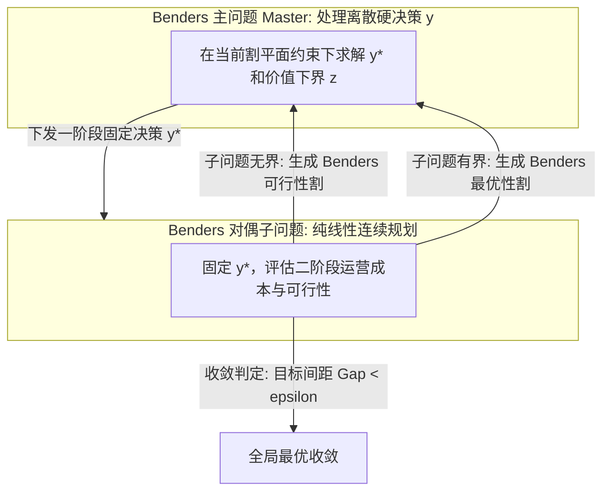

# Lec 15 大规模优化 II：Benders 分解原理与延迟割平面生成 (Benders Decomposition)

> MIT 15.081J / 6.251J 数学规划导论 · 讲义 15 · 授课教师：Prof. Dimitris Bertsimas / John Tsitsiklis

## TL;DR

- Dantzig-Wolfe 是变量空间的列生成，Benders 分解是对偶空间维度的延迟割平面生成。
- 复杂二阶段系统固定一阶段硬决策后，二阶段连续凸规划的对偶极点生成极端有效割。
- 极方向对应可行性割（Feasibility Cut），极点对应最优性割（Optimality Cut）。

## 1. 变量投影与二阶段决策结构的解构

前一讲的 Dantzig-Wolfe 分解针对的是“约束多、矩阵呈现横向耦合”的问题。而在混合整数规划（MIP）、设施选址与两阶段随机规划中，我们常常面对完全相反的结构：**变量具有异构性——一部分是极难处理的离散投资决策 $y$（如是否建厂、机组启停），另一部分是连续且易于流动的运营变量 $x$（如物料配送量、发电出力）**。

考虑如下两阶段混合规划问题：

$$\begin{aligned}
\min_{x, y} \quad & c^T x + f(y) \\
\text{s.t.} \quad & A x + B y \ge b \\
& x \ge 0, \quad y \in Y
\end{aligned}$$

其中 $Y \subset \mathbb{R}^p$ 可以包含复杂的离散整数约束（如 $y \in \{0, 1\}^p$）。
如果将 $x$ 和 $y$ 混在一起同时求解，离散变量的组合爆炸会导致分支定界树规模呈灾难性扩张。

雅克·本德斯（Jacques F. Benders）在 1962 年洞察到：**如果我们先假定固定一阶段战略变量 $y$，那么剩下的二阶段子问题就是一个纯粹的、极易求解的连续线性规划！**

## 2. 对偶极点、极方向与两类 Benders 割平面

固定 $y$ 后，关于连续变量 $x$ 的二阶段子问题写作：
$$v(y) = \min_{x \ge 0} \{ c^T x \mid A x \ge b - B y \}$$

为该子问题构建对偶问题（Dual Subproblem, DSP）：
$$v(y) = \max_{p \ge 0} \{ p^T (b - B y) \mid A^T p \le c \}$$

注意观察这个对偶可行域：
$$D = \{p \in \mathbb{R}^m \mid A^T p \le c, \; p \ge 0\}$$
**这个集合的约束完全由 $A$ 和 $c$ 决定，与一阶段决策变量 $y$ 毫无关系！** 无论 $y$ 如何变化，对偶可行域 $D$ 都是欧氏空间中一个固定的多面体。

设 $D$ 的极点集合为 $\{p^1, \dots, p^K\}$，极射线集合为 $\{r^1, \dots, r^J\}$。
根据第 4 讲的表示定理与第 10 讲的强对偶定理，子问题的极值特性由以下两类几何实体完全判定：

### 2.1 Benders 可行性割（Feasibility Cut）
若对于当前试探的 $y^*$，子问题原可行域为空集（即该选址方案无法满足下游需求）。
根据对偶无界定理，对偶问题无上界，必然存在某个对偶极方向 $r^j$ 使得：
$$(r^j)^T (b - B y^*) > 0$$
为了杜绝这种不可行方案，主问题必须立即添加一条**可行性割**，强制排除该无界射线：
$$(r^j)^T (b - B y) \le 0$$

### 2.2 Benders 最优性割（Optimality Cut）
若对偶问题有界，最优解必然在某个极点 $p^k$ 处取得：
$$v(y) = \max_{k=1,\dots,K} (p^k)^T (b - B y)$$
引入辅助连续变量 $\theta$ 逼近二阶段成本 $v(y)$，主问题动态添加**最优性割**：
$$\theta \ge (p^k)^T (b - B y)$$

## 3. 完整 Benders 分解算法流程

1. **主问题（Master Problem）**：
   $$\min_{y \in Y, \theta} \quad f(y) + \theta \quad \text{s.t.} \quad \text{已生成的割平面集}$$
   求解得到当前试探解 $(y^*, \theta^*)$。此时 $f(y^*) + \theta^*$ 构成了全局最优解的**确定性下界（Lower Bound）**。
2. **求解对偶子问题**：代入 $y^*$ 求解 DSP。
   - 若无界（发现极方向 $r$）：向主问题添加可行性割，转步骤 1；
   - 若有界（最优值为 $v(y^*)$，对应最优极点 $p^*$）：当前全局成本上界更新为 $\text{UB} = \min(\text{UB}, f(y^*) + v(y^*))$。
3. **收敛终止**：若 $\text{UB} - \text{LB} \le \varepsilon$，算法收敛退出；否则向主问题添加最优性割 $\theta \ge (p^{*})^T (b - B y)$，返回步骤 1。

::: insight 列与割的对偶镜像关系
Dantzig-Wolfe 分解与 Benders 分解是现代运筹学中最完美的一对“孪生镜像”：
- DW 分解在**原问题空间**工作，由于极点极多，采用**延迟列生成（Delayed Column Generation）**逐步丰富决策空间；
- Benders 分解在**对偶问题空间**工作，由于约束极多，采用**延迟割生成（Delayed Constraint / Cut Generation）**逐步雕刻外包络。
在两阶段随机优化中，子问题对应成千上万个未来情景（Scenarios），Benders 分解（又称 L-shaped Method）使得每个情景的子问题可以完全在分布式计算集群上毫秒级并行求解。这种强大的解耦架构，支撑着当今从电网日前出清到超大规模跨国供应链规划的底层算力。
:::
