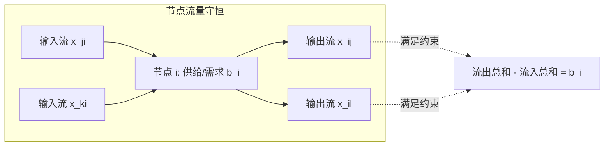

# Lec 16 网络流规划 I：最小费用流模型与最大流残量网络 (Network Flows I)

> MIT 15.081J / 6.251J 数学规划导论 · 讲义 16 · 授课教师：Prof. Dimitris Bertsimas / John Tsitsiklis

## TL;DR

- 节点-弧关联矩阵（Node-Arc Incidence Matrix）展现高度优美的全单模图拓扑结构。
- 最大流最小割定理（Max-Flow Min-Cut Theorem）是线性规划对偶在网络拓扑中的纯净具象。
- 残量网络（Residual Network）与增广路径算法以组合迭代彻底摆脱浮点消元开销。

## 1. 最小费用流问题（Min-Cost Flow）的数学抽象

在运筹优化的庞大图景中，**网络流模型（Network Flow Models）**占据着极其特殊的尊崇地位。现实工业世界中成千上万的物流配送、通信路由交换、航线调度与水利电网系统，本质上都是流（Flow）在有向图网络中的拓扑守恒与运送分配。

设连通有向图 $G = (V, E)$，其中节点集合为 $V$（包含 $|V| = n$ 个节点），弧集合为 $E$（包含 $|E| = m$ 条有向弧 $(i, j)$）。
每个节点 $i \in V$ 拥有净外生供给或需求量 $b_i$（若 $b_i > 0$ 表示供给源点 Source；若 $b_i < 0$ 表示需求汇点 Sink；若 $b_i = 0$ 表示中继转运点 Transshipment）。假设网络全局流量守恒：$\sum_{i \in V} b_i = 0$。
每条弧 $(i, j) \in E$ 具有单位运费 $c_{ij}$、流量下限 $0$ 与容量上限 $u_{ij}$。

**经典最小费用流模型（Minimum Cost Network Flow, MCNF）**写作：

$$\begin{aligned}
\min_{x} \quad & \sum_{(i, j) \in E} c_{ij} x_{ij} \\
\text{s.t.} \quad & \sum_{\{j \mid (i, j) \in E\}} x_{ij} - \sum_{\{j \mid (j, i) \in E\}} x_{ji} = b_i, \quad \forall i \in V \quad &&\text{(节点流量平衡约束)} \\
& 0 \le x_{ij} \le u_{ij}, \quad \forall (i, j) \in E \quad &&\text{(弧容量上下界约束)}
\end{aligned}$$

用矩阵形式紧凑表述：
$$\min_{x} \quad c^T x \quad \text{s.t.} \quad A x = b, \quad 0 \le x \le u$$
其中 $A \in \{-1, 0, 1\}^{n \times m}$ 称为有向图 $G$ 的**节点-弧关联矩阵（Node-Arc Incidence Matrix）**。其每一列对应一条弧 $(i, j)$：该列在源节点 $i$ 处元素为 $+1$，在目标节点 $j$ 处元素为 $-1$，其余所有行全为 $0$！

## 2. 最大流最小割定理与残量网络

当弧费用全为零、我们只追求从单一源点 $s$ 向汇点 $t$ 输送最大流量时，最小费用流退化为**最大流问题（Maximum Flow Problem）**。

::: definition 割（Cut）与割容量
在有向网络中，将节点集 $V$ 划分为包含源点的集合 $S$ 和包含汇点的集合 $T = V \setminus S$（其中 $s \in S, t \in T$）。
集合对 $[S, T]$ 称为一个 **$s-t$ 割**。割的容量定义为从 $S$ 指向 $T$ 的所有前向弧容量之和：
$$C(S, T) = \sum_{i \in S, j \in T, (i, j) \in E} u_{ij}$$
:::

显然，从 $s$ 运送到 $t$ 的任何物理流，都必须横跨割 $[S, T]$。因此任何可行流的流量 $v$ 永远不可能超过任意一个合法割的容量：$v \le C(S, T)$。这是网络流的弱对偶性！

::: theorem 最大流最小割定理 (Max-Flow Min-Cut Theorem)
在任意网络中，从源点 $s$ 到汇点 $t$ 的最大可行流的流量，**严格等于所有 $s-t$ 割的最小容量**：
$$\max \; v = \min_{[S, T]} C(S, T)$$
:::

该定理是线性规划强对偶定理在图论中的完美具象化。福特（L. R. Ford）与富尔克森（D. R. Fulkerson）提出的**残量网络（Residual Network）**理论，给出了无懈可击的构造性证明：

::: definition 残量网络与增广路径
给定当前流 $x$：
1. 若弧 $(i, j)$ 流量未饱和（$x_{ij} < u_{ij}$），在残量网络 $G(x)$ 中保留前向弧 $(i, j)$，残量容量为 $r_{ij} = u_{ij} - x_{ij}$；
2. 若弧 $(i, j)$ 存在正向流（$x_{ij} > 0$），在残量网络中添加反向退流弧 $(j, i)$，残量容量为 $r_{ji} = x_{ij}$。
残量网络中从源点 $s$ 到汇点 $t$ 的任意一条简单有向路径，称为**增广路径（Augmenting Path）**。沿此路径推进流量 $\delta = \min r$，即可严格增大全局总流量。当且仅当残量网络中不存在增广路径时，当前流达到最大！
:::

::: insight 网络流的组合化降维打击
网络流问题虽然形式上是线性规划，但在工业界极少直接调用通用单纯形法求解。
为什么？因为节点-弧关联矩阵的特殊结构，使得整个高维矩阵求逆操作完全退化为了图上的**深度优先搜索（DFS）与广度优先搜索（BFS）**！增广路径算法以纯粹的图论遍历规避了所有的浮点舍入与矩阵求逆开销。这种“发掘特定物理结构的极度退化与加速”，是高级运筹学从平庸走向卓越的必修课。
:::
