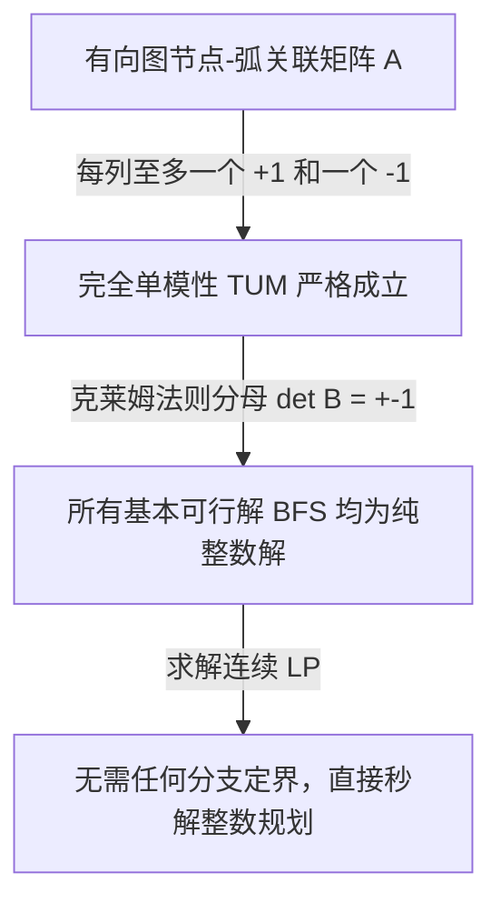
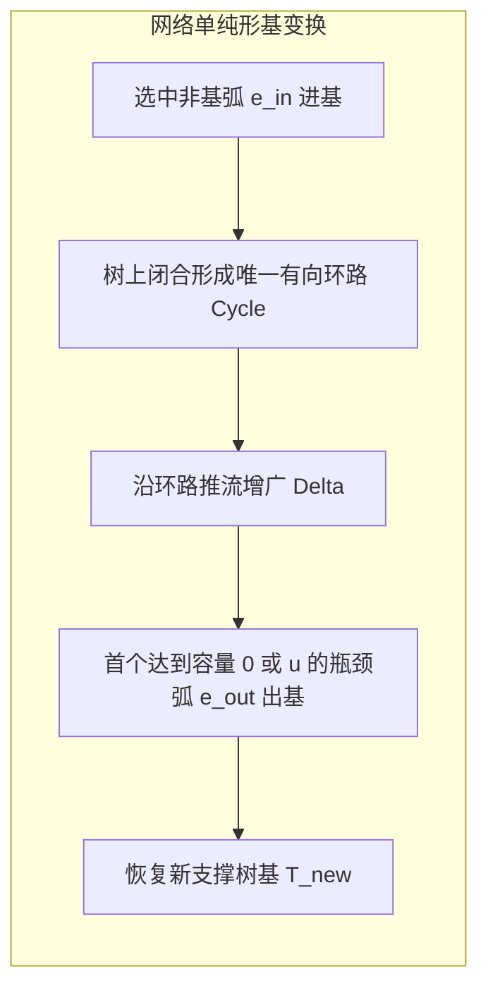

# Lec 17 网络流规划 II：网络单纯形法与完全单模矩阵 (Network Flows II: TUM & Simplex)

> MIT 15.081J / 6.251J 数学规划导论 · 讲义 17 · 授课教师：Prof. Dimitris Bertsimas / John Tsitsiklis

## TL;DR

- 完全单模矩阵（Totally Unimodular Matrix, TUM）是线性规划天然拥有整数解的充要基石。
- 节点-弧关联矩阵的完全单模性保证了：只要供给与容量为整数，最优流必然全为整数！
- 网络单纯形法（Network Simplex）将基矩阵映射为支撑树，以树上加边删边实现纳秒级主元迭代。

## 1. 整数性的圣杯：完全单模矩阵（Totally Unimodular Matrix）

在离散优化中，绝大多数整数规划（IP）属于 NP-hard 难题，必须耗费指数级算力。然而，有一大类极其特殊的整数规划，我们对其直接去掉整数约束、当作连续线性规划求解，得到的最优解**天然百分之百就是整数**！

这个连接连续多面体与离散整数网格的最高数学桥梁，就是**完全单模矩阵（Totally Unimodular, TUM）**。

::: definition 完全单模矩阵 (Totally Unimodular Matrix)
一个整数矩阵 $A \in \mathbb{Z}^{m \times n}$ 称为完全单模矩阵（TUM），若它的**任意阶方子矩阵的行列式都只能取值为 $0, +1$ 或 $-1$**：
$$\det(S) \in \{-1, 0, 1\}, \quad \forall \text{ 方子阵 } S$$
:::

::: theorem 霍夫曼-克鲁斯卡尔整数性定理 (Hoffman-Kruskal Theorem)
设 $A$ 为整数矩阵。多面体 $P = \{x \mid A x \le b, x \ge 0\}$ 对于**所有可能的整数右端项向量 $b \in \mathbb{Z}^m$**，其全部极点都为整数向量，当且仅当矩阵 $A$ 是完全单模矩阵（TUM）。
:::

证明直截了当：根据克莱姆法则（Cramer's Rule），任意基本可行解的基变量分量为 $x_i = \det(B_i) / \det(B)$。由于 $B$ 是从 $A$ 中抽取的基方阵，若 $A$ 是 TUM，则 $\det(B) = \pm 1$。当 $b$ 为整数时，分母为 $\pm 1$，基解必然是纯整数！

::: theorem 节点-弧关联矩阵的完全单模性
任意有向图的节点-弧关联矩阵 $A$ 都是完全单模矩阵（TUM）。
因此，在任何运输问题、指派问题、最大流与最小费用流规划中，只要供给向量 $b$ 和容量上限 $u$ 是整数，**最优流 $x_{ij}^*$ 必然严格为整数**！
:::

## 2. 网络单纯形法（Network Simplex Method）

由于关联矩阵 $A$ 的特殊拓扑，线性规划中的一个“基（Basis）”在几何图论上精确对应图中的一棵**支撑树（Spanning Tree）**！

在网络单纯形法中：
1. **基变量（Tree Arcs）**：对应无环连通支撑树 $T$ 上的弧；
2. **非基变量（Non-tree Arcs）**：分为流量等于下界 $0$ 的下界弧集合 $L$，以及流量达到容量上限 $u$ 的上界弧集合 $U$。

网络单纯形法的每一步迭代无比优雅：
- **单纯形乘子（节点电位 Node Potentials）**：令根节点电位 $p_{\text{root}} = 0$。沿着支撑树的树弧直接递推计算：$p_i - p_j = c_{ij}$，无需解方程，一次树遍历即可求出所有节点的对偶影子价格！
- **检验数计算**：对非基弧计算 $\bar{c}_{ij} = c_{ij} - (p_i - p_j)$。若违背最优性条件，则将该弧加入支撑树；
- **环路推流与出基**：向支撑树添加一条非基弧，必然在树上闭合形成唯一的**简单环路（Cycle）**！沿该环路推流，直到环路上某条弧流量被抽干或打满；该饱和弧即为出基变量被斩断移出，重新恢复一棵新的支撑树。

网络单纯形法由于完全基于指针操作与树遍历，运行速度比通用修正单纯形法快 **100 到 1000 倍**，是超大规模图优化领域的绝对统治者。

::: insight 几何拓扑对代数矩阵的终极降维
网络单纯形法向我们展示了数学最高境界的和谐：
代数上的线性方程消元，对应图论中的沿环推流；代数上的满秩基矩阵，对应图论中的极小无环支撑树；代数上的对偶变量，对应物理网络中的节点电势差。
当矩阵的代数自由度被图的拓扑刚性完全捕获时，矩阵运算就融化为直观的拓扑动力学。这是所有应用数学研究者终身追求的化境。
:::
