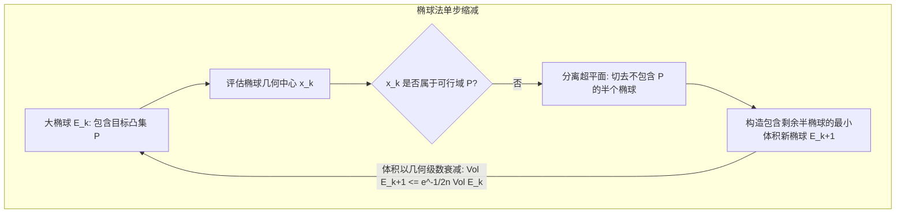

# Lec 18 椭球法与多项式时间线性规划复杂度理论 (The Ellipsoid Method)

> MIT 15.081J / 6.251J 数学规划导论 · 讲义 18 · 授课教师：Prof. Dimitris Bertsimas / John Tsitsiklis

## TL;DR

- 单纯形法在最坏情况下（Klee-Minty 扭曲超立方体）具有指数级复杂度。
- 哈奇扬（Khachiyan）于 1979 年利用椭球法在人类历史上首次证明线性规划属于 P 多项式类。
- 椭球体积以常数几何速率收敛，彻底击碎了判定 LP 可解性的复杂度迷雾。

## 1. 复杂度的危机：Klee-Minty 扭曲超立方体反例

从 1947 年单纯形法诞生起的三十年间，工业界普遍感受到单纯形法的神奇高效：对于拥有 $m$ 条约束的问题，平均只需 $2m$ 到 $3m$ 步主元消元即可终止。学术界普遍猜测：单纯形法或许是一个多项式时间算法？

然而，维克多·克利（Victor Klee）与乔治·明蒂（George Minty）在 1972 年构造了一个震惊世界的**扭曲超立方体（Klee-Minty Cube）**反例：

考虑 $n$ 维空间中的变形扰动多胞形：
$$\begin{aligned}
\max \quad & x_n \\
\text{s.t.} \quad & 0 \le x_1 \le 1 \\
& \varepsilon x_{i-1} \le x_i \le 1 - \varepsilon x_{i-1}, \quad \forall i=2,\dots,n
\end{aligned}$$

如果单纯形法采用丹齐格原始的“贪心挑选最负检验数”规则，由于多面体顶点的几何扭曲，算法将被狡猾地诱导**遍历该超立方体的全部 $2^n$ 个几何顶点**！
这意味着单纯形法的最坏时间复杂度是指数级的：$\mathcal{O}(2^n)$。

线性规划究竟是否能在多项式时间内求解？这是 20 世纪 70 年代理论计算机科学与应用数学领域悬赏最高的世界级悬案。

## 2. 哈奇扬椭球法（Khachiyan's Algorithm）的核心几何原理

1979 年，前苏联年轻数学家列昂尼德·哈奇扬（Leonid Khachiyan）在《苏联数学通报》上发表了一篇仅有 4 页纸的重磅论文，宣布使用基于苏联学者涅米洛夫斯基与尤金的**椭球法（Ellipsoid Method）**，在国际数学界首次严格证明：**线性规划存在多项式时间算法！线性规划属于 $\mathcal{P}$ 类！**

::: definition 欧氏空间中的椭球
在 $\mathbb{R}^n$ 中，中心为 $x_0$、由对称正定矩阵 $M \succ 0$ 确定的椭球定义为：
$$E(x_0, M) = \left\{ x \in \mathbb{R}^n \mid (x - x_0)^T M^{-1} (x - x_0) \le 1 \right\}$$
:::

椭球法求解线性系统可行性问题（$A x < b$）的几何迭代过程如下：
1. **初始化**：构造一个极其巨大、但半径在多项式编码长度内的初始欧氏球 $E_0$，保证若原可行域 $P$ 非空，则 $P$ 必然被完全包围在 $E_0$ 内部；
2. **中心可行性测试**：考察当前椭球 $E_k$ 的中心点 $x_k$：
   - 若 $x_k \in P$，算法成功终止，找到可行解！
   - 若 $x_k \notin P$，则至少违反一条约束，设为 $a_i^T x_k \ge b_i$。该超平面 $a_i^T (x - x_k) = 0$ 称为**分离超平面（Cutting Plane）**；
3. **半椭球包络与更新**：可行域 $P$ 必然只能落在半椭球 $\{x \in E_k \mid a_i^T x < a_i^T x_k\}$ 这一半空间中。数学上可以严格推导出**包含这半个椭球的唯一体积最小的新椭球 $E_{k+1}$**：
   $$x_{k+1} = x_k - \frac{1}{n+1} \frac{M_k a_i}{\sqrt{a_i^T M_k a_i}}$$
   $$M_{k+1} = \frac{n^2}{n^2 - 1} \left( M_k - \frac{2}{n+1} \frac{M_k a_i a_i^T M_k}{a_i^T M_k a_i} \right)$$

::: theorem 椭球体积几何级数收缩定理
在 $n$ 维空间中，更新后的新椭球体积与旧椭球体积之比满足严格的指数收敛：
$$\frac{\operatorname{Vol}(E_{k+1})}{\operatorname{Vol}(E_k)} \le \exp\left( -\frac{1}{2(n+1)} \right) < 1$$
:::

如果在执行了 $\mathcal{O}(n^2 L)$ 步迭代后，椭球的体积已经被压缩得比理论上可能存在的非空可行域最小体积还要小，而算法仍未踩中可行点，则算法可以 $100\%$ 确定地判定：**原系统完全不可行！**

## 3. 理论的伟业与实践的跛行

哈奇扬定理在《纽约时报》头条引发了全球轰动，宣告了线性规划在计算复杂度意义上的胜利。然而，当工程师在计算机上真正实现椭球法时，却震惊地发现：**椭球法的实际求解速度极其缓慢，在工程性能上被被它证明具有最坏指数复杂度的单纯形法打得毫无还手之力！**

这是为什么？
因为椭球法每一次迭代都必须老老实实收缩固定体积比（每次只减少 $\mathcal{O}(1/n)$），收敛步长极度死板保守，而且每次矩阵更新都必须维护高精度的平方根与浮点数以防精度坍塌。
然而，哈奇扬定理的伟大绝不在于提供一个实用的求解代码，而在于它带来了第 19 讲所展开的震撼推论：**分离神谕与优化神谕的多项式等价性**！

::: insight 复杂度阶乘与工程现实的辩证法
哈奇扬的突破是运筹学史上最戏剧性的启示录。
它告诉后世研究者：最坏情况多项式复杂度（Worst-case Polynomial Bound）是理论计算机科学家对安全性的终极证明；而平均情况复杂度（Average-case Behavior）与利用实际稀疏结构则是工程师战胜维数灾难的生命线。椭球法打赢了法律上的地位保卫战，而实践的高速公路，正静静等待着下一位划时代的革命者——内点法的登场。
:::
