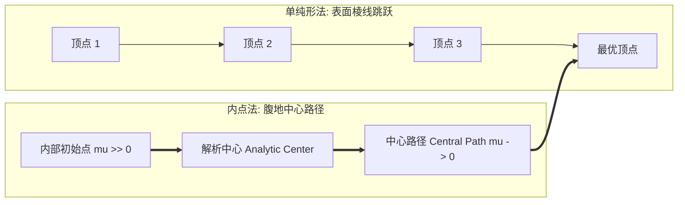
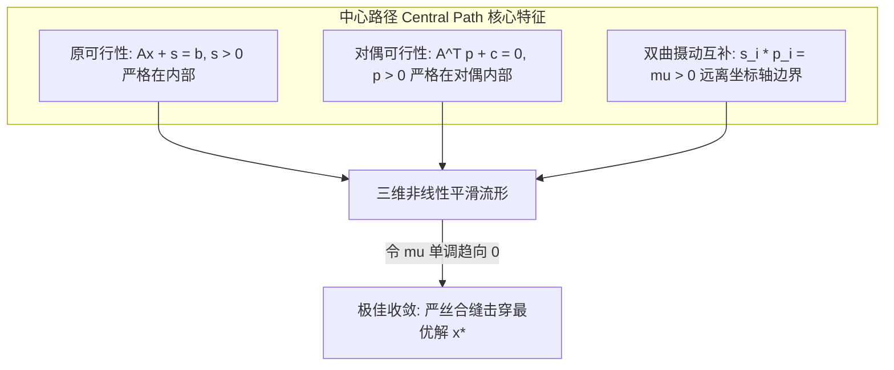

# Lec 20 内点法 I：障碍函数法与中心路径几何 (Interior Point Methods I: Central Path)

> MIT 15.081J / 6.251J 数学规划导论 · 讲义 20 · 授课教师：Prof. Dimitris Bertsimas / John Tsitsiklis

## TL;DR

- 单纯形法沿多面体外沿棱线爬行，内点法穿透多面体内部核心平滑穿透。
- 对数障碍函数（Logarithmic Barrier）将有约束多面体转化为光滑连续非线性曲面。
- 中心路径（Central Path）是一条以障碍参数 $\mu$ 为驱动直击原对偶最优解的平滑解析曲线。

## 1. 范式转移：穿透多面体腹地的内点革命

自丹齐格 1947 年提出单纯形法以来的近四十年间，全人类对线性规划的理解都被牢牢禁锢在“多面体外表面”：
可行域是一个由无数个面和棱交织而成的几何晶体。单纯形法沿着棱线从一个顶点爬向相邻顶点；椭球法虽然在外部构造椭球，但也只能从外向内压缩包络。

1984 年，贝尔实验室的年轻学者**纳伦德拉·卡马卡（Narendra Karmarkar）**提出了划时代的卡马卡算法，引爆了应用数学界波澜壮阔的**内点法（Interior Point Methods, IPM）革命**！

卡马卡的逆向思维震撼了所有人：
**为什么一定要在多面体险峻锋利的外边缘爬行？为什么不直接从多面体丰盈开阔的“腹地内部（Interior）”直接向最优解开凿一条平滑的高速公路？**

内点法不仅在理论上拥有严格的多项式时间复杂度，而且在面对拥有数十万行的大规模稀疏工业问题时，其求解速度往往比修正单纯形法快数倍到数十倍！

## 2. 对数障碍函数与障碍子问题（Log-Barrier Problem）

考虑标准不等式形式的线性规划：
$$\min_{x} \quad c^T x \quad \text{s.t.} \quad A x \le b$$
假设该多面体的内点集合 $\mathcal{P}^\circ = \{x \in \mathbb{R}^n \mid A x < b\}$ 非空且有界。

为了将这个受限于刚性边界的不等式规划转化为无约束连续优化，我们引入经典的**弗里施对数障碍函数（Logarithmic Barrier Function）**：

$$B_\mu(x) = c^T x - \mu \sum_{i=1}^m \ln(b_i - a_i^T x)$$

其中 $\mu > 0$ 称为**障碍参数（Barrier Parameter）**。
仔细考察这个对数项：
- 当 $x$ 稳稳地处于可行域内部深处时，松弛量 $s_i = b_i - a_i^T x > 0$，对数函数取有限平滑实数；
- 当 $x$ 试图向任何一个多面体约束边界靠近时（$s_i \to 0^+$），$-\ln(s_i) \to +\infty$！该对数项化作一堵高耸入云的“无限势垒无穷高墙”，将试探点狠狠反弹回多面体内部！

::: definition 障碍优化问题与极值点
对于给定的固定参数 $\mu > 0$，定义无约束凸规划子问题：
$$x(\mu) = \arg\min_{x \in \mathcal{P}^\circ} \left\{ c^T x - \mu \sum_{i=1}^m \ln(b_i - a_i^T x) \right\}$$
由于目标函数在有界凸集 $\mathcal{P}^\circ$ 上是严格凸函数（Hessian 矩阵严格正定），极小值点 $x(\mu)$ **存在且唯一**！
:::

## 3. 中心路径（The Central Path）的代数与微积分刻画

令障碍目标函数的梯度等于零：
$$\nabla_x B_\mu(x) = c + \mu \sum_{i=1}^m \frac{a_i}{b_i - a_i^T x} = c + A^T p = 0$$
其中我们自然地定义了**对偶试探变量向量 $p(\mu) \in \mathbb{R}^m$**：
$$p_i(\mu) = \frac{\mu}{b_i - a_i^T x(\mu)} = \frac{\mu}{s_i(\mu)}$$

将该式变形，得到震撼运筹学界的**摄动互补松弛方程（Perturbed Complementary Slackness）**：
$$s_i(\mu) \cdot p_i(\mu) = \mu, \quad \forall i = 1, \dots, m$$

::: theorem 中心路径 (Central Path)
随着障碍参数 $\mu$ 从 $+\infty$ 连续单调下降到 $0$，唯一的极值解轨迹 $\{x(\mu) \mid \mu > 0\}$ 在可行域内部绘制出一条完全平滑、无限阶可微的解析曲线，称为**中心路径（Central Path）**。
特别地：
1. 当 $\mu \to +\infty$ 时，$x(\mu)$ 汇聚于多面体的**解析中心（Analytic Center）**；
2. 当 $\mu \to 0^+$ 时，摄动互补条件退化为精确互补条件 $s_i p_i = 0$！中心路径的极限点 $x^* = \lim_{\mu \to 0^+} x(\mu)$ 必然**严格收敛于原线性规划的全局最优极点**！
:::

更令人赞叹的是当前点的对偶间距：
$$c^T x(\mu) - (-b^T p(\mu)) = c^T x + b^T p = (-p^T A) x + b^T p = p^T (b - A x) = p^T s = \sum_{i=1}^m p_i s_i = m \mu$$
**当前点到理论最优下界的绝对对偶间隙，恰好精确等于 $m \mu$！**
只要我们通过算法将 $\mu$ 缩减到 $\varepsilon / m$，当前点就绝对保证进入理论最优值的 $\varepsilon$ 误差带内！

::: insight 势垒物理学与大自然的平滑智慧
自然界的物理场极少发生阶跃跳变，万事万物皆倾向于沿能量势阱最平缓的梯度滑动。
单纯形法在离散组合的棱角上反复碰撞，就像在布满棱角的碎石滩上摸索；而对数障碍函数在整个多面体内部注入了一片斥力流体，将生硬的不等式边界软化为光滑的引力势场。牛顿拉夫逊算法在这条柔顺的中心引力水道上滑行，每一次迭代都是确定性的物理降落。这正是内点法席卷现代优化殿堂的无上魅力。
:::
