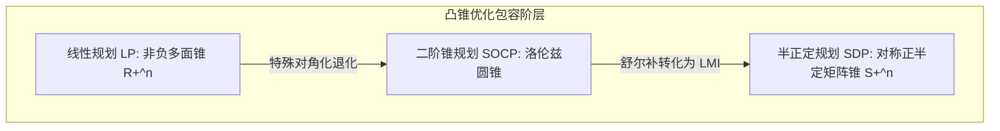
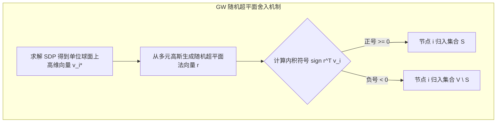

# Lec 23 半正定规划与半正定锥松弛：Goemans-Williamson 算法 (Semidefinite Optimization)

> MIT 15.081J / 6.251J 数学规划导论 · 讲义 23 · 授课教师：Prof. Dimitris Bertsimas / John Tsitsiklis

## TL;DR

- 半正定规划（SDP）在对称正半定矩阵锥（PSD Cone）上最小化线性迹函数。
- 线性矩阵不等式（LMI）统一表达了凸多面体、二阶锥与非线性二次约束。
- Goemans-Williamson 利用超球面随机超平面投影，将 NP-hard Max-Cut 保证在 0.878 近似比！

## 1. 凸优化的广袤新大陆：半正定锥（Positive Semidefinite Cone）

在线性规划中，非负约束是标量维度的 $x \ge 0$，即决策变量受限在非负卦限多面锥 $\mathbb{R}_+^n$ 中。如果我们把这个非负概念从一维标量推广到**多维对称矩阵的正半定性**，我们就跨入了现代凸优化最迷人、最强大的领域——**半正定规划（Semidefinite Programming, SDP）**。

记 $\mathbb{S}^n$ 为 $n \times n$ 对称实矩阵空间。
定义矩阵偏序：$X \succeq 0$ 表示矩阵 $X$ 为对称半正定矩阵（Positive Semidefinite, PSD），即对任意非零向量 $z \in \mathbb{R}^n$，恒有二次型 $z^T X z \ge 0$（或者等价于 $X$ 的所有特征值非负：$\lambda_i(X) \ge 0$）。

所有正半定矩阵构成的几何集合：
$$\mathbb{S}_+^n = \left\{ X \in \mathbb{S}^n \mid X \succeq 0 \right\}$$
是一个闭凸锥，称为**半正定锥（PSD Cone）**。

::: definition 半正定规划标准型 (Standard SDP)
定义矩阵弗罗贝尼乌斯内积：$C \bullet X = \operatorname{tr}(C^T X) = \sum_{i=1}^n \sum_{j=1}^n C_{ij} X_{ij}$。
半正定规划的标准形式为：

$$\begin{aligned}
\min_{X \in \mathbb{S}^n} \quad & C \bullet X \\
\text{s.t.} \quad & A_i \bullet X = b_i, \quad \forall i = 1, \dots, m \\
& X \succeq 0
\end{aligned}$$
:::

通过著名的**舒尔补引理（Schur Complement Lemma）**，任何凸二次约束 $x^T P x + q^T x + r \le 0$ 以及矩阵特征值界限，都可以精确表示为**线性矩阵不等式（Linear Matrix Inequality, LMI）**，被 SDP 完美吞纳。

## 2. 划时代的经典：Goemans-Williamson Max-Cut 算法

半正定规划最震撼人类计算科学界的战役，是由米歇尔·戈曼斯（Michel Goemans）与大卫·威廉姆森（David Williamson）在 1995 年利用 SDP 松弛解决**图的最大割问题（Max-Cut Problem）**。

给定无向图 $G = (V, E)$，为每条边赋予非负权重 $w_{ij}$。我们要将节点划分到两个互斥集合 $S$ 与 $V \setminus S$ 中，使得跨越两个集合的边权重之和最大。
这是一个著名的经典 NP-hard 组合优化难题。

为每个节点赋予离散变量 $y_i \in \{-1, +1\}$（若 $y_i = 1$ 表示 $i \in S$；若 $y_i = -1$ 表示 $i \notin S$）。
若边 $(i, j)$ 被割开，则 $y_i$ 与 $y_j$ 异号，$y_i y_j = -1$，此时 $\frac{1 - y_i y_j}{2} = 1$；
若未被割开，则同号，$y_i y_j = 1$，此时项为 $0$。

Max-Cut 精确等价为离散二次规划：
$$\max_y \quad \frac{1}{2} \sum_{(i, j) \in E} w_{ij} (1 - y_i y_j) \quad \text{s.t.} \quad y_i \in \{-1, +1\}, \quad \forall i \in V$$

### 2.1 降维打击：从一维标量到高维单位向量松弛
一维离散变量 $y_i \in \{-1, 1\}$ 导致组合爆炸。
GW 算法做出了一次惊天地泣鬼神的松弛：**将一维离散变量 $y_i$，松弛为 $n$ 维欧氏空间单位球面上的连续向量 $v_i \in \mathbb{R}^n$（$\|v_i\|_2 = 1$）！**

松弛后的向量规划为：
$$\max_{v} \quad \frac{1}{2} \sum_{(i, j) \in E} w_{ij} (1 - v_i^T v_j) \quad \text{s.t.} \quad \|v_i\|_2^2 = 1, \quad \forall i \in V$$

定义格拉姆内积矩阵（Gram Matrix）$X_{ij} = v_i^T v_j$。由于格拉姆矩阵必然是对称正半定矩阵，且反之任意对称正半定矩阵都可以通过乔列斯基分解唯一分解为向量内积！
上述向量优化**百分之百等价于一个标准的半正定规划（SDP）**：

$$\max_{X \succeq 0} \quad \frac{1}{2} \sum_{(i, j) \in E} w_{ij} (1 - X_{ij}) \quad \text{s.t.} \quad X_{ii} = 1, \quad \forall i = 1, \dots, n$$

这个 SDP 可以在多项式时间内用内点法求解出高精度的最优 Gram 矩阵 $X^*$！

### 2.2 几何随机超平面舍入（Random Hyperplane Rounding）
求解得到球面上的最优向量解 $v_i^*$ 之后，如何恢复出离散节点分类？
GW 算法在 $\mathbb{R}^n$ 中均匀随机生成一个过原点的**随机超平面**，其单位法向量为 $r \sim \mathcal{N}(0, I)$。
利用该超平面将球面一分为二：
$$y_i = \begin{cases} +1, & \text{若 } r^T v_i^* \ge 0 \\ -1, & \text{若 } r^T v_i^* < 0 \end{cases}$$

两向量 $v_i^*$ 与 $v_j^*$ 被随机超平面切开的概率，几何上精确等于两向量夹角 $\theta_{ij}$ 占全周角的比例：
$$\Pr[y_i \ne y_j] = \frac{\theta_{ij}}{\pi} = \frac{1}{\pi} \arccos(v_i^{*T} v_j^*)$$

计算该随机割的数学期望值，并与连续 SDP 上界进行全微分比值放缩，Goemans 与 Williamson 导出了轰动现代数学界的理论常数：

::: theorem Goemans-Williamson 近似比定理
GW 算法输出的离散割期望值，与真实 NP-hard 最大割的最优值之比严格满足：
$$\alpha = \min_{0 \le \theta \le \pi} \frac{\theta / \pi}{\frac{1 - \cos \theta}{2}} = \frac{2}{\pi} \min_{0 \le \theta \le \pi} \frac{\theta}{1 - \cos \theta} \approx 0.878567$$
即该多项式时间算法**绝对保证输出至少 $87.8567\%$ 的理论最优权重**！
:::

在计算复杂度理论中，后续学者（Khot et al.）证明：在唯一博弈猜想（Unique Games Conjecture, UGC）成立的前提下，**$0.878$ 是任何多项式时间算法逼近 Max-Cut 的数学绝对极限！** 没有任何算法能够超越 SDP 树立的这道物理铁幕。

::: insight 高维升维与几何投影的纯粹美
GW 算法是应用数学最具启发性的诗篇。
面对难以逾越的离散二进制互斥，它没有在低维空间死磕，而是把每个变量优雅地升维成高维空间中自由漂浮的几何球冠。在半正定锥的平滑引力下完成内点优化，再以一道纯粹随机的超平面切片，将高维的丰饶信息瞬间投影回离散的现实世界。这种“升维解题、投影落地”的数学思想，是整个人类运筹优化智慧的王冠。
:::
