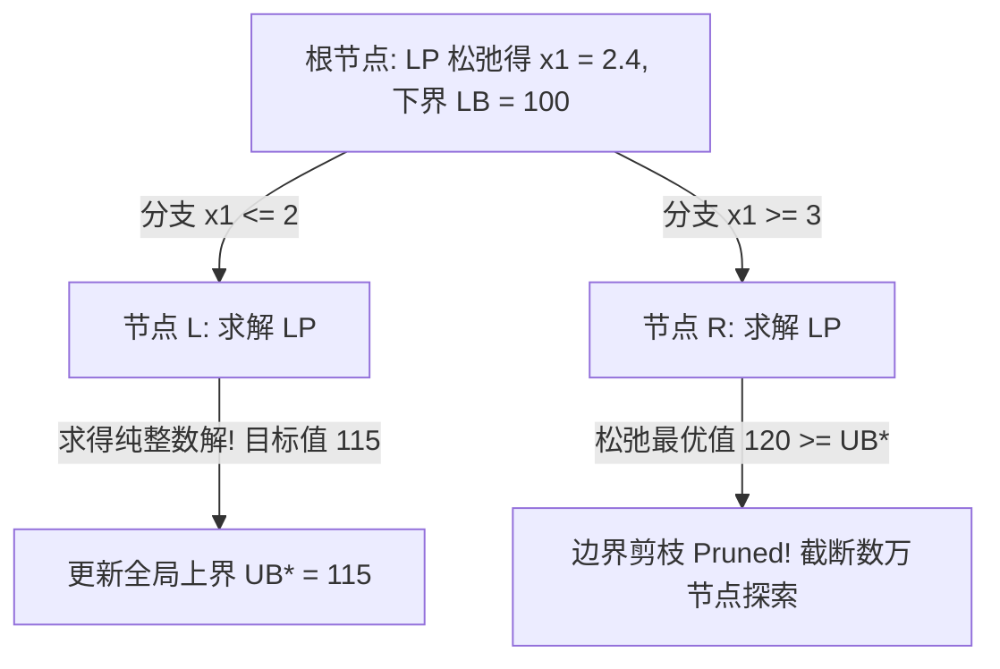

# Lec 25 离散优化 II：分支定界树、割平面法与分支割平面全景 (Branch and Cut)

> MIT 15.081J / 6.251J 数学规划导论 · 讲义 25 · 授课教师：Prof. Dimitris Bertsimas / John Tsitsiklis

## TL;DR

- 分支定界（Branch and Bound）通过分治树形枚举与 LP 连续松弛上下界剪枝。
- Gomory 割平面纯代数提炼分数部分，在不伤及任意整数解前提下切去非整数极点。
- 分支割平面法（Branch and Cut）融通列割树三维一体，铸就现代混合整数求解器的终极底座。

## 1. 分治与上下界剪枝：分支定界法（Branch and Bound）

作为 15.081J 的收官终局大课，我们将所有之前学过的理论——几何极点、单纯形表、对偶松弛、割平面与多面体逼近，全部汇聚到现代计算优化的终极形态：**分支割平面法（Branch and Cut）**。

分支定界法由兰德与多伊格（Land and Doig）于 1960 年提出。其核心哲学是“分而治之，靠界剪枝”：

考虑纯整数规划 $\min \{c^T x \mid A x = b, x \ge 0, x \in \mathbb{Z}^n\}$。
1. **求解根节点松弛 LP**：忽略整数约束，解得连续极点解 $x^*$。
   - 若 $x^*$ 奇迹般全为整数，直接大功告成退出！
   - 若某些分量为小数（设 $x_j^* = 3.7$），则最优目标值 $z_{\text{LP}}$ 构成了该节点子树所有可能整数解的**绝对下界（Lower Bound, LB）**！
2. **空间正交分支（Branching）**：由于真实解必须是整数，显然 $x_j$ 绝不可能落在开区间 $(3, 4)$ 内。我们将当前多面体切成互斥的两半：
   - 左子节点多面体：追加约束 $x_j \le 3$；
   - 右子节点多面体：追加约束 $x_j \ge 4$。
3. **剪枝三大法则（Pruning Rules）**：
   - **不可行剪枝（Pruning by Infeasibility）**：子节点的 LP 松弛无解，彻底截断该分支；
   - **整数解更新剪枝（Pruning by Integrality）**：子节点求得纯整数解，其目标函数值立即刷新全局现任最优上界（Upper Bound, $\text{UB}^*$），该节点已完全探索无需再分；
   - **界限剪枝（Pruning by Bound）**：子节点的连续 LP 松弛下界满足 $\text{LB}_{\text{node}} \ge \text{UB}^*$。既然该分支内最完美的非整数解都比不上我们在其他地方已经拿到的真实整数解，该子树内绝无可能藏着更好的解，**连根拔除，直接剪枝！**

## 2. 戈莫里割平面法（Gomory Cutting Plane Method）

单纯依靠空间分支，分支树的深度和广度在变量较多时仍可能面临组合爆炸。拉尔夫·戈莫里（Ralph Gomory）在 1958 年提出了纯代数生成有效不等式的**Gomory 割平面法**。

设当前松弛 LP 的最优单纯形表中，某基变量 $x_{B(i)}$ 取值为非整数：
$$x_{B(i)} + \sum_{j \in N} \bar{a}_{ij} x_j = \bar{b}_i$$
将实数拆分为整数部分与纯小数部分（记 $\lfloor r \rfloor$ 为向下取整，$f_r = r - \lfloor r \rfloor \in [0, 1)$ 为小数部分）：
$$( \lfloor \bar{b}_i \rfloor + f_0 ) = x_{B(i)} + \sum_{j \in N} ( \lfloor \bar{a}_{ij} \rfloor + f_j ) x_j$$
移项整理：
$$f_0 - \sum_{j \in N} f_j x_j = x_{B(i)} + \sum_{j \in N} \lfloor \bar{a}_{ij} \rfloor x_j - \lfloor \bar{b}_i \rfloor$$

注意观察：等式右边在任何合法的整数解处，全都是整数的加减乘除，因此**等式右边必须是一个整数**！
而等式左边中，$f_0 \in (0, 1)$ 是一个严格正纯小数，而 $x_j \ge 0, f_j \ge 0$。如果左边想要成为一个整数，它唯一的可能就是小于等于 0！

由此，戈莫里导出了堪称魔术般的**Gomory 分数割（Gomory Fractional Cut）**：
$$\sum_{j \in N} f_j x_j \ge f_0$$

::: theorem Gomory 割平面的两大约束刚性
1. **绝不误杀任何合法整数解**：对于原问题中的任意可行整数解，该割平面严格恒成立；
2. **一刀切去当前分数极点**：对于当前的连续松弛最优解，由于所有非基变量 $x_N = 0$，将该解代入割平面左边为 $0$。而 $f_0 > 0$，不等式 $0 \ge f_0$ 发生矛盾！当前的分数解被当场斩首剔除！
:::

在加入 Gomory 割后，根据我们在第 11 讲学到的对偶单纯形法，求解器无需重算，仅需热启动 1~2 步对偶主元迭代即可恢复新的更优下界！

## 3. 终极工业武器：分支割平面法（Branch and Cut）全景

现代工业级混合整数规划求解器（如 Gurobi, CPLEX, FICO Xpress, SCIP）早已不再使用纯粹的分支定界或纯粹的割平面法，而是将两者在树形搜索中深度熔铸为**分支割平面架构（Branch and Cut）**：

在分支树的每一个节点：
1. **预处理与探测（Presolve & Probing）**：利用区间代数传播收紧变量上下界；
2. **求解根松弛并生成割平面池（Cutting Plane Pool）**：动态挖掘数十类强组合割（Knapsack Cover Cuts, MIR 混合整数舍入割, Clique 团割, Flow Cover 流覆盖割）；
3. **启发式寻找潜水解（Primal Heuristics）**：运行可行性泵（Feasibility Pump）或大邻域局部搜索（RINS），快速抢占一个极高质量的初始整数解 $\text{UB}^*$；
4. **强分支决策（Strong Branching）**：预估各候选变量分支后对下界的推升效能，选取杀伤力最强的主变量进行深潜。

::: insight 运筹理论的终曲与星辰大海
回顾整个 15.081J 的壮丽征途：
我们从最简单的标准型建模与多面体极点起步，跨越单纯形表的代数几何镜像，登顶强对偶性与互补松弛的哲学山巅；我们驯服了大规模分布式计算的列与割，见证了椭球法与内点法穿透多面体腹地的理论胜利；最终，我们将所有这切——对偶、极点、投影、内点与割平面，全部熔铸在分支割平面这台人类计算工业的终极巨构之中。
数学规划从不承诺抹去现实世界的不确定性与稀缺性，但它赋予了人类在纷繁复杂的约束宇宙中，用严密的理性之光锚定唯一帕累托最优的无上力量。
:::
