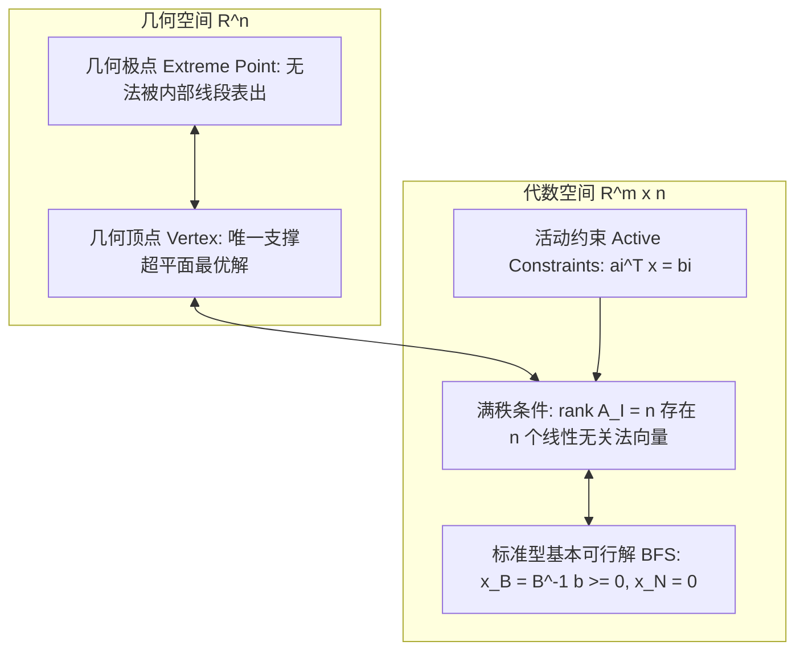

# Lec 3 代数与几何的统一：基本可行解与活动约束 (Geometry II: Basic Feasible Solutions)

> MIT 15.081J / 6.251J 数学规划导论 · 讲义 3 · 授课教师：Prof. Dimitris Bertsimas / John Tsitsiklis

## TL;DR

- 活动约束（Active Constraints）的线性无关性是判定多面体极点的核心代数准则。
- 基本可行解（BFS）建立了线性方程组基矩阵 $B$ 与高维几何顶点的一一对应。
- 退化性（Degeneracy）产生于同一个几何极点被超过 $n$ 个超平面同时穿过的多重代数表示。

## 1. 活动约束与极点的代数刻画

前一讲我们从纯几何视角定义了极点与顶点。然而，计算机算法无法直接识别抽象的几何凸组合，算法只能处理线性方程组与矩阵的秩。Dimitris Bertsimas 教授在 15.081J 中最精彩的理论构建，就是将极点的几何性质完全转化为**活动约束矩阵的代数满秩条件**。

设多面体 $P = \{x \in \mathbb{R}^n \mid A x \ge b\}$，其中 $A$ 为 $m \times n$ 矩阵。

::: definition 活动约束（Active / Binding Constraints）
对于点 $x^* \in P$，如果第 $i$ 个约束等号成立，即 $a_i^T x^* = b_i$，则称该约束在 $x^*$ 处是**活动约束（Active/Binding）**；若 $a_i^T x^* > b_i$，则称其为非活动约束（Inactive）。
记 $I(x^*) = \{i \in \{1,\dots,m\} \mid a_i^T x^* = b_i\}$ 为活动约束指标集。
:::

::: theorem 极点的代数充要条件
设 $P = \{x \in \mathbb{R}^n \mid A x \ge b\}$ 为多面体，$x^* \in P$。以下三条陈述完全等价：
1. $x^*$ 是 $P$ 的几何极点（Extreme Point）；
2. $x^*$ 是 $P$ 的几何顶点（Vertex）；
3. 在 $x^*$ 处的活动约束向量集合 $\{a_i \mid i \in I(x^*)\}$ 包含 $n$ 个线性无关的向量，即活动约束子矩阵的秩为 $n$：
$$\operatorname{rank}\left(A_{I(x^*)}\right) = n$$
:::

这一定理具有非凡的理论穿透力：它表明，要在一个 $n$ 维空间中锁定一个离散极点，必须且仅需 $n$ 个超平面在该点精确相交，且法向量线性无关！

## 2. 标准型线性规划中的基本可行解（BFS）

现在将这一代数准则具体落实到标准型多面体：
$$P = \{x \in \mathbb{R}^n \mid A x = b, \; x \ge 0\}$$
其中 $A \in \mathbb{R}^{m \times n}$，且 $\operatorname{rank}(A) = m < n$。

在这个系统中，总共有 $m + n$ 个约束：$m$ 个等式约束 $A x = b$（天然永远活动）和 $n$ 个不等式非负约束 $x_j \ge 0$。
要获得 $n$ 个线性无关的活动约束，我们必须从非负约束中挑选 $n - m$ 个使其等号成立（即令对应的分量为 0）。

::: definition 基本解与基本可行解（BFS）
将变量指标集划分为基变量集 $B$（包含 $m$ 个下标）和非基变量集 $N$（包含 $n-m$ 个下标），使得对应的基子矩阵 $B = A_B \in \mathbb{R}^{m \times m}$ 可逆（$\det(B) \ne 0$）：
1. 令非基变量为零：$x_N = 0$；
2. 解唯一的线性方程组确定基变量：$x_B = B^{-1} b$。
向量 $x = (x_B, x_N)$ 称为一个**基本解（Basic Solution）**。
3. 若基本解满足非负性约束 $x_B \ge 0$，则称 $x$ 为**基本可行解（Basic Feasible Solution, BFS）**。
:::

::: theorem BFS 与极点的一一对应
对于标准型多面体 $P = \{x \in \mathbb{R}^n \mid A x = b, \; x \ge 0\}$，一个向量 $x \in P$ 是 $P$ 的几何极点，当且仅当 $x$ 是一个基本可行解（BFS）。
:::

## 3. 退化性（Degeneracy）的几何与代数实质

在非退化情况下，一个极点恰好由 $n$ 个活动约束定义，基变量全部严格为正：$x_B > 0$。此时一个极点精确对应唯一的基矩阵 $B$。

然而，在真实大规模工业优化中，往往会出现**退化（Degeneracy）**现象：

::: definition 退化基本可行解
设 $x$ 是一个基本可行解。若基变量向量 $x_B$ 中至少有一个分量取值为 0，即存在某个 $i$ 使得 $x_{B(i)} = 0$，则称该基本可行解是**退化的（Degenerate）**。
:::

::: example 退化性的几何三棱锥顶角相交
想象三维空间（$n=3$）中的埃及金字塔（四棱锥）：
其底面为正方形，四个侧面斜向上交汇于顶角点 $V$。
在顶点 $V$ 处，有 4 个平面同时相交！但空间维度只有 3。
因此，从 4 个活动平面中任意选取 3 个都可以构成一个局部的基。这意味着同一个物理几何顶点 $V$，在代数上对应了 $\binom{4}{3} = 4$ 个不同的基！
在单纯形法执行中，如果算法在这些对应同一个几何顶点的不同基之间跳转，目标函数值保持不变（$\Delta z = 0$），这就埋下了单纯形法陷入死循环（Cycling）的病理隐患。
:::

::: insight 代数冗余与死循环的哲学根源
退化性揭示了数学建模中“表达（Representation）”与“本质（Ontology）”的张力。
几何极点是物理本质，是唯一的；而基矩阵只是人类观察该极点的一副局部代数坐标系。当多重超平面在同一奇点过度约束时，代数坐标系产生了退化奇异。单纯形法之所以需要精妙的防循环摄动法（Perturbation）或 Bland 规则，正是为了在这座代数迷宫中打破对称性，强制算法继续向几何深处迈进。
:::
