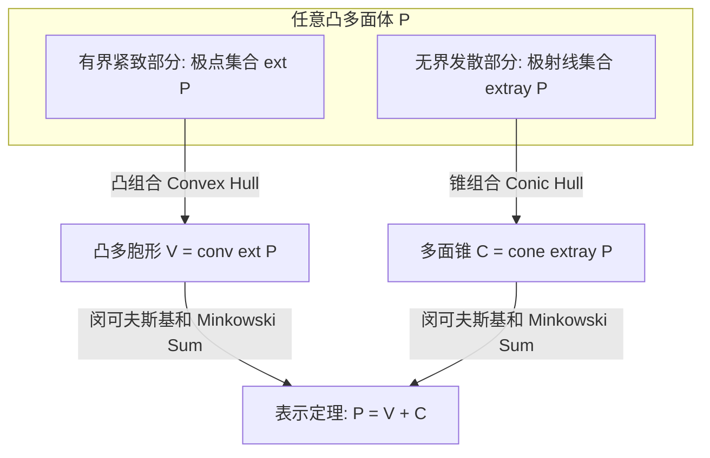

# Lec 4 多面体表示定理与极射线分解 (Geometry III: Representation Theorem)

> MIT 15.081J / 6.251J 数学规划导论 · 讲义 4 · 授课教师：Prof. Dimitris Bertsimas / John Tsitsiklis

## TL;DR

- 极方向与极射线刻画了无界多面体向无穷远处发散的渐近凸锥结构。
- 魏尔-闵可夫斯基表示定理（Minkowski-Weyl Theorem）证明多面体等于极点凸包与极射线锥包之和。
- 线性规划的可行性、有界性与最优解存在性在此定理下获得了彻底的代数闭包。

## 1. 衰退锥、极方向与极射线

许多实际优化问题（例如包含自由决策、无上限外协加工产能）的可行域是无界（Unbounded）的多面体。为了完全刻画无界多面体的全局拓扑结构，必须引入方向与射线的几何工具。

::: definition 衰退方向与极方向
设 $P = \{x \in \mathbb{R}^n \mid A x \ge b\}$ 为非空多面体。
1. **衰退方向（Recession Direction）**：非零向量 $d \in \mathbb{R}^n \setminus \{0\}$ 称为 $P$ 的一个方向，若对于任意起点 $x_0 \in P$ 以及任意非负步长 $\theta \ge 0$，均有：
$$x_0 + \theta d \in P$$
所有衰退方向构成的集合（连同零向量）称为多面体 $P$ 的**衰退锥（Recession Cone）**，记为 $\operatorname{rec}(P) = \{d \in \mathbb{R}^n \mid A d \ge 0\}$。
2. **极射线与极方向（Extreme Ray）**：方向 $d \in \operatorname{rec}(P)$ 称为极方向，若它无法表示为衰退锥中两个非共线方向的正线性组合。
:::

对于标准型多面体 $P = \{x \in \mathbb{R}^n \mid A x = b, \; x \ge 0\}$，其衰退锥为：
$$\operatorname{rec}(P) = \{d \in \mathbb{R}^n \mid A d = 0, \; d \ge 0\}$$

## 2. 魏尔-闵可夫斯基表示定理（Representation Theorem of Polyhedra）

表示定理（又称 Resolution Theorem 或 Minkowski-Weyl Theorem）是凸分析与线性多面体理论最宏伟的里程碑定理。它揭示了：任何一个由半空间相交定义的“内涵”多面体，都可以完全由其极点与极方向生成出的“外延”代数和唯一重建！

::: theorem 魏尔-闵可夫斯基表示定理 (Minkowski-Weyl)
设非空多面体 $P = \{x \in \mathbb{R}^n \mid A x \ge b\}$ 至少包含一个极点。
设 $x^1, \dots, x^K$ 为 $P$ 的全部有限个极点，$d^1, \dots, d^J$ 为 $P$ 的全部有限个极方向。
则 $x \in P$ 当且仅当 $x$ 可以分解为极点的凸组合与极方向的非负锥组合之和：
$$x = \sum_{k=1}^K \lambda_k x^k + \sum_{j=1}^J \mu_j d^j$$
其中组合系数满足：
$$\sum_{k=1}^K \lambda_k = 1, \quad \lambda_k \ge 0, \quad \mu_j \ge 0$$
:::

该定理直接给出了多胞形（有界多面体）的终极推论：**一个集合是有界多面体，当且仅当它是有限个点的凸包（Convex Hull）**。

## 3. 线性规划基本定理的完整几何证明

利用魏尔-闵可夫斯基表示定理，我们可以在三行推导内彻底证明线性规划的基本定理：

考虑线性规划 $\min_{x \in P} c^T x$。将任意可行解 $x \in P$ 代入目标函数：
$$c^T x = \sum_{k=1}^K \lambda_k (c^T x^k) + \sum_{j=1}^J \mu_j (c^T d^j)$$

分析该线性式的极值特性：
1. **无界判定（Unboundedness）**：若存在某个极方向 $d^j$ 使得 $c^T d^j < 0$，我们只需令其系数 $\mu_j \to +\infty$，即可让目标函数趋向 $-\infty$。此时 LP 无下界。
2. **最优极点存在性（Fundamental Theorem of LP）**：若对所有极方向均有 $c^T d^j \ge 0$，则极小化最优选择显然是令所有 $\mu_j = 0$。此时：
$$\min_{x \in P} c^T x = \min_{k=1,\dots,K} c^T x^k$$
由于 $\sum \lambda_k = 1$，最小值必然在使得 $c^T x^k$ 最小的某个**极点 $x^{k^*}$** 处取得！

::: insight 有限组合爆炸与单纯形搜索的几何合法性
表示定理在理论上彻底宣判了：求解一个连续空间的线性规划，完全等价于在一个有限离散集合 $\{x^1, \dots, x^K\}$ 中挑选最小元素！
然而，由 $m$ 个半空间生成的极点数量 $K$ 随维度 $n$ 呈组合爆炸增长（至多 $\binom{m}{n}$）。枚举极点是天方夜谭，但表示定理赋予了我们战略定力：**最优点必然驻留在极点上**。单纯形法的伟大之处，就是发明了一种利用对偶梯度在相邻极点之间进行局部贪心搜索的智慧导航仪。
:::
