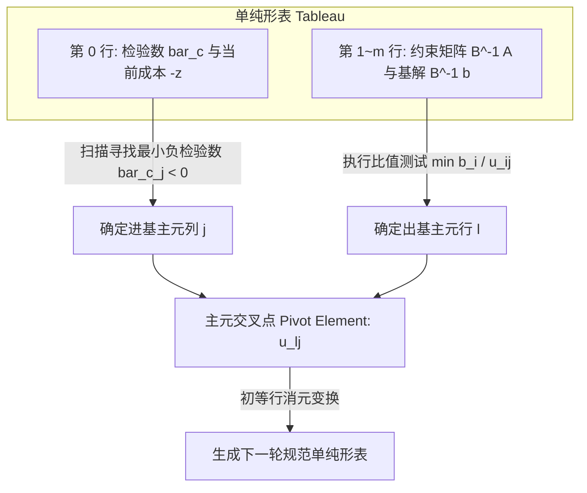

# Lec 6 单纯形法 II：单纯形表更新与两阶段法 (The Simplex Method II: Tableau & Phase I)

> MIT 15.081J / 6.251J 数学规划导论 · 讲义 6 · 授课教师：Prof. Dimitris Bertsimas / John Tsitsiklis

## TL;DR

- 单纯形表（Tableau）通过初等行变换将高维矩阵求逆紧凑压缩为常数行消元。
- 人工变量（Artificial Variables）突破了无显式单位初始可行基时的冷启动瓶颈。
- 两阶段法（Two-Phase Method）以阶段一最小化人工变量和作为阶段二寻找极点的通行证。

## 1. 单纯形表（Simplex Tableau）的代数结构

在计算机浮点运算或手算推演中，若每次迭代都显式计算 $m \times m$ 矩阵求逆 $B^{-1}$，时间复杂度将高达 $O(m^3)$。丹齐格设计的**单纯形表（Simplex Tableau）**将当前基下的全部系统状态紧凑编码在一个 $(m+1) \times (n+1)$ 的增广矩阵中，通过高斯-若尔当主元消元（Gauss-Jordan Pivoting）实现行内更新。

在任意迭代步，对应基 $B$ 的满单纯形表结构如下：

| 行 | 目标 / 约束 | 变量 $x_1, \dots, x_n$ | 资源右端项 RHS |
| :---: | :---: | :---: | :---: |
| 0 | 目标函数行 | $\bar{c}^T = c^T - c_B^T B^{-1} A$ | $-z = -c_B^T B^{-1} b$ |
| $1 \sim m$ | 约束方程行 | $B^{-1} A$ | $x_B = B^{-1} b$ |

::: definition 主元变换（Pivoting Operation）
设选定第 $j$ 列变量进基，根据最小比值测试选定第 $l$ 行基变量出基。元素 $u_l = (B^{-1} A)_{l, j} > 0$ 称为**主元（Pivot Element）**。
通过初等行变换更新表格：
1. 主元行归一化：第 $l$ 行整体乘以 $1 / u_l$；
2. 其余各行消零：对于 $i = 0, 1, \dots, m$（$i \ne l$），将第 $l$ 行的 $(B^{-1} A)_{i, j}$ 倍从第 $i$ 行减去。
完成变换后，第 $j$ 列将变成单位向量 $e_l$，标志着 $x_j$ 正式成为新的基变量。
:::

## 2. 初始可行基困境与两阶段单纯形法

标准型要求求解 $A x = b, x \ge 0$。但如何获得**第一个**基本可行解？
如果原始约束全是 $\le$ 且 $b \ge 0$，加入松弛变量后可立即凑出单位阵 $B = I$；但在包含 $\ge$ 或等式 $=$ 的通用约束中，寻找初始 BFS 本身就是一个极具挑战的课题。

为了解决这一冷启动难题，运筹学发展出了**两阶段单纯形法（Two-Phase Simplex Method）**：

::: definition 人工变量与第一阶段辅助问题
在原系统 $A x = b$（假设 $b \ge 0$）中引入非负**人工变量（Artificial Variables）** $y = (y_1, \dots, y_m)^T \ge 0$：
$$A x + I y = b, \quad x \ge 0, \; y \ge 0$$
构造第一阶段辅助线性规划（Phase I LP）：
$$\min_{x, y} \quad w = \sum_{i=1}^m y_i = \mathbf{1}^T y \quad \text{s.t.} \quad A x + I y = b, \; x \ge 0, \; y \ge 0$$
:::

在 Phase I 中，由于单位阵 $I$ 的存在，初始 BFS 显而易见：$x = 0, y = b \ge 0$。我们可以立即运行标准单纯形法求解 Phase I。

::: theorem 阶段一终止判据与原问题可行性
设 Phase I 求解的最优目标函数值为 $w^*$：
1. **原问题不可行（Infeasible）**：若 $w^* > 0$，说明即使所有决策变量 $x$ 极力配合，也无法消除人工变量。原问题可行域为空集，算法终止！
2. **原问题可行（Feasible）**：若 $w^* = 0$，说明所有人工变量成功被压制为 0（$y = 0$）。此时当前基中的变量（或通过驱赶人工变量后的基）构成原问题 $A x = b, x \ge 0$ 的一个纯净基本可行解！
此时丢弃所有人工变量，恢复原目标函数 $c^T x$，进入**第二阶段（Phase II）**继续寻找最优解。
:::

::: example 大 M 法（Big-M Method）的工程隐患
另一种寻找初始基的传统教科书方法是大 M 法，即在目标函数中惩罚人工变量：$\min c^T x + M \sum y_i$（$M$ 为非常大的正数）。
但在实际工程计算中，大 M 法被主流工业求解器完全摒弃。因为引入极其巨大的常数 $M$ 会使单纯形表的条件数恶化数十个数量级，在有限精度的 IEEE 754 浮点数计算中引发极其严重的舍入误差与假最优判定。两阶段法将可行性与最优化严格解耦，是数值上唯一可靠的标准。
:::

::: insight 寻找可行解与寻找最优解的等价性
两阶段法揭示了运筹计算深处的一大对称性：判断一个线性多面体是否非空（Feasibility），在计算复杂度上与在该多面体上求极值（Optimization）完全处于同一难度级别。
Phase I 本质上是在构建一个人工几何锥体，让不可行系统的超平面在虚拟维度强制相交，再利用单纯形投影将解逐步拉回真实的物理子空间。这种“升维寻找投影”的几何哲学，是现代数学规划处理奇异初值的终极法门。
:::
