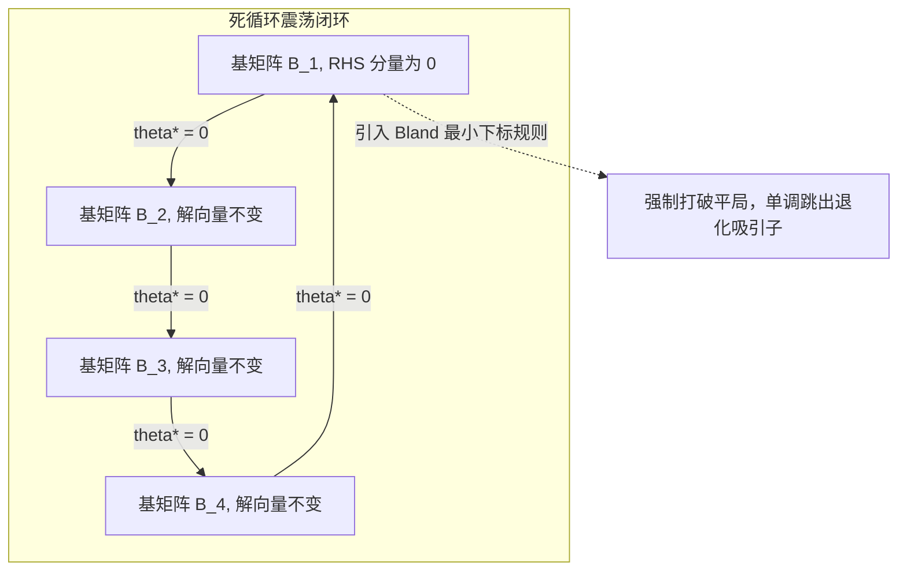

# Lec 7 单纯形法 III：退化性、死循环与 Bland 最小下标防循环法则 (Simplex III: Bland Rule)

> MIT 15.081J / 6.251J 数学规划导论 · 讲义 7 · 授课教师：Prof. Dimitris Bertsimas / John Tsitsiklis

## TL;DR

- 退化多面体导致比值测试步长 $\theta^* = 0$，产生零进度迭代与基变换死循环。
- 霍夫曼经典六维案例证明：在不当进基出基策略下，单纯形法会在 6 个基之间无限循环。
- Bland 最小下标规则与字典序法在纯代数层面彻底消解了死循环，保障有限步强收敛。

## 1. 零步长迭代与死循环（Cycling）的机理

在第 5 讲中我们看到，进基步长由最小比值测试决定：
$$\theta^* = \min_{\{i \mid u_i > 0\}} \frac{x_{B(i)}^*}{u_i}$$

如果当前基本可行解是**退化的（Degenerate）**，即某个基变量本身就等于 0（$x_{B(i)}^* = 0$），且对应的主元分量 $u_i > 0$，则算出的最优步长将被迫为零：
$$\theta^* = \frac{0}{u_i} = 0$$

当 $\theta^* = 0$ 时，单纯形表虽然通过主元行变换调换了一个进基变量和一个出基变量，基矩阵 $B$ 发生了改变，但**物理空间中的解向量完全没有移动**（$x_{\text{new}} = x_{\text{old}}$），目标函数值也没有任何变化（$\Delta z = 0$）。

如果随后的数次迭代步长一直为 0，而算法在选择进基和出基变量时打破平局（Tie-Breaking）的规则设计不当，算法完全有可能在遍历了若干个代数基后，重新回到了最初的那个基矩阵！这就是臭名昭著的**死循环（Cycling）**。一旦发生死循环，单纯形法将陷入无限震荡，永远无法终止。

## 2. 霍夫曼（Hoffman）死循环经典反例

为了证明死循环并非虚构的理论恐吓，Alan Hoffman 于 1953 年构建了一个经典的包含 3 个等式约束和 4 个变量的退化线性规划反例。若采用丹齐格最原始的“贪心挑选最负检验数”与“首个遇到变量出基”规则，算法将在 6 轮主元消元后百分之百复原为初始单纯形表！

这一发现当时震动了运筹学界，迫使数学家必须在理论上给出百分之百杜绝死循环的确定性防线。

## 3. Bland 最小下标法则（Bland's Smallest-Subscript Rule）

1977 年，罗伯特·布兰德（Robert G. Bland）提出了一条震惊学术界的防死循环规则。令人拍案叫绝的是，该规则无需任何浮点矩阵运算或微小摄动，仅凭**自然数下标的偏序关系**即可彻底消除死循环：

::: definition Bland 最小下标优先规则
将原问题所有变量按固定顺序编号（$x_1, x_2, \dots, x_n$）：
1. **进基规则**：在所有检验数为负的非基变量候选集 $\{j \in N \mid \bar{c}_j < 0\}$ 中，**选择下标最小的变量**进基：
$$j^* = \min \{j \in N \mid \bar{c}_j < 0\}$$
2. **出基规则**：在最小比值测试中，若有多个基变量同时达到最小比值 $\theta^*$ 产生平局，**选择下标最小的基变量**出基：
$$l^* = \min \left\{ B(i) \;\middle|\; \frac{x_{B(i)}^*}{u_i} = \theta^* \right\}$$
:::

::: theorem Bland 规则有限步终止定理
使用 Bland 最小下标规则的单纯形法，绝不会发生死循环。算法必然在**有限次迭代**内宣告终止（要么找到全局最优解，要么判定问题无界）。
:::

定理的严格证明基于反证法：假设存在循环，定义参与循环变换的最大下标变量 $x_k$。通过在循环中提取包含 $x_k$ 进基与出基的两个关键单纯形表，构造检验数与约束行向量的内积，利用弱对偶正负号冲突，可严格导出 $0 < 0$ 的代数荒谬矛盾！

::: example 字典序法（Lexicographic Rule）的几何摄动对照
在工业商业求解器（如 CPLEX, Gurobi）中，除 Bland 规则外，更常用的是**字典序法（Lexicographic Pivoting）**。
字典序法的几何本质是对资源限制向量 $b$ 施加无穷小符号级摄动：$b(\varepsilon) = b + \sum_{j=1}^n \varepsilon^j a_j$。由于代数线性无关，这一摄动在微观拓扑上将“多重超平面交于一点”的金字塔尖角彻底“揉散”为微小的多面体面，从而在物理上消除了所有退化性（$x_B^* > 0$ 恒成立）。
:::

::: insight 偏序破缺与算法确定性的数学美
为什么看似微不足道的“最小下标”能够打破无穷维度的死循环？
在数学物理学中，系统陷入震荡对称往往源于平局时的随机选择或贪心对称性。Bland 规则在整个变量系统上强加了一个刚性的良序拓扑（Well-Ordering）。一旦出现退化零步长，这套偏序关系就会在状态转移图上施加单调的李雅普诺夫势函数漂移，使得代数轨迹在有向图上绝不可能闭合形成环路。这正是离散数学与连续连续运筹学结合的最高艺术境界。
:::
