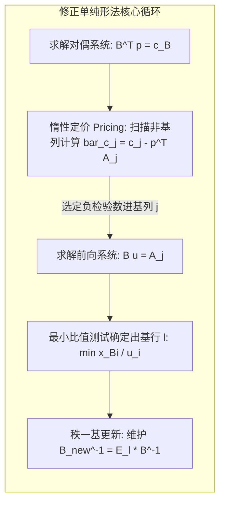

# Lec 8 修正单纯形法与大规模稀疏矩阵求逆更新 (Simplex IV: Revised Simplex)

> MIT 15.081J / 6.251J 数学规划导论 · 讲义 8 · 授课教师：Prof. Dimitris Bertsimas / John Tsitsiklis

## TL;DR

- 标准单纯形表维护完整 $m \times n$ 增广矩阵，在大规模稀疏问题中存在巨大的内存浪费。
- 修正单纯形法仅保留基逆矩阵 $B^{-1}$ 或其三角分解，按需惰性计算当前列与检验数。
- 利用 Eta 初等置换矩阵实现基逆的秩一更新，将单步计算开销降为 $O(m^2)$ 或稀疏线性量级。

## 1. 全单纯形表的计算冗余与工业瓶颈

在第 6 讲中我们学习的标准单纯形表（Simplex Tableau），在每一次主元迭代中都需要对整个增广矩阵（大小为 $(m+1) \times (n+1)$）执行高斯-若尔当行消元。对于一个拥有 $m = 10^5$ 条约束和 $n = 10^6$ 个变量的真实企业级线性规划（如全美航空排班或全国电网潮流调度），完整单纯形表将占用上百吉字节（GB）的内存空间！

然而，在任何一次主元迭代中，我们真正需要的只有三项核心信息：
1. 当前基解：$x_B = B^{-1} b$；
2. 寻找进基变量所需的检验数行向量：$\bar{c}^T = c^T - p^T A$，其中仅需单纯形乘子 $p^T = c_B^T B^{-1}$；
3. 执行最小比值测试所需的进基变量当前列：$u = B^{-1} A_j$。

绝大多数非基变量的列在绝大多数迭代中根本不会被访问。为全体非基变量实时更新完整的 $B^{-1} A$，不仅浪费了海量的算力，更破坏了工业矩阵通常高达 $99.9\%$ 的极高稀疏性（Sparsity）。为了克服这一致命缺陷，乔治·丹齐格与奥查德-黑斯提出了**修正单纯形法（Revised Simplex Method）**。

在上述循环中，矩阵 $A$ 始终以原始稀疏格式（如压缩稀疏行 CSR 或压缩稀疏列 CSC）保存在只读内存中，算法绝不对 $A$ 做任何原地写入修改，所有的计算全部转化为对线性方程组 $B^T p = c_B$ 与 $B u = A_j$ 的快速求解。

## 2. Eta 矩阵与基逆的秩一更新机制

当第 $j$ 列变量进基替换第 $l$ 行基变量时，新的基矩阵 $\bar{B}$ 与旧基矩阵 $B$ 之间仅有一列之差：
$$\bar{B} = B + (A_j - B e_l) e_l^T$$

我们完全不需要对 $\bar{B}$ 重新从头执行高斯消元，而是可以通过左乘一个**初等 Eta 矩阵（Eta Matrix）**实现基逆的在线增量更新：

::: definition Eta 矩阵与基逆迭代
记向量 $u = B^{-1} A_j$，定义初等列变换矩阵 $E \in \mathbb{R}^{m \times m}$，其仅在第 $l$ 列偏离单位阵：
$$E = \begin{bmatrix}
1 & & & \eta_1 & & \\
& \ddots & & \vdots & & \\
& & 1 & \eta_{l-1} & & \\
& & & \eta_l & & \\
& & & \eta_{l+1} & 1 & \\
& & & \vdots & & \ddots \\
& & & \eta_m & & & 1
\end{bmatrix}, \quad \text{其中} \quad \begin{aligned}
\eta_l &= \frac{1}{u_l} \\
\eta_i &= -\frac{u_i}{u_l}, \quad \forall i \ne l
\end{aligned}$$
则新的基逆矩阵为：
$$\bar{B}^{-1} = E \cdot B^{-1}$$
:::

在实际运行若干轮迭代后，如果累积了过多 Eta 矩阵导致乘法链路过长，求解器会触发一次**LU 三角重分解（Reinversion / Refactorization）**，利用 Markowitz 启发式主元选取策略将基矩阵重构为下三角矩阵 $L$ 与上三角矩阵 $U$，使得 $B = L U$，从而重新将解方程的耗时压缩到绝对极限。

::: insight 惰性计算（Lazy Evaluation）的工程美学
修正单纯形法的思想不仅统治了运筹求解器，更是现代软件系统架构中“惰性求值（Lazy Evaluation）”的先驱。
与其盲目维护全局一致的派生状态，不如保留最小核心原语（State Kernel），只在消费端真正发起请求时按需物化局部切片。工业级算法的性能天花板，往往不取决于大 $O$ 复杂度的花哨外壳，而取决于对内存局部性与稀疏模式的极致尊重。
:::
