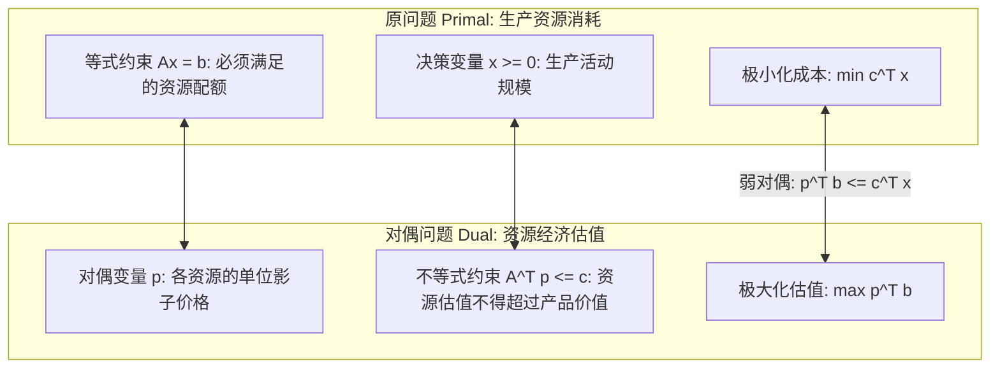

# Lec 9 对偶理论 I：对偶问题构建、弱对偶性与经济影子价格 (Duality Theory I)

> MIT 15.081J / 6.251J 数学规划导论 · 讲义 9 · 授课教师：Prof. Dimitris Bertsimas / John Tsitsiklis

## TL;DR

- 对偶规划（Dual LP）通过为原约束引入乘子寻找原问题目标函数下界的最大化。
- 弱对偶定理（Weak Duality Theorem）确立了任意对偶可行解永远不大于原可行解的基本偏序。
- 对偶变量的物理本质是稀缺资源的影子价格（Shadow Price），刻画边际松弛的经济增益。

## 1. 寻找下界：对偶规划的构造直觉

考虑标准型最小化线性规划（称为原问题 Primal LP, $P$）：

$$\begin{aligned}
z^* = \min_{x} \quad & c^T x \\
\text{s.t.} \quad & A x = b \\
& x \ge 0
\end{aligned}$$

假设我们要向企业的投资委员会证明：当前生产计划的最小总成本 $z^*$ 无论如何也不可能低于 1000 万元。我们如何给出一个无可辩驳的数学证据？

最自然的思路是构造约束方程 $A x = b$ 的线性组合。为这 $m$ 个等式约束分别赋予乘子 $p = (p_1, \dots, p_m)^T \in \mathbb{R}^m$。显然，只要 $A x = b$ 成立，就有：
$$p^T (A x) = p^T b$$

将该等式与目标函数 $c^T x$ 进行对比：
$$c^T x = p^T b + (c^T - p^T A) x$$

如果我们在选取乘子向量 $p$ 时，能够严格保证系数满足：
$$c^T - p^T A \ge 0 \iff p^T A \le c^T \iff A^T p \le c$$
那么，因为原决策变量是非负的（$x \ge 0$），两向量内积必非负：$(c^T - p^T A) x \ge 0$。于是立即得出：
$$c^T x = p^T b + (c^T - p^T A) x \ge p^T b$$

这真是一个绝妙的下界！任意满足 $A^T p \le c$ 的乘子向量 $p$，都会产生一个严格不大于真实最优成本的保底数值 $p^T b$。
既然每个合法的 $p$ 都提供一个下界，为了获得**最紧致、最逼近真实极限的终极下界**，我们理应将这个下界推到极致——极大众化 $p^T b$！
这就自然引出了原问题对应的**对偶规划（Dual LP, $D$）**：

$$\begin{aligned}
w^* = \max_{p} \quad & p^T b \\
\text{s.t.} \quad & A^T p \le c
\end{aligned}$$

## 2. 弱对偶定理（Weak Duality Theorem）及其推论

::: theorem 弱对偶定理
设 $x$ 是原问题 $P$ 的任意可行解（满足 $A x = b, x \ge 0$），$p$ 是对偶问题 $D$ 的任意可行解（满足 $A^T p \le c$）。则恒有：
$$p^T b \le c^T x$$
:::

证明仅需一行代数恒等式变换：
$$p^T b = p^T (A x) = (p^T A) x \le c^T x \quad (\because p^T A \le c^T \text{ 且 } x \ge 0)$$

弱对偶定理虽然形式极简，但具有极为强悍的系统推论：

::: theorem 弱对偶推论集
1. **最优性充分判据**：若找到了原可行解 $x^*$ 与对偶可行解 $p^*$，且二者的目标函数值恰好相等，即 $p^{*T} b = c^T x^*$，则 $x^*$ 必然是原问题的全局最优解，$p^*$ 必然是对偶问题的全局最优解！
2. **无界性与不可行性对偶**：
   - 若原问题 $P$ 的目标函数无下界（$\min c^T x = -\infty$），则对偶问题 $D$ 必然**不可行**；
   - 若对偶问题 $D$ 的目标函数无上界（$\max p^T b = +\infty$），则原问题 $P$ 必然**不可行**。
:::

::: example 原对偶对应表（SOP 规则）
在非标准形式下，原问题与对偶问题变量与约束的正负符号对应关系被称为 SOP（Signs of Primal-Dual）规则：
- 原问题中第 $i$ 个**等式约束**（$= b_i$）对应对偶变量 $p_i$ **自由（Free / Unrestricted）**；
- 原问题中第 $i$ 个**不等式约束**（$\ge b_i$）对应对偶变量 $p_i \ge 0$；
- 原问题中变量 $x_j \ge 0$ 对应对偶问题第 $j$ 个不等式约束（$A_j^T p \le c_j$）。
:::

::: insight 弱对偶性作为算法收敛的物理锚点
在工程求解器的日志屏幕上，我们常常看到两列数字在高速滚动：一列不断下降的 Primal Objective，一列不断上升的 Dual Objective。
它们之间的差值 $\text{Gap} = c^T x - p^T b \ge 0$ 被称为对偶间距（Duality Gap）。由于弱对偶定理的绝对存在，这个间距构成了算法收敛的“物理安全锁”。即使算法在运行了数小时后被管理员紧急中断，当前所持有的对偶下界也能绝对客观地证明：“当前解距离不可逾越的理论物理最优解，绝对误差不超过 $0.05\%$”。这就是确定性数学规划带给决策者的无上安全感。
:::
