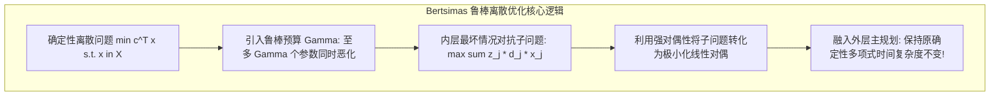

# Lec 11 鲁棒离散优化：Bertsimas 预算不确定性与抗震荡建模 (Robust Discrete Optimization)

> MIT 15.083 / 6.859J 整数规划与组合优化 · 讲义 11 · 授课教师：Prof. Dimitris Bertsimas

## TL;DR

- 传统离散优化对参数极度敏感，微小扰动即导致整数可行性崩塌与成本剧增。
- Bertsimas-Simchi-Levi 鲁棒预算模型保证了：鲁棒离散优化与原确定性问题属于同一复杂度类！
- 鲁棒最短路、鲁棒背包与鲁棒支撑树问题在对偶展开下获得了优雅的多项式时间求解器。

## 1. 离散优化的脆弱性与最坏情况免疫

在第 1-8 讲中，我们默认所有的技术系数——产品成本 $c$、背包重量 $a$ 与图边权 $w$ 都是精密确定的常数。
然而，在真实的供应链、军事物流与电网调度中，参数充满了不可预测的剧烈震荡：
- 海运航运：由于港口罢工或台风，某条航线的航行耗时可能突然增加 $300\%$；
- 通信网络：某条光纤可能在施工中被意外挖断，其通信延迟从 10 毫秒激增至无穷大；
- 生产制造成本：稀有贵金属价格瞬息万变。

如果我们在建模时采用传统的名义平均值，求出的“最优方案”往往会紧紧贴着离散约束的刀刃。一旦现实世界发生极其微小的摄动，方案就会大面积瘫痪。
Dimitris Bertsimas 教授与 David Simchi-Levi 等学者创立了**鲁棒离散优化（Robust Discrete Optimization）**理论，其核心理念是：**不假设参数的先验概率分布，要求离散解针对不确定性集合内的所有恶劣情景保持强鲁棒性！**

## 2. Bertsimas 鲁棒预算不确定集（Budget of Uncertainty）

最原始的鲁棒模型是盒状不确定集（Box Uncertainty）：假定每个成本系数都在区间 $[c_j, c_j + d_j]$ 内任意浮动。
如果要求防御所有参数同时恶化到最大值 $c_j + d_j$，这在统计上是概率几乎为零的极小概率事件，会导致系统**过度保守（Over-conservatism）**，产出极其昂贵、无法落地的鸡肋方案。

Bertsimas 提出了天才般的**参数化鲁棒预算（Budget of Uncertainty, $\Gamma$）**模型：
假设在系统中，**至多只有 $\Gamma$ 个参数（$\Gamma \in [0, n]$）会同时恶化到最坏极端情况**：

$$\min_{x \in X} \quad \left\{ c^T x + \max_{\{S \subset \{1,\dots,n\} \mid |S| \le \Gamma\}} \sum_{j \in S} d_j x_j \right\}$$

其中 $X \subset \{0, 1\}^n$ 为离散可行域。
注意观察中间那个令人生畏的内层极大化子问题（Protection Function）：
$$\beta(x, \Gamma) = \max_{z} \quad \sum_{j=1}^n d_j x_j z_j \quad \text{s.t.} \quad \sum_{j=1}^n z_j \le \Gamma, \quad 0 \le z_j \le 1$$

## 3. 复杂度不变定理（Complexity Invariance Theorem）

初学者最担心的疑问是：引入了外层极小化与内层对抗极大化，原本就是 NP 难度的离散优化，会不会彻底失控变成多项式不可解的超级怪物？

Bertsimas 给出了震撼全球学术界的**复杂度保持定理**：

为内层连续线性规划关于变量 $z$ 构建对偶问题！
引入对偶变量 $\theta \ge 0$（对应 $\sum z_j \le \Gamma$）以及 $p_j \ge 0$（对应 $z_j \le 1$）。
由强对偶定理，内层极大化问题严格等价为其对偶极小化：
$$\beta(x, \Gamma) = \min_{\theta, p} \quad \left\{ \Gamma \theta + \sum_{j=1}^n p_j \;\middle|\; \theta + p_j \ge d_j x_j, \; \theta \ge 0, \; p_j \ge 0 \right\}$$

将对偶极小化直接融入到外层的极小化目标中，外层与内层的最小化算子完美合并！
整个鲁棒离散优化问题，被**无缝、严格重构为一个紧凑的确定性混合整数规划**：

$$\begin{aligned}
\min_{x \in X, \theta, p} \quad & c^T x + \Gamma \theta + \sum_{j=1}^n p_j \\
\text{s.t.} \quad & \theta + p_j \ge d_j x_j, \quad \forall j = 1, \dots, n \\
& \theta \ge 0, \quad p_j \ge 0
\end{aligned}$$

::: theorem Bertsimas 复杂度保持定理 (Complexity Preservation)
若原始确定性离散问题 $\min_{x \in X} c^T x$ 在多项式时间内可解（例如最短路、最小支撑树、最小费用流、拟阵交）。
则对应的鲁棒离散优化问题，**必然依然在多项式时间内精确可解！其计算复杂度阶数保持严格不变！**
:::

进一步，Bertsimas 证明了只需调用至多 $n + 1$ 次原始确定性算法，即可完全解出鲁棒最优解！

::: insight 鲁棒预算作为可调节的风险滑块
Bertsimas 鲁棒离散模型是现代风险管理在运筹学中最伟大的落地工具。
预算参数 $\Gamma$ 就像一个直观的“风险滑块”：
当 $\Gamma = 0$ 时，退化为传统激进的名义确定性模型；
当 $\Gamma = n$ 时，对应绝对防御的最坏情景；
决策者通过在屏幕上滑动 $\Gamma$，可以实时观察到企业的期望利润与风险抵御能力之间的帕累托权衡曲线。它让运筹学真正走出了象牙塔，成为了跨国企业抵御全球黑天鹅冲击的坚实底座。
:::
