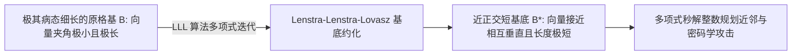

# Lec 12 格理论 I：点阵几何、Hermite 标准型与 LLL 基底约化 (Lattices I: LLL)

> MIT 15.083 / 6.859J 整数规划与组合优化 · 讲义 12 · 授课教师：Prof. Dimitris Bertsimas

## TL;DR

- 格（Lattice）是欧氏空间中离散离散点阵的代数系统，由一组线性无关基底整系数张成。
- 厄米特标准型（Hermite Normal Form, HNF）确立了格基矩阵在初等整行变换下的唯一规范形式。
- LLL 算法以多项式时间求解近正交短基底，彻底终结了最短向量问题（SVP）的高维几何梦魇。

## 1. 离散点阵的代数空间：格（Lattices）

在第 1-11 讲中，我们主要利用凸多面体的外轮廓切平面来逼近离散最优解。从本讲开始，我们将开启一扇通往高阶纯数学的绝美之门——**数论、代数几何与格理论（Lattices & Geometry of Numbers）**。

在数论中，研究离散点阵几何的始祖是赫尔曼·闵可夫斯基（Hermann Minkowski）。

::: definition 格 (Lattice)
设 $b_1, \dots, b_k \in \mathbb{R}^n$ 是 $k$ 个线性无关的列向量（$k \le n$）。
由这组基向量的**所有可能整数线性组合**构成的离散点集合，称为一个**格（Lattice）**，记作 $\mathcal{L}(B)$：
$$\mathcal{L}(B) = \left\{ \sum_{i=1}^k z_i b_i \;\middle|\; z_i \in \mathbb{Z} \right\} = B \mathbb{Z}^k$$
矩阵 $B = [b_1, \dots, b_k] \in \mathbb{R}^{n \times k}$ 称为该格的一个**基底矩阵（Basis）**。$k$ 称为格的维数或秩。
:::

格的一个基本物理几何特征是其**基本平行多面体（Fundamental Parallelotope）**：
$$\mathcal{P}(B) = \left\{ B x \;\middle|\; 0 \le x_i < 1, \; i = 1, \dots, k \right\}$$
其 $k$ 维高维欧氏体积由著名的行列式给出，称为**格的行列式（Determinant of Lattice）**：
$$\det(\mathcal{L}) = \sqrt{\det(B^T B)}$$
行列式度量了格点在空间中的空间稀疏程度，它是一个绝对的物理不变量，与具体选取哪一组基无关！

## 2. 整数矩阵的阶梯化：厄米特标准型（Hermite Normal Form, HNF）

在实数线性代数中，任意矩阵可以通过初等高斯行变换化为唯一的行最简阶梯形（RREF）。
在整数环 $\mathbb{Z}$ 上，为了消除浮点除法并保留整数可逆性，初等变换仅允许三种**单模变换（Unimodular Row Operations）**：
1. 某一行乘以 $-1$；
2. 交换任意两行；
3. 将某一行的**整数倍**加到另一行上。
这些变换在矩阵层面对应左乘一个行列式为 $\pm 1$ 的**单模矩阵（Unimodular Matrix $U$）**。

::: definition 厄米特标准型 (Hermite Normal Form, HNF)
对于任意满行秩整数矩阵 $A \in \mathbb{Z}^{m \times n}$（$m \le n$），必然存在一个单模矩阵 $U \in \mathbb{Z}^{m \times m}$，使得乘积矩阵 $H = U A$ 呈现如下**唯一的下三角规范形式**：
$$H = \begin{bmatrix}
h_{11} & 0 & 0 & \dots & 0 \\
h_{21} & h_{22} & 0 & \dots & 0 \\
\vdots & \vdots & \ddots & & \vdots \\
h_{m1} & h_{m2} & \dots & h_{mm} & 0
\end{bmatrix}$$
满足：
1. 对角线元素严格为正：$h_{ii} > 0$；
2. 非对角线元素非负且被对角线严格压制：$0 \le h_{ij} < h_{ii}$（$\forall j < i$）。
:::

HNF 标准型在整数规划中具有降维打击的威力：**它可以在多项式时间内彻底判定线性丢番图方程组 $A x = b$ 是否存在纯整数解！**

## 3. 20 世纪数学的丰碑：LLL 基底约化算法（Lenstra-Lenstra-Lovász）

在格理论中，最核心、也最险峻的难题是**最短向量问题（Shortest Vector Problem, SVP）**：
在格 $\mathcal{L}$ 中，寻找一个非零格点 $v \in \mathcal{L} \setminus \{0\}$，使得其欧氏范数 $\|v\|_2$ 达到最小。
SVP 是高维空间中的 NP-hard 难题，构成了后量子时代抗量子密码学（如格密码 Kyber, Dilithium）的理论支柱。

给定一个格，其基向量可能极其扭曲——两根向量极其漫长，且彼此之间的夹角几乎为 0 度（接近平行）。在这种基底下求解整数规划如同在泥潭中摸索。
1982 年，阿扬·伦斯特拉（Arjen Lenstra）、亨德里克·伦斯特拉（Hendrik Lenstra）与拉兹洛·洛瓦兹（László Lovász）三位大师联手发表了震惊现代计算机科学的 **LLL 算法**！

LLL 算法定义了什么是“优良约化基底（Reduced Basis）”：
设对基向量执行 Gram-Schmidt 正交化：$b_i = b_i^* + \sum_{j < i} \mu_{ij} b_j^*$。

::: definition LLL 约化基条件
一组基底 $B = [b_1, \dots, b_n]$ 称为 LLL 约化的（参数 $\delta \in (1/4, 1)$），若满足：
1. **尺寸缩减（Size-reduced）**：$|\mu_{ij}| \le \frac{1}{2}, \quad \forall 1 \le j < i \le n$；
2. **洛瓦兹局部 Lovász 条件**：
$$\delta \|b_{k-1}^*\|_2^2 \le \|b_k^* + \mu_{k, k-1} b_{k-1}^*\|_2^2$$
:::

::: theorem LLL 算法多项式复杂度与近似定理
LLL 算法能够在**多项式时间复杂度 $\mathcal{O}(n^5 L^3)$** 内，输出一组 LLL 约化基底！
其输出的第一根基向量 $b_1$，其长度绝对保证逼近真实最短向量：
$$\|b_1\|_2 \le 2^{(n-1)/2} \cdot \lambda_1(\mathcal{L})$$
:::

LLL 算法的诞生直接引发了现代代数计算的雪崩效应：它在多项式时间内完成了有理数多项式的因式分解，彻底攻破了基于背包问题的公钥密码体制，更直接催生了下一讲伦斯特拉对固定维度整数规划多项式可解性的伟大证明。

::: insight 坐标系的整形手术
格理论告诉我们：高维离散点阵本身是客观存在的物理几何，而我们写下的矩阵 $B$ 只是人类观察点阵的一副坐标系。
糟糕的坐标系把空间扭曲成极度狭窄的尖刀；而 LLL 算法以不可思议的多项式速度，在离散网格上做了一场高明的“几何正交整形手术”。
它把原本漫长、纠缠、险恶的基底，打磨成了一组彼此几乎互相垂直、长度极短的纯金基底。一旦拥有了优质的格基，离散空间的所有迷宫瞬间迎刃而解。
:::
