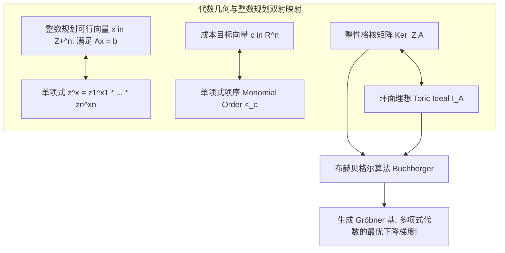

# Lec 14 代数几何在整数规划中的应用 I：Gröbner 基与多项式理想 (Algebraic Geometry I)

> MIT 15.083 / 6.859J 整数规划与组合优化 · 讲义 14 · 授课教师：Prof. Dimitris Bertsimas

## TL;DR

- 代数几何将整数格点映射为环中单项式代数理想（Polynomial Ideals）。
- 格罗布纳基（Gröbner Bases）是多项式理想在单项式序（Monomial Ordering）下的规范阶梯生成元。
- 布赫贝格尔算法（Buchberger's Algorithm）将整数规划最优解转化为单项式连续正规形式约化。

## 1. 跨界革命：当运筹学遭遇交换代数

在传统的整数规划中，我们使用的数学语言是线性代数、凸几何与图论。
然而，在 20 世纪 90 年代，以贝恩德·斯图姆费尔斯（Bernd Sturmfels）为首的应用代数学家开创了整数规划最激进、最绚烂的跨界流派——**代数几何整数规划（Algebraic Integer Programming）**。

其核心思维模式颠覆了所有运筹学者的常识：
**为什么一定要把整数点视为向量？为什么不把整数点视为多项式环中的“单项式（Monomials）”？**

设整数向量 $x = (x_1, \dots, x_n) \in \mathbb{Z}_+^n$。
将其一一对应于多元多项式环 $\mathbb{R}[z_1, \dots, z_n]$ 中的一个**单项式**：
$$x \longleftrightarrow z^x = z_1^{x_1} z_2^{x_2} \dots z_n^{x_n}$$

在这个映射下：
- 向量的非负整数加法 $x + y$，瞬间变成了单项式的代数乘法：$z^{x+y} = z^x \cdot z^y$！
- 线性方程组 $A x = b$，在单项式代数中对应了多项式除法与理想商群中的等价类！

## 2. 环面理想（Toric Ideals）与单项式项序（Term Orders）

设线性约束矩阵为 $A \in \mathbb{Z}^{m \times n}$。
考察其齐次核格空间：$\ker_\mathbb{Z}(A) = \{u \in \mathbb{Z}^n \mid A u = 0\}$。
对于任意一个整数核向量 $u$，将其拆解为正部分与负部分：$u = u^+ - u^-$（其中 $u^+, u^- \ge 0$），显然有 $A u^+ = A u^-$。

::: definition 环面理想 (Toric Ideal)
由矩阵 $A$ 诱导的**环面理想（Toric Ideal）** $I_A \subset \mathbb{R}[z_1, \dots, z_n]$，定义为由所有核向量诱导的二项式（Binomials）张成的代数理想：
$$I_A = \left\langle z^{u^+} - z^{u^-} \;\middle|\; u \in \mathbb{Z}^n, \; A u = 0 \right\rangle$$
:::

为了在代数中实现“极小化目标函数 $c^T x$”，我们必须在多项式环的所有单项式之间强加一个**与成本向量 $c$ 兼容的单项式偏序（Monomial Order $<_c$）**：
$$z^x <_c z^y \iff c^T x < c^T y \quad (\text{平局时利用字典序打破})$$

在这个项序下，成本最低的解对应的单项式就是“最小的单项式”。

## 3. 格罗布纳基（Gröbner Bases）作为最优梯度向量场

奥地利数学家布鲁诺·布赫贝格尔（Bruno Buchberger）在 1965 年（以其导师沃尔夫冈·格罗布纳命名）创立了**Gröbner 基**理论。

::: definition Gröbner 基
理想 $I_A$ 的一组有限多项式生成元 $G = \{g_1, \dots, g_t\}$ 称为关于项序 $<_c$ 的 **Gröbner 基**，若 $I_A$ 中任意多项式的先导项（Leading Term），都能被 $G$ 中某个元素的先导项整除。
:::

格罗布纳基在整数规划中究竟意味着什么？
Sturmfels 证明了令人惊掉下巴的定理：
**关于成本项序 $<_c$ 的环面理想 $I_A$ 的 Gröbner 基，其每一个二项式生成元 $z^{u^+} - z^{u^-}$，其对应的差值向量 $u = u^+ - u^-$，精确构成了一组“在整数点阵上单调走向全局最优解的通用行进方向（Test Set）”！**

::: theorem 代数整数规划极值定理 (Conti-Traverso, 1991)
利用 Buchberger 算法计算出环面理想 $I_A$ 关于成本序 $<_c$ 的 Gröbner 基 $G$。
给定任意一个初始整数可行解 $x_0$（对应单项式 $z^{x_0}$）：
利用 Gröbner 基 $G$ 对单项式 $z^{x_0}$ 执行标准的**多项式除法多步约化（Normal Form Reduction）**；
当除法算法无法继续约化时，输出的唯一正规形式单项式 $z^{x^*}$，**其指数向量 $x^*$ 必然无懈可击地是该整数规划的全局唯一最优解！**
:::

所有的分支定界、割平面和单纯形消元，在此全部蒸发，退化为了一道大一近世代数中的多项式多项式长除法！

::: insight 代数拓扑对运筹学的终极降维
用 Gröbner 基求解整数规划，是应用数学最纯粹的艺术展演。
它把离散点阵中由于约束限制引发的组合几何难题，完全抽象为了交换代数理想商环 $\mathbb{R}[z]/I_A$ 中的等价类化简。
尽管在实际高维计算中，Buchberger 算法求 Gröbner 基自身可能遭遇双指数复杂度（Doubly Exponential），但这一理论为整数规划赋予了代数几何的纯正血统，直接催生了下一讲利用复数代数拓扑计算全空间可行整数解个数的 Barvinok 算法。
:::
