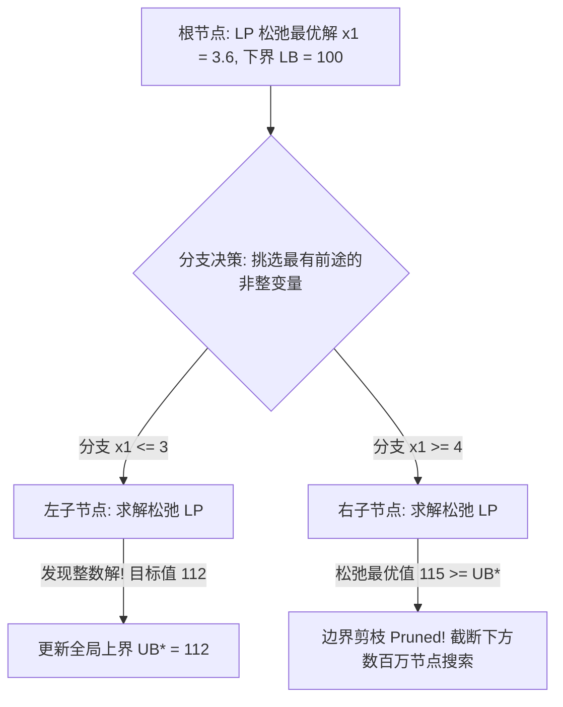

# Lec 19 树形搜索枚举算法：分支定界与强分支策略 (Enumerative Methods: B&B)

> MIT 15.083 / 6.859J 整数规划与组合优化 · 讲义 19 · 授课教师：Prof. Dimitris Bertsimas

## TL;DR

- 分支定界（Branch and Bound）构成分治求解混合整数规划的终极算法骨架。
- 节点选择策略（深度优先、最佳优先、最佳估计）平衡了找可行解与提升全局下界。
- 强分支（Strong Branching）与伪成本（Pseudocosts）以极小试探算力实现指数级剪枝。

## 1. 分治与剪枝的哲学：分支定界算法（Branch and Bound）

尽管我们在第 3-18 讲中发明了海量的割平面技术，但在绝大多数超大规模工业复杂混合整数规划中，单纯依靠割平面法往往会在后期陷入微小推进的收敛停滞（Tail-off Effect）。
最终彻底攻克 NP 难离散解空间的终极武器，依然是**分支定界树形搜索（Branch and Bound, B&B）**。

分支定界由艾琳·兰德（Ailsa Land）与艾莉森·多伊格（Alison Doig）于 1960 年提出，其核心哲学是“在多面体几何的引导下实行有智慧的分治枚举”：

三大剪枝准则（Pruning Rules）构成了分支树的剪刀：
1. **不可行剪枝（Pruning by Infeasibility）**：子节点的线性松弛无解，直接剪枝；
2. **整数解更新剪枝（Pruning by Integrality）**：子节点求得纯整数解，刷新现任最佳解（Incumbent $\text{UB}^*$），无需再分；
3. **界限剪枝（Pruning by Bound）**：子节点的松弛连续下界 $\text{LB}_{\text{node}} \ge \text{UB}^*$。既然该子树内最完美的非整数解都比不上我们在其他地方已经拿到的真实整数解，连根剪除！

## 2. 节点选择策略（Node Selection Strategies）

在任意搜索时刻，待探索的活动节点池（Open Node Queue）中可能积累了数万个候选子节点。求解器在下一轮应该挑选哪一个节点先展开？

| 搜索策略 | 选取标准 | 核心工程优势 | 致命软肋 |
| :--- | :--- | :--- | :--- |
| **深度优先 (DFS)** | 优先探索最新生成的深层子节点 | 内存开销极小（仅保留当前调用栈）；单纯形热启动极快 | 容易在错误的无解深渊中一条道走到黑 |
| **最佳优先 (Best-Bound)** | 优先挑选当前下界最低的节点：$\min \text{LB}_i$ | 理论上探索的总节点数绝对最小；全力推升全局下界 | 内存消耗极大；树跳跃导致基重构耗时 |
| **最佳估计 (Best-Estimate)** | 综合考量当前下界与整数伪成本预测值 | 兼顾推升下界与快速寻找高质量可行解 | 依赖启发式历史统计参数 |

现代商业求解器的标准策略是**混合交替**：在初期采用深潜探测（Diving）与最佳估计快速抓取高质量整数可行解；一旦全局上界锁定，立即切换到最佳优先全力啃掉顽固节点、推升全局下界以消灭对偶间距（MIP Gap）。

## 3. 分支变量选取的杀手锏：强分支与伪成本（Branching Variable Selection）

当松弛解中有 100 个变量都是非整数时，我们应该拿哪一个变量作为分叉的刀刃？
**选错一个分支变量，整棵树的规模可能膨胀 1000 倍！**

### 3.1 强分支策略（Strong Branching）
对候选的若干个非整数变量，求解器在内存中**提前试探性地执行 5 到 10 步对偶单纯形迭代**：
分别预估左分支 $x_j \le \lfloor x_j^* \rfloor$ 与右分支 $x_j \ge \lceil x_j^* \rceil$ 对目标函数下界的抬升幅度：
$$\Delta z_j^- = z_{\text{LP}}^-(x_j) - z_{\text{LP}}, \qquad \Delta z_j^+ = z_{\text{LP}}^+(x_j) - z_{\text{LP}}$$
定义综合评分函数（Score Function）：
$$\text{Score}_j = (1 - \mu) \min(\Delta z_j^-, \Delta z_j^+) + \mu \max(\Delta z_j^-, \Delta z_j^+) \quad (\mu \approx 0.16)$$
挑选评分最高的变量正式执行分支！强分支能够以极高的准确率斩断分支树，但单步测试耗时较长。

### 3.2 伪成本（Pseudocosts）与可靠性分支（Reliability Branching）
为了避免每一步都做强分支，求解器在历史搜索中统计每个变量每改变 1 单位整数偏差所带来的平均下界提升率（称为**伪成本 $\Psi_j^-, \Psi_j^+$**）。
**可靠性分支（Reliability Branching）**：在搜索初期对每个变量运行几次强分支以初始化其伪成本；一旦某个变量的历史分支次数超过阈值（如 $\eta \ge 8$），此后直接复用历史统计伪成本进行零开销评估！

::: insight 搜索树是人类算力对抗组合爆炸的防御工事
分支定界法向我们展示了分治算法在运筹学中的巅峰形态。
面对指数级的 NP 难组合深渊，人类没有坐以待毙。连续线性松弛为我们提供了居高临下的望远镜（下界评估），强分支与对偶热启动为我们打造了削铁如泥的手术刀。
在数以百万计的节点在几秒内被界限剪枝连根拔起的一瞬间，数学逻辑战胜了组合爆炸的混沌。这是工业级运筹求解器最震撼的技术力量。
:::
