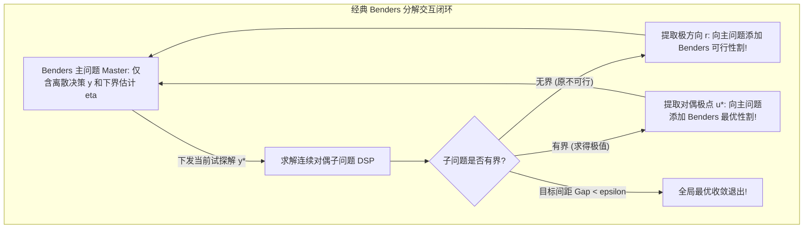

# Lec 24 混合整数优化 I：Benders 分解原理与延迟行生成 (Mixed Integer I: Benders)

> MIT 15.083 / 6.859J 整数规划与组合优化 · 讲义 24 · 授课教师：Prof. Dimitris Bertsimas

## TL;DR

- Benders 分解原理通过变量投影将离散硬决策（Master）与连续运营子规划（Subproblem）解耦。
- 极射线导出 Benders 可行性割（Feasibility Cut），极点导出 Benders 最优性割（Optimality Cut）。
- 延迟约束生成（Delayed Constraint Generation）彻底战胜两阶段随机规划的情景组合爆炸。

## 1. 异构变量的解耦哲学：Benders 分解在 MIP 中的应用

在真实的现代企业混合整数规划中，变量往往呈现出极度强烈的**决策层级异构性**：
- **战略硬决策（First-Stage Strategic $y$）**：0-1 离散变量，涉及数百万甚至数千万元的重资产投资（例如选址建设哪几座大型物流枢纽、启停哪几台巨型发电机组）；
- **战术运营流（Second-Stage Operational $x$）**：连续实数变量，涉及物资在既定网络中的具体流动分配（例如卡车每日运单、电网每小时潮流分配）。

考虑标准的混合整数规划架构：
$$\begin{aligned}
\min_{x, y} \quad & f^T y + c^T x \\
\text{s.t.} \quad & B y + A x \ge b \\
& y \in Y \subset \mathbb{Z}_+^p, \quad x \ge 0
\end{aligned}$$

如果把离散变量 $y$ 与成百上千个连续变量 $x$ 混在一起同时交给分支定界求解器，离散分支树会因为连续变量的拖累而膨胀到数千万个节点。
雅克·本德斯（Jacques F. Benders）在 1962 年洞察到：**如果我们先把战略离散决策 $y$ 固定下来，剩下的关于运营变量 $x$ 的子问题，就是一个极易求解的纯连续线性规划！**

## 2. 对偶极点与两类 Benders 割平面的形式化推导

固定试探解 $y = y^*$ 后，关于连续变量 $x$ 的二阶段子问题写作：
$$v(y^*) = \min_{x \ge 0} \left\{ c^T x \;\middle|\; A x \ge b - B y^* \right\}$$

构建其**对偶子问题（Dual Subproblem, DSP）**：
$$v(y^*) = \max_{u \ge 0} \left\{ u^T (b - B y^*) \;\middle|\; A^T u \le c \right\}$$

注意观察这个对偶可行域：
$$\mathcal{D} = \{u \in \mathbb{R}^m \mid A^T u \le c, \; u \ge 0\}$$
**这个多面体 $\mathcal{D}$ 的形状由矩阵 $A$ 和成本 $c$ 唯一确定，它与离散决策 $y$ 完全毫无关系！无论 $y$ 如何变化，对偶可行域 $\mathcal{D}$ 是欧氏空间中一个永远静止的固定凸体！**

设多面体 $\mathcal{D}$ 的全部有限个极点集合为 $\{u^1, \dots, u^K\}$，极方向集合为 $\{r^1, \dots, r^J\}$。
根据线性规划强对偶性，子问题的极值特性由以下两类几何实体完全判定：

### 2.1 Benders 可行性割（Feasibility Cut）
若对于当前试探的选址方案 $y^*$，子问题原可行域为空（即该网络拓扑根本无法承载下游负荷）。
由对偶无界定理，对偶规划目标发散到 $+\infty$！对偶单纯形法必然发现一条极方向 $r^j$ 使得 $(r^j)^T (b - B y^*) > 0$。
主问题必须立即添加一条**可行性割**，彻底封杀这种违规方案：
$$(r^j)^T (b - B y) \le 0$$

### 2.2 Benders 最优性割（Optimality Cut）
若对偶问题有界，最优值必然在某个极点 $u^k$ 处取得：$v(y^*) = (u^k)^T (b - B y^*)$。
引入辅助变量 $\eta \in \mathbb{R}$ 逼近未来二阶段运营成本，主问题动态生成**最优性割**：
$$\eta \ge (u^k)^T (b - B y)$$

## 3. 现代现代分支定界单树集成（Modern Branch-and-Benders-Cut）

在早期的经典 Benders 算法中，主问题每添加一条割平面，都必须从头重新运行一遍完整的分支定界算法。这导致计算时间被成百上千次冷启动消耗殆尽。

在现代工业求解器（如 Gurobi, CPLEX）中，Benders 分解被升华为了**分支与 Benders 割（Branch-and-Benders-Cut）**：
**全过程仅维护唯一的一棵分支定界主树！**
在分支树探索的每一个节点（或每当遇到一个整数候选解时）：
1. 求解器挂起当前分支，将当前节点的整数解 $y^*$ 传入后台子问题；
2. 后台在毫秒内求解 DSP，若违背最优性或可行性，利用**延迟约束回调（Lazy Constraint Callback）**将生成的 Benders 割原地注入当前搜索树；
3. 搜索树无需重启，利用对偶单纯形法原地热启动，继续向前深潜。

这一现代架构，使得两阶段随机整数规划（Stochastic MIP）在面对数十万个未来随机场景时，能够以惊人的并发度在分布式集群上秒级收敛。

::: insight 战略与战术的分工美学
Benders 分解体现了人类处理超复杂系统的顶级分工智慧：
主问题是集团董事会，只负责做出宏观离散的战略决断 $y$（建厂、开机、投资）；
子问题是执行层与战术层，负责在董事会既定的框架下优化运营物料调度 $x$。
执行层遇到困难时，通过对偶极射线向董事会上报可行性警告；执行层发现成本上升时，通过最优性割平面向董事会反馈真实的边际成本。这种由数学强对偶性统领的上下级闭环博弈，是复杂巨系统在算法上的最高体现。
:::
