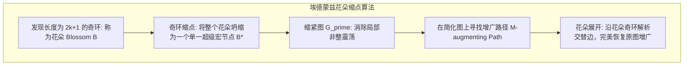

# Lec 7 理想表述 III：一般图匹配多面体与 Edmonds 花朵算法 (Matching Polytope)

> MIT 15.083 / 6.859J 整数规划与组合优化 · 讲义 7 · 授课教师：Prof. Dimitris Bertsimas

## TL;DR

- 一般图（含奇数环）的连续匹配松弛必然包含非整数分数极点（$x_e = 1/2$）。
- 埃德蒙兹奇割不等式（Odd-Set Inequalities）彻底削去半整数顶点，闭合出真正匹配凸包。
- 花朵算法（Blossom Algorithm）通过奇环缩点在多项式时间内完美攻破一般图最大匹配。

## 1. 奇数环的诅咒：一般图匹配的非整困境

在第 5 讲中我们看到，二分图的匹配多面体是完全单模（TUM）的理想表述。
然而，真实世界中的社交好友互助配对、器官捐赠交叉置换、网约车顺风车拼车，底层图拓扑必然包含奇数环（三角形、五边形回路），绝不可能是纯粹的二分图！

考察最简单的三角形完全图 $K_3$（节点为 $1, 2, 3$，边为 $e_1=(1,2), e_2=(2,3), e_3=(1,3)$）：
每个节点的度数为 2。平凡的度数约束为：
$$\begin{cases}
x_{12} + x_{13} \le 1 \\
x_{12} + x_{23} \le 1 \\
x_{13} + x_{23} \le 1
\end{cases} \qquad x_{ij} \ge 0$$

如果我们运行连续线性规划求解：
联立三个方程取等号，立刻解出一个分数顶点极点：
$$x^* = (x_{12}^*, x_{23}^*, x_{13}^*) = \left( \frac{1}{2}, \; \frac{1}{2}, \; \frac{1}{2} \right)$$
计算其目标和：$\sum x_e^* = 1.5$！
然而在物理现实中，一个三角形里面最多只能挑出 1 条互不相交的边（最大匹配数必为 1）！
平凡线性松弛多面体在每一个奇数环周围都严重虚胖膨胀，导致求解器产生 $50\%$ 的巨大假最优伪解。

## 2. 划时代的杰作：埃德蒙兹匹配多胞形（Edmonds' Matching Polytope）

1965 年，图论与运筹学泰斗杰克·埃德蒙兹（Jack Edmonds）在《加拿大数学杂志》发表了被誉为组合优化开山之作的论文《路径、树与花朵》。
埃德蒙兹指出：为了斩杀所有奇数环上的分数假解，必须向多面体注入**奇割不等式（Odd-Set Inequalities）**！

对于任意包含奇数个节点的顶点真子集 $U \subset V$（$|U| \ge 3$ 且 $|U|$ 为奇数）：
在集合 $U$ 内部挑出的边，其两个端点都在 $U$ 内部。由于每个合法匹配中的边两两不相交，这至多只能覆盖 $U$ 中的偶数个节点；因此在 $U$ 内部最多只能挑出 $\frac{|U| - 1}{2}$ 条匹配边！

::: theorem 埃德蒙兹匹配多面体定理 (Edmonds' Matching Theorem)
任意无向图 $G = (V, E)$ 的最大匹配整数凸包 $\operatorname{conv}(\text{Matching}(G))$，**百分之百精确由以下三组线性不等式唯一定义**：
1. **度数非负约束**：
   $$\sum_{e \in \delta(v)} x_e \le 1, \quad \forall v \in V \qquad x_e \ge 0, \quad \forall e \in E$$
2. **奇割有效不等式（Blossom / Odd-Set Inequalities）**：
   $$\sum_{e \in E(U)} x_e \le \frac{|U| - 1}{2}, \quad \forall U \subset V, \; |U| \ge 3 \text{ 且 } |U| \text{ 为奇数}$$
并且，该线性不等式系统**严格满足全对偶整数性（TDI）**！
:::

将 $U = \{1, 2, 3\}$ 代入奇割不等式：
$$x_{12} + x_{23} + x_{13} \le \frac{3 - 1}{2} = 1$$
这一刀直接将刚才那个 $1/2 + 1/2 + 1/2 = 1.5$ 的分数假解瞬间斩落马下！多面体瞬间恢复为了纯整数凸包！

## 3. 花朵算法（Blossom Algorithm）的多项式多项式奇迹

奇割不等式的数量高达 $2^{|V|}$ 条。我们如何多项式求解？
埃德蒙兹设计的**花朵算法（Blossom Algorithm）**以纯粹的图论几何完成了这一伟业：

1. **交替树搜索（Alternating Tree）**：从未匹配点出发，通过广度优先交替遍历未匹配边与已匹配边；
2. **奇环碰撞与花朵缩点（Blossom Shrinking）**：当交替树中两根外向标号相同的链发生碰撞，必然在局部闭合形成一个长度为 $2k+1$ 的**奇环（称为花朵 Blossom）**！
   此时，算法**奇迹般地将这整个奇环直接当场坍缩为一个单一的超级宏节点（Super-node）**！
   缩点后的图将所有内部奇偶冲突完全屏蔽，使交替路搜索得以继续穿透推进；
3. **寻找增广路与花朵展开（Augmentation & Unfolding）**：一旦在宏观图上撞击到另一个未匹配节点（找到增广路），算法顺着树枝逆向回溯，把被压缩的花朵逐一像花瓣一样展开，在奇环内部沿唯一的奇偶交替方向推流，将整条路径上的匹配状态反转，使得总匹配数绝对加一！

花朵算法的时间复杂度仅为 $\mathcal{O}(|V|^2 |E|)$，是人类历史上第一个真正意义上的非平凡多项式时间组合优化算法。

::: insight 奇偶对立与多面体切割的诗篇
一般图匹配多面体是组合多面体学最壮丽的里程碑。
面对三角形与五边形的奇环死结，埃德蒙兹没有被指数级的刻画面吓退。他用奇割不等式雕刻出了完美的凸包，更发明了花朵缩点这台精密的代数拓扑切割机。
在花朵展开的一瞬间，离散图论的组合结构与连续多面体的极限切线融为一体。这不仅是一项算法发明，更彻底确立了“多项式时间算法即易解性”的现代计算哲学。
:::
