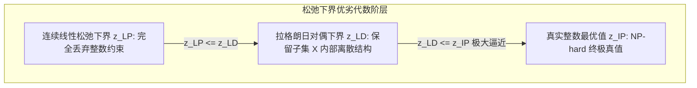

# Lec 9 整数对偶理论 II：拉格朗日松弛与对偶间隙 (Duality Theory II: Lagrangian Relaxation)

> MIT 15.083 / 6.859J 整数规划与组合优化 · 讲义 9 · 授课教师：Prof. Dimitris Bertsimas

## TL;DR

- 拉格朗日松弛（Lagrangian Relaxation）通过惩罚耦合约束将难题拆解为易解子结构。
- 拉格朗日对偶界 $z_{\text{LD}}$ 严格优于或等于普通线性规划松弛界：$z_{\text{LP}} \le z_{\text{LD}} \le z_{\text{IP}}$。
- 赫尔德-卡普（Held-Karp）1-树松弛给出了旅行商问题（TSP）最著名的近优下界。

## 1. 拆解硬约束：拉格朗日松弛的工程动机

在真实工业界的复杂整数规划中，约束通常分为两类：
1. **“硬”约束（Complicating / Coupling Constraints）**：数量不多，但结构错综复杂，死死将整个系统捆绑在一起（例如多品种流的共享弧容量上限、机组排班的跨基地轮换配额）；
2. **“软”结构约束（Easy Constraints）**：即使包含整数约束，如果独立求解，具有极佳的特殊多项式结构（例如每个工厂独立的背包问题、图上的最小支撑树问题）。

如果将所有约束混在一起直接调用求解器，分支定界往往由于松弛虚弱而崩溃。
拉格朗日松弛（Lagrangian Relaxation）的核心理念是：**将那些让人头疼的“硬约束”从约束集合中剥离出来，乘以乘子 $\lambda$ 作为惩罚项直接搬进目标函数中，留下极其纯净的、多项式易解的子问题独立求解！**

考虑整数规划：
$$\begin{aligned}
z_{\text{IP}} = \min_{x} \quad & c^T x \\
\text{s.t.} \quad & A x \ge b \quad &&\text{(硬耦合约束 Complicating)} \\
& x \in X = \{x \in \mathbb{Z}_+^n \mid D x \ge d\} \quad &&\text{(易解离散子集 Easy)}
\end{aligned}$$

引入非负拉格朗日乘子向量 $\lambda \ge 0$：
$$L(\lambda) = \min_{x \in X} \left\{ c^T x + \lambda^T (b - A x) \right\} = \lambda^T b + \min_{x \in X} (c - A^T \lambda)^T x$$

## 2. 拉格朗日对偶问题（Lagrangian Dual）与几何实质

由于对于任意原可行解 $x \in X$ 且 $A x \ge b$，乘子满足 $\lambda \ge 0$，故 $\lambda^T (b - A x) \le 0$。
因此，对于任意合法的 $\lambda \ge 0$，$L(\lambda)$ 天然构成原问题的一个**绝对下界（Lower Bound）**：
$$L(\lambda) \le z_{\text{IP}}, \quad \forall \lambda \ge 0$$

为了获得最紧致、杀伤力最强的终极下界，我们构建**拉格朗日对偶问题（Lagrangian Dual, LD）**：
$$z_{\text{LD}} = \max_{\lambda \ge 0} \quad L(\lambda)$$

拉格朗日对偶界究竟有多强？
杰夫里昂（Arthur Geoffrion）在 1974 年证明了里程碑式的几何等价定理：

::: theorem 杰夫里昂拉格朗日对偶几何定理 (Geoffrion's Theorem)
拉格朗日对偶问题 $z_{\text{LD}} = \max_{\lambda \ge 0} L(\lambda)$ 的最优目标值，**精确等于在原约束与子集合 $X$ 的凸包交集上求解连续线性规划的最优值**：
$$z_{\text{LD}} = \min \left\{ c^T x \;\middle|\; A x \ge b, \; x \in \operatorname{conv}(X) \right\}$$
特别地：
1. **永远不弱于 LP 松弛**：$z_{\text{LP}} \le z_{\text{LD}} \le z_{\text{IP}}$；
2. **严格强于 LP 松弛的条件**：若子系统集合 $X$ **不满足完全单模性**（即 $\operatorname{conv}(X) \subsetneq X_{\text{LP}}$），则拉格朗日对偶下界**严格高于普通线性规划松弛下界**：
$$z_{\text{LP}} < z_{\text{LD}} \le z_{\text{IP}}$$
:::

## 3. 经典传奇：Held-Karp 1-树松弛求解旅行商问题（TSP）

拉格朗日松弛在运筹史上最惊艳的战役，是由迈克尔·赫尔德（Michael Held）与理查德·卡普（Richard Karp）利用 1-树松弛攻克对称 TSP。

TSP 要求寻找包含所有节点的最小哈密顿回路（每个节点度数为 2，且全局连通）。
Held 与 Karp 观察到：一个合法的 TSP 巡回回路，**去掉节点 1 之后，剩下的节点之间必然构成一棵无环的最小支撑树（Spanning Tree）**，外加节点 1 连接出来的 2 条边！这种拓扑被称为 **1-树（1-Tree）**！

- **易解子问题（Easy）**：在无向图上寻找最小权重的 1-树，只需调用一次极快的 Kruskal 算法（时间复杂度仅为 $\mathcal{O}(|E| \log |V|)$）！
- **复杂硬约束（Hard）**：1-树并不保证每个节点的度数恰好等于 2（某些节点度数可能为 3 或 4，另一些节点可能为 1）。

为每个节点的度数约束 $\sum_{e \in \delta(i)} x_e = 2$ 赋予拉格朗日乘子 $\lambda_i \in \mathbb{R}$。
将度数偏差移入目标函数后，每条边 $e=(i, j)$ 的有效修改成本变为：
$$\tilde{c}_{ij} = c_{ij} - \lambda_i - \lambda_j$$
在此虚拟成本下求解最小 1-树，结合次梯度法快速更新乘子 $\lambda$。
实验表明：**Held-Karp 算出的拉格朗日下界，距离真实 TSP 整数最优解的相对误差平均不到 $0.8\%$！** 这极其恐怖的高精度下界，使得现代 TSP 求解器 Concorde 能够秒级剪枝并求解数万个城市的超级难题。

::: insight 破界思维：把复杂留给自己，把纯粹留给算法
拉格朗日松弛体现了运筹优化最深刻的工程妥协哲学：
不要试图与耦合约束死磕到底。既然它让你痛苦，就给它贴上一个对偶价格标签，把它请出约束的大门。
剩下的子系统恢复了图论与拟阵的纯净骨架，可以在多项式时间内极速狂飙。对偶乘子 $\lambda$ 像一位无形的调优师，在子系统的反复迭代中，把那些违背全局平衡的节点逐一拉回正轨。这是现代混合整数规划求解器最强大的引擎之一。
:::
