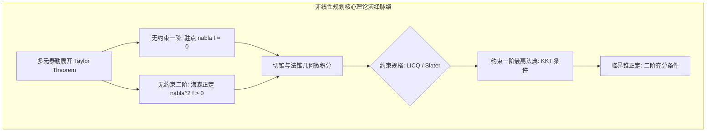
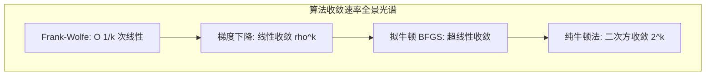

# Lec 13 非线性规划前半程核心理论与算法收敛全景对比 (Midterm Synthesis: Theory & Algorithms)

> MIT 15.084J / 6.252J 非线性规划 · 讲义 13 · 授课教师：Prof. Robert Freund

## TL;DR

- 系统回顾无约束与约束最优性微分法则：驻点、KKT 与临界锥二阶正定性。
- 建立一阶梯度、共轭梯度、拟牛顿（BFGS）与纯牛顿法的理论收敛谱系。
- 梳理外罚函数、增广拉格朗日、障碍内点法与 Frank-Wolfe 在工业选型中的决策边界。

## 1. 理论公理体系大一统：从微积分到 KKT

在 15.084J 前半程的壮丽探索中，我们从无约束微积分起步，步步为营跨越了切锥几何、约束规格，最终构筑起现代非线性规划的理论圣殿。

整个理论大厦由三大支柱层层递进锁定：

| 理论层次 | 核心数学条件 | 几何物理诠释 | 成立边界 |
| :--- | :--- | :--- | :--- |
| **无约束一阶** | $\nabla f(x^*) = 0$ | 曲面水平切平面切点（驻点） | 开集局域极小必要 |
| **无约束二阶** | $\nabla^2 f(x^*) \succ 0$ | 局部二次抛物面向上凹陷弯曲 | 严格局部极小充分 |
| **约束一阶 (KKT)** | $\nabla f + A^T \mu + B^T \lambda = 0, \; \mu \ge 0, \; \mu_i g_i = 0$ | 负梯度力与各活动壁面反作用力矢量平衡 | LICQ/Slater 成立时必要；凸规划下充要 |
| **约束二阶 (SOSC)** | $d^T \nabla_{xx}^2 L(x^*, \mu^*, \lambda^*) d > 0, \; \forall d \in C(x^*)$ | 拉格朗日曲率在切向临界锥上严格为正 | 严格隔离局部极小充分 |

## 2. 算法竞技场：收敛阶数与计算复杂度的全景矩阵

在算法工程实现端，没有任何单一算法能够统治所有现实问题。算法的选型是对**单步计算开销（Per-iteration Cost）**与**迭代总轮数（Convergence Rate）**的精妙权衡。

| 算法门派 | 代表算法 | 单步核心矩阵计算开销 | 收敛速率 (Convergence Rate) | 内存开销 | 核心应用场景与致命软肋 |
| :--- | :--- | :--- | :--- | :--- | :--- |
| **一阶显式** | 最速下降法 (Steepest Descent) | $\mathcal{O}(n)$ 纯内积与梯度 | 线性收敛 $\left(\frac{\kappa-1}{\kappa+1}\right)^2$ | $\mathcal{O}(n)$ 极轻量 | 大模型训练必选；受制于条件数严重之字震荡 |
| **一阶加速** | Frank-Wolfe 条件梯度法 | 求解一次线性目标 LP | 次线性收敛 $\mathcal{O}(1/k)$ | $\mathcal{O}(n)$ 极轻量 | 极度适合核范数与矩阵完备；收敛较慢且步长固定 |
| **拟牛顿族** | BFGS / L-BFGS | $\mathcal{O}(n^2)$（L-BFGS 为 $\mathcal{O}(mn)$） | 超线性收敛 (Superlinear) | $\mathcal{O}(mn)$ 极佳 | 工业非线性标配；海森逆阵秩二逼近，免除求导求逆 |
| **二阶精准** | 经典阻尼牛顿法 (Newton-CG) | $\mathcal{O}(n^3)$ 海森求逆或分解 | 局部二次收敛 (Quadratic) | $\mathcal{O}(n^2)$ 沉重 | 极高精度物理仿真与内点法引擎；大维度内存受限 |
| **约束序列** | 增广拉格朗日乘子法 (ALM) | 内层运行拟牛顿/牛顿法 | 外层超线性收敛 | 继承内层 | 约束优化万能引擎；解耦条件数，数值稳定性极强 |

## 3. 经典工业诊断思维模型

面对一个新的工程决策优化需求，资深运筹工程师应遵循如下决策漏斗：
1. **凸性审查（Convexity Check）**：目标与约束是否为凸？若是凸问题，全力利用 Slater 条件与 KKT 充要性，放心使用局部算法求解全局最优；
2. **约束刚性评估（Constraint Hardness）**：
   - 若仅含简单边界盒状约束（Box Constraints $l \le x \le u$）：优先采用坐标下降（Coordinate Descent）或投影拟牛顿法（L-BFGS-B）；
   - 若等式约束维数较高：采用零空间约化梯度法（Null-Space Method）消去等式；
   - 若存在高度非线性耦合不等式：果断采用增广拉格朗日法（ALM）或序列二次规划（SQP）；
3. **稀疏性与规模（Sparsity & Scale）**：
   - 维度 $n < 10^3$：直接阻尼牛顿法，享受二次收敛的机精度秒杀；
   - 维度 $10^3 \le n \le 10^6$：L-BFGS 或预条件共轭梯度法（PCG）；
   - 维度 $n > 10^7$：一阶随机梯度下降（SGD）或无投影 Frank-Wolfe。

::: insight 运筹工程师的元认知境界
非线性优化不仅是一套公式，更是一种面对现实混沌世界的工程世界观。
现实系统永远充满非线性阻力、资源壁垒与多变量交织。粗浅的工程师试图强行套用通用黑盒，结果在奇异矩阵与死锁发散中耗尽算力；
卓越的工程师首先审视几何：用凸分析透视可行域流形，用约束规格规避代数陷阱，用增广拉格朗日驯服发散条件数。前半程的理论积淀，正是为了让读者在面对任何复杂的非线性大题时，胸中皆有定盘之针。
:::
