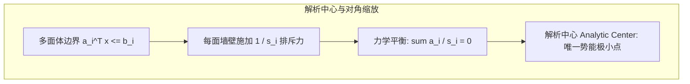

# Lec 14 线性优化内点法 I：仿射几何与解析中心势函数 (IPM for Linear Optimization I)

> MIT 15.084J / 6.252J 非线性规划 · 讲义 14 · 授课教师：Prof. Robert Freund

## TL;DR

- 解析中心（Analytic Center）是在多面体内部最大化对数距离乘积的几何质心。
- 卡马卡（Karmarkar）势函数融合了目标成本与对数势垒，实现非线性势能严格递减。
- 势还原内点法证明了每步势能减少常数 $\delta > 0$ 即可锁定多项式收敛阶数。

## 1. 多面体的几何质心：解析中心（Analytic Center）

在非线性规划的前半程，我们看到了对数障碍函数在约束边界建立高压势垒的威力。现在，我们将这一思想深度植入到线性规划的多面体中，开启非线性内点法与凸几何的深度结合。

设多面体有界且具有非空内部：
$$P = \{x \in \mathbb{R}^n \mid a_i^T x \le b_i, \; i = 1, \dots, m\}$$
定义每个约束的松弛量为 $s_i(x) = b_i - a_i^T x > 0$。

在多面体内部，哪一个点最能代表该几何体的“物理中心”？
切比雪夫中心（Chebyshev Center）追求内切欧氏球的最大化，但计算复杂且仅由少数活动面决定。
匈牙利数学家吉斯·卡采尔森在 20 世纪 60 年代提出了更具微积分全纯性质的**解析中心（Analytic Center）**：

::: definition 解析中心 (Analytic Center)
解析中心 $x_{\text{ac}}$ 是在多面体内部最大化所有面松弛距离几何平均值的点，等价于极小化对数势能：
$$x_{\text{ac}} = \arg\min_{x \in P^\circ} \quad \phi(x) = -\sum_{i=1}^m \ln(b_i - a_i^T x)$$
:::

解析中心的梯度与海森矩阵具有无与伦比的优雅形式：
$$\nabla \phi(x) = \sum_{i=1}^m \frac{a_i}{b_i - a_i^T x} = A^T S(x)^{-1} \mathbf{1} = 0$$
$$\nabla^2 \phi(x) = \sum_{i=1}^m \frac{a_i a_i^T}{(b_i - a_i^T x)^2} = A^T S(x)^{-2} A \succ 0$$
其中 $S(x) = \operatorname{diag}(s_1(x), \dots, s_m(x))$。
由于海森矩阵是严格正定的，解析中心**存在且唯一**！它像一个在所有墙壁斥力弹簧达到完美静力平衡的悬浮质点。

## 2. 卡马卡（Karmarkar）势函数与势还原算法

1984 年，卡马卡算法之所以震惊世界，正是因为他提出了一种完全摆脱传统路径跟踪的非线性评价函数——**卡马卡势函数（Karmarkar's Potential Function）**。

考虑标准型齐次线性规划（假设最优目标值为 0）：$\min c^T x$ s.t. $A x = 0, \mathbf{1}^T x = 1, x \ge 0$。
卡马卡设计了著名的**对数势函数（Karmarkar's Potential Function）**：

$$\Psi(x) = q \cdot \ln(c^T x) - \sum_{j=1}^n \ln(x_j)$$

仔细观察这个势函数的双向张力：
1. **牵引力项 $q \cdot \ln(c^T x)$**：强力将目标函数 $c^T x$ 向零（最优解）拽拉。当目标趋向 0 时，该项趋向 $-\infty$；
2. **斥力项 $-\sum \ln(x_j)$**：保证变量远离非负边界 $x_j = 0$。防止算法过早被困在非最优的边界角落。

只要参数选取 $q \ge n$，势函数在整个空间中就展现出坚挺的连续下凸性。

## 3. 势能单步恒定衰减与多项式收敛定理

卡马卡势还原算法（Potential Reduction Algorithm）的迭代步骤如下：
1. 在当前点 $x_k$ 处，构建对角标度矩阵 $X_k = \operatorname{diag}(x_k)$；
2. 在投影坐标系中计算负势函数梯度的正交投影方向：
$$d = -P_{A X_k} \nabla_y \Psi(X_k \mathbf{1})$$
3. 沿该方向执行回溯线搜索，更新 $x_{k+1}$。

::: theorem 势能恒定下降收敛定理
设参数设定为 $q = n + \sqrt{n}$。在每一步势还原迭代中，算法保证势函数值实现**常数级的绝对减少**：
$$\Psi(x_{k+1}) \le \Psi(x_k) - \delta, \quad \text{其中 } \delta \ge 0.2$$
因此，在至多：
$$K = \mathcal{O}\left( \sqrt{n} \ln\left( \frac{c^T x_0}{\varepsilon} \right) \right)$$
步迭代内，目标函数 $c^T x$ 必然降低到 $\varepsilon$ 误差带内！
:::

定理的深刻之处在于：**不论问题规模是多大，每走一步，势函数的绝对能量至少下降 0.2 个单位！**
势函数的单调递减为算法收敛提供了像热力学第二定律一样铁打的熵增保障。

::: insight 势能作为目标与约束的终极粘合剂
在过去的优化方法中，“满足约束”和“降低目标”是两个割裂的诉求，工程师常常在这两个目标之间来回拉扯。
卡马卡势函数将“目标价值”和“边界距离”融合在同一个无量纲的对数势能场中。优化算法不再是一个生硬的代数消元程序，而是一个在人工物理场中做势能极小化滚动的粒子。这种物理学隐喻，将非线性规划的灵动与严谨推向了最高峰。
:::
