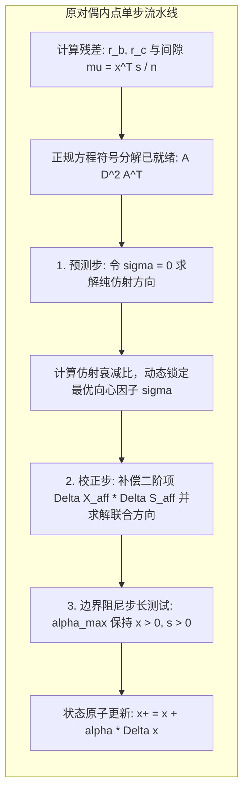

# Lec 15 线性优化内点法 II：原对偶中心路径跟踪与工业实现 (IPM for Linear Optimization II)

> MIT 15.084J / 6.252J 非线性规划 · 讲义 15 · 授课教师：Prof. Robert Freund

## TL;DR

- 原对偶内点法将扰动 KKT 系统视为非线性联立方程做多维牛顿迭代。
- 求解过程被高度凝练为对称正定正规方程组 $(A D^2 A^T) \Delta p = r$ 的稀疏乔列斯基分解。
- 梅罗特拉（Mehrotra）高阶预测-校正器大幅拉长步长，成为全球工业内点求解器的绝对霸主。

## 1. 原对偶扰动 KKT 系统的非线性牛顿视点

在第 14 讲中我们从势函数视角审视了内点法。然而，现代商业优化界（如 Mosek, Gurobi, Xpress）实际采用的核心代码，百分之百是**原对偶路径跟踪内点法（Primal-Dual Path-Following Interior-Point Method）**。

考虑标准型线性规划及其对偶：
$$\begin{aligned}
\text{(Primal)} \quad & \min \; c^T x \quad \text{s.t.} \quad A x = b, \; x \ge 0 \\
\text{(Dual)} \quad & \max \; b^T p \quad \text{s.t.} \quad A^T p + s = c, \; s \ge 0
\end{aligned}$$

根据第 7 讲学到的 KKT 条件，最优解充要满足：
$$A x = b, \quad A^T p + s = c, \quad X S \mathbf{1} = 0, \quad (x \ge 0, s \ge 0)$$
其中互补松弛条件 $x_j s_j = 0$ 构成了方程组中唯一的**非线性双曲乘积项**！

为了避免过早陷入坐标轴边界，原对偶内点法对互补松弛施加正向微扰：令 $x_j s_j = \mu > 0$。
定义非线性残差映射向量：
$$F_\mu(x, p, s) = \begin{bmatrix} A x - b \\ A^T p + s - c \\ X S \mathbf{1} - \mu \mathbf{1} \end{bmatrix} = 0$$

对其应用标准的**牛顿-拉夫逊方法（Newton-Raphson Method）**，在当前点 $(x, p, s)$ 处线性化求解切线方向：

$$\begin{bmatrix}
A & 0 & 0 \\
0 & A^T & I \\
S & 0 & X
\end{bmatrix} \begin{bmatrix}
\Delta x \\
\Delta p \\
\Delta s
\end{bmatrix} = -\begin{bmatrix}
r_b \\
r_c \\
X S \mathbf{1} - \sigma \mu \mathbf{1}
\end{bmatrix}$$

其中 $r_b = A x - b$ 为原可行性残差，$r_c = A^T p + s - c$ 为对偶可行性残差，$\sigma \in [0, 1]$ 为向心居中因子。

## 2. 核心代数消元：正规方程（Normal Equations）

观察上述 $(2n + m)$ 维的巨型非线性牛顿矩阵。如果直接对其求逆，运算量将彻底失控。
利用块高斯消元，我们可以进行精妙绝伦的代数降维：

由第三行方程展开：
$$S \Delta x + X \Delta s = -X S \mathbf{1} + \sigma \mu \mathbf{1} \implies \Delta s = -X^{-1} S \Delta x - s + \sigma \mu X^{-1} \mathbf{1}$$

由第二行方程：
$$\Delta s = -r_c - A^T \Delta p$$

联立上述两式，解出决策变量增量 $\Delta x$：
$$\Delta x = S^{-1} X A^T \Delta p + D^2 (r_c - s) + \sigma \mu S^{-1} \mathbf{1}$$
其中引入核心对角矩阵 $D = X^{1/2} S^{-1/2} = \operatorname{diag}\left( \sqrt{\frac{x_1}{s_1}}, \dots, \sqrt{\frac{x_n}{s_n}} \right)$！

将 $\Delta x$ 代入第一行约束方程 $A \Delta x = -r_b$，我们最终将全部变量压缩为一个仅有 $m$ 维的对称正定线性方程组——**正规方程组（Normal Equations）**：

$$\left( A D^2 A^T \right) \Delta p = -r_b - A D^2 \left( r_c - s + \sigma \mu X^{-1} \mathbf{1} \right)$$

::: theorem 增广正规矩阵的对称正定性
只要约束矩阵 $A$ 行满秩，且当前处于严格内点（$x > 0, s > 0$），则矩阵：
$$M = A D^2 A^T \in \mathbb{R}^{m \times m}$$
**必然是一个严格对称正定矩阵（Symmetric Positive Definite, SPD）**！
因此，解此方程组可以使用最稳定、无任何数值发散风险的**乔列斯基分解（Cholesky Decomposition $M = L L^T$）**！
:::

## 3. 梅罗特拉预测-校正器（Mehrotra's Predictor-Corrector）

纯牛顿方向只考虑了一阶导数，忽略了 $x_j s_j$ 的二阶交叉微分项 $\Delta x_j \Delta s_j$。
梅罗特拉（Sanjay Mehrotra）在 1992 年提出了改变工业历史的两步预测-校正算法：

1. **预测步（Affine Predictor Step）**：
   令 $\sigma = 0$ 且不加二阶项，求解纯粹的仿射牛顿方向 $(\Delta x_{\text{aff}}, \Delta p_{\text{aff}}, \Delta s_{\text{aff}})$；
   计算如果完全按该方向走，保持变量非负的最大可能步长 $\alpha_{\text{aff}}$，并评估其对偶间隙衰减量 $\mu_{\text{aff}}$；
2. **自适应居中因子（Adaptive Centering Parameter）**：
   梅罗特拉给出了著名的自适应经验公式：
   $$\sigma = \left( \frac{\mu_{\text{aff}}}{\mu} \right)^3$$
   如果预测步下降极快（$\mu_{\text{aff}} \ll \mu$），$\sigma \to 0$，算法开足马力向最优解冲刺；
   如果预测步遭遇阻碍，$\sigma \to 1$，算法自动增大向心力拉回中心管道！
3. **二阶校正步（Corrector Step）**：
   将预测步算出的非线性交叉项 $\Delta X_{\text{aff}} \Delta S_{\text{aff}} \mathbf{1}$ 补偿进右端项，重新求解一次正规方程！
   注意：**正规矩阵 $A D^2 A^T$ 完全不需要重新做乔列斯基分解！只需复用刚才已经算好的三角因式 $L$，仅需执行一次极快的常数级前向回代（Back-substitution）！**

这一步几乎零成本的二阶曲率校正，使得单步阻尼步长可以轻松推高到 $\alpha \approx 0.999$，将全流程迭代次数牢牢锁定在惊人的 30 步以内。

::: insight 矩阵代数拓扑对连续分析的统领
深入工业级内点法源码，你会发现微积分的戏份只占 $5\%$，剩下的 $95\%$ 全是稀疏矩阵图论与数值线性代数。
多面体松弛的几何动力学，最终被凝练成了矩阵 $A D^2 A^T$ 的填元（Fill-in）最小化排序（如 AMD 近似最小度排序）和超节点乔列斯基并行流水线。
当连续世界的非线性牛顿迭代，与离散世界的稀疏图分解在芯片级底层完美咬合时，数学优化才真正迸发出了主宰工业大系统的澎湃伟力。
:::
