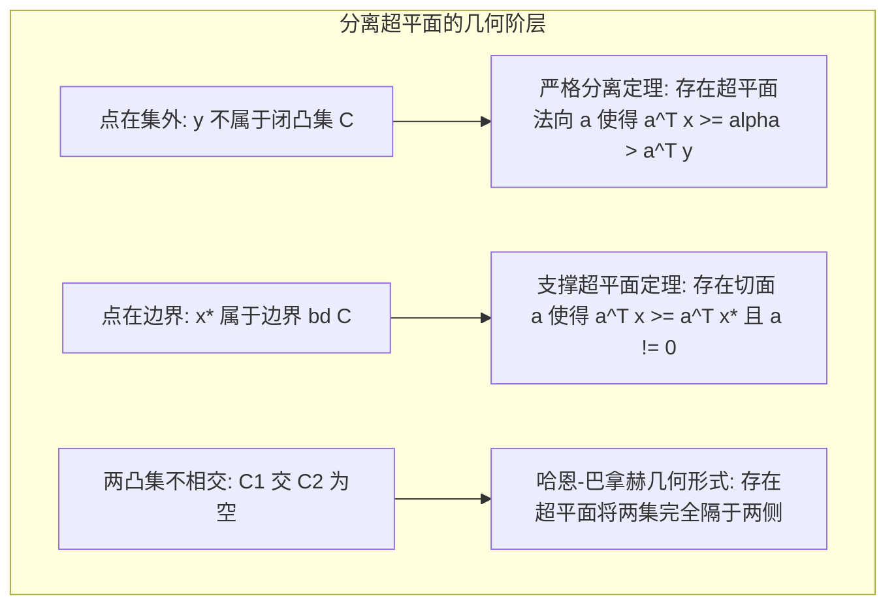

# Lec 16 凸集几何学：分离超平面、支撑超平面与凸锥极对偶 (Analysis of Convex Sets)

> MIT 15.084J / 6.252J 非线性规划 · 讲义 16 · 授课教师：Prof. Robert Freund

## TL;DR

- 点与闭凸集的严格分离定理构成了整个凸对偶与泛函分析的几何基座。
- 支撑超平面定理（Supporting Hyperplane）证明凸集边界上处处存在支撑切面。
- 极锥（Polar Cone）与双极定理（Bipolar Theorem）建立了凸锥与投影几何的代数闭包。

## 1. 欧氏空间中凸集的严格分离公理

在第 10 讲中，我们曾借用分离超平面的结论证明了线性规划的法卡斯引理。在非线性优化的后半程，为了建立普遍的拉格朗日对偶性与共轭函数理论，我们必须从公理化拓扑几何角度，把**凸集分离理论（Separation Theorems for Convex Sets）**建立在坚不可摧的基础之上。

在欧氏空间 $\mathbb{R}^n$ 中，凸集拥有一个极其特殊的物理刚性：**任意外部点到该闭凸集上，存在唯一一个距离最近的正交投影点！**

::: theorem 闭凸集投影定理 (Projection onto Convex Sets)
设 $C \subset \mathbb{R}^n$ 为非空闭凸集。对于任意点 $y \in \mathbb{R}^n$，存在**唯一确定的点** $x^* = \Pi_C(y) \in C$，使得：
$$\|y - x^*\|_2 = \min_{x \in C} \|y - x\|_2$$
并且，$x^*$ 是投影点当且仅当满足变分不等式：
$$(y - x^*)^T (x - x^*) \le 0, \quad \forall x \in C$$
:::

几何图像极其直观：从外部点 $y$ 望向其投影点 $x^*$，向量 $y - x^*$ 与集合内任意点到投影点的连线向量 $x - x^*$ 必然形成钝角（内积小于等于 0）！

利用这个变分不等式，我们令法向量 $a = y - x^* \ne 0$，立即导出了**点与闭凸集的严格分离定理**：
$$a^T x \ge a^T x^* > a^T y, \quad \forall x \in C$$
超平面 $a^T z = \frac{a^T x^* + a^T y}{2}$ 完美且绝无触碰地横亘在外部点 $y$ 与整个凸集 $C$ 之间！

## 2. 支撑超平面定理（Supporting Hyperplane Theorem）

如果点不是在凸集外部，而是**恰好落在凸集的拓扑边界上**（$x^* \in \operatorname{bd}(C)$），能否做分离？

::: definition 支撑超平面 (Supporting Hyperplane)
设 $C \subset \mathbb{R}^n$ 为凸集，$x^* \in \operatorname{bd}(C)$ 为其边界点。若存在非零向量 $a \in \mathbb{R}^n \setminus \{0\}$，使得：
$$a^T x \ge a^T x^*, \quad \forall x \in C$$
则超平面 $H = \{x \in \mathbb{R}^n \mid a^T x = a^T x^*\}$ 称为凸集 $C$ 在点 $x^*$ 处的**支撑超平面**。法向量 $a$ 称为该点处的外法向量。
:::

::: theorem 支撑超平面存在性定理
设 $C \subset \mathbb{R}^n$ 为非空凸集。对于 $C$ 的**每一个边界点 $x^* \in \operatorname{bd}(C)$**，必然存在至少一个通过 $x^*$ 的支撑超平面！
:::

更震撼的是，如果集合 $C$ 是闭凸集，**该集合精确等于所有包含它的闭半空间的交集！**
这意味着：**任何一个凸集的宏观外轮廓，可以被其表面无穷多个支撑超平面的切线法向量完全重构与代数刻画！**

## 3. 凸锥极对偶与双极定理（The Bipolar Theorem）

在现代锥优化（Conic Optimization）中，集合往往展现出原点收拢的锥结构（Cone）。

::: definition 凸锥与极锥 (Polar Cone)
1. **凸锥（Convex Cone）**：集合 $K \subset \mathbb{R}^n$ 称为锥，若 $\forall x \in K$ 且 $\lambda \ge 0$，均有 $\lambda x \in K$；若同时对加法封闭，则称为凸锥；
2. **对偶锥与极锥（Dual Cone / Polar Cone）**：定义与 $K$ 内所有元素内积非负的集合为对偶锥（Dual Cone）：
$$K^* = \{y \in \mathbb{R}^n \mid y^T x \ge 0, \; \forall x \in K\}$$
（其相反数集合 $K^\circ = -K^*$ 称为极锥 Polar Cone）。
:::

极锥在代数上展现出与线性代数正交补子空间（Orthogonal Complement $V^\perp$）完全平行的美妙公理系统：

::: theorem 双极定理 (Bipolar Theorem)
设 $K \subset \mathbb{R}^n$ 为非空闭凸锥。则其对偶锥的对偶锥严格等于其自身：
$$(K^*)^* = K$$
:::

若锥不闭合，其双极锥即为其闭包：$(K^*)^* = \operatorname{cl}(K)$。这一几何对偶定理，是后续第 18 讲到第 21 讲拉格朗日强对偶与锥对偶理论的绝对公理源头。

::: insight 凸性作为超平面切片的几何本质
什么是凸集？
初等数学告诉你“两点连线在集合内”，这是**内包络视角（Internal Representation）**；
而几何分析学告诉你：**凸集是所有半平面的交，是支撑切面的共同包络**，这是**外对偶视角（External Dual Representation）**。
正是因为边界处处存在支撑超平面，我们才能为每一个约束赋予唯一的法向拉格朗日乘子。没有支撑超平面定理，就没有拉格朗日函数，就没有现代经济学的要素定价体系。这是数学对客观存在最深邃的几何凝视。
:::
