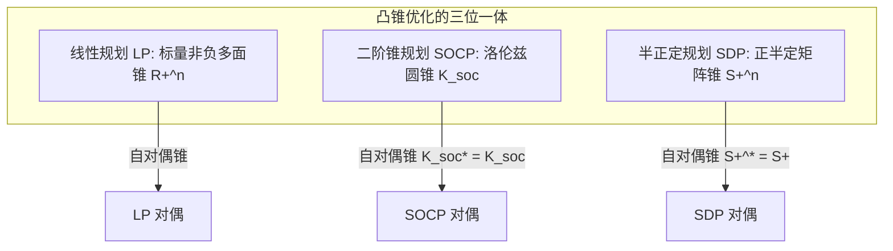

# Lec 21 对偶理论 IV：广义锥对偶与二阶锥/半正定锥对偶映射 (Duality Theory IV: Conic Duality)

> MIT 15.084J / 6.252J 非线性规划 · 讲义 21 · 授课教师：Prof. Robert Freund

## TL;DR

- 广义锥规划（Conic Programming）将标量非负不等式推广至凸锥偏序 $x \succeq_K 0$。
- 对偶锥（Dual Cone）$K^*$ 诱导出了结构完全对称的锥对偶问题（Conic Dual）。
- 二阶锥（SOCP）自对偶，半正定锥（SDP）自对偶，开启了现代多项式凸锥优化新纪元。

## 1. 广义不等式与锥规划（Conic Optimization）

在经典的线性规划与拉格朗日对偶中，所有的约束都是基于标量的大于等于零（$x_i \ge 0$），即定义在非负卦限多面锥 $\mathbb{R}_+^n$ 上的偏序关系。

然而，在现代雷达信号处理、量子信息论、结构拓扑抗震与金融资产鲁棒配置中，我们频繁遭遇非标量约束：
- **二阶锥约束**：约束一个向量的欧氏长度不超过某个标量（$\sqrt{x_1^2 + x_2^2} \le x_0$）；
- **半正定矩阵约束**：要求一个协方差矩阵或状态转移矩阵在所有方向上的二次型非负（$X \succeq 0$）。

为了将所有这些高阶几何结构囊括在统一的公理化框架下，现代应用数学诞生了**锥规划（Conic Programming）**。

::: definition 固锥与广义偏序
设 $K \subset \mathbb{R}^n$ 为一个**固锥（Proper Cone）**，即满足：
1. 凸锥（Convex Cone）；
2. 闭集（Closed）；
3. 具有非空内部（Solid, $\operatorname{int}(K) \ne \emptyset$）；
4. 点锥（Pointed, $K \cap (-K) = \{0\}$，不包含任何完整直线）。
由固锥 $K$ 在空间中自然诱导出**广义不等式偏序（Generalized Inequality）**：
$$x \succeq_K y \iff x - y \in K, \qquad x \succ_K y \iff x - y \in \operatorname{int}(K)$$
:::

## 2. 锥规划的标准型与锥对偶构建

设内积空间配备标准对称内积 $\langle \cdot, \cdot \rangle$。定义凸锥 $K$ 的**对偶锥（Dual Cone）**：
$$K^* = \{y \mid \langle y, x \rangle \ge 0, \; \forall x \in K\}$$

**标准型原锥规划（Primal Conic Problem）**写作：

$$\begin{aligned}
\min_{x} \quad & \langle c, x \rangle \\
\text{s.t.} \quad & A x = b \\
& x \in K \quad (\text{即 } x \succeq_K 0)
\end{aligned}$$

为约束引入乘子向量 $y \in \mathbb{R}^m$ 与对偶松弛变量 $s$：
$$L(x, y) = \langle c, x \rangle - \langle y, A x - b \rangle = \langle b, y \rangle + \langle c - A^* y, x \rangle$$
为了让 $\inf_{x \in K} L(x, y)$ 有有限下界，根据对偶锥的定义，向量 $c - A^* y$ 必须落入对偶锥 $K^*$ 之中！

由此，直接导出**标准型对偶锥规划（Dual Conic Problem）**：

$$\begin{aligned}
\max_{y} \quad & \langle b, y \rangle \\
\text{s.t.} \quad & A^* y + s = c \\
& s \in K^* \quad (\text{即 } s \succeq_{K^*} 0)
\end{aligned}$$

## 3. 自对偶性（Self-Duality）与 SOCP / SDP 实例

在通用数学理论中，对偶锥 $K^*$ 的形状可能与原锥 $K$ 大相径庭。然而，运筹优化界最钟爱的三大神锥，全部拥有不可思议的**自对偶性（Self-Duality, $K^* = K$）**！

### 3.1 线性规划锥（Linear Cone）
非负象限 $K = \mathbb{R}_+^n$。显然其对偶锥为自身：$(\mathbb{R}_+^n)^* = \mathbb{R}_+^n$。原对偶完全恢复为经典的标量 LP。

### 3.2 二阶锥 / 洛伦兹锥（Second-Order / Lorentz Cone）
$$K_{\text{soc}}^{n+1} = \left\{ (x_0, x) \in \mathbb{R} \times \mathbb{R}^n \;\middle|\; x_0 \ge \|x\|_2 \right\}$$
通过柯西-施瓦茨不等式极易证明：**二阶锥是严格自对偶的**！
$$(K_{\text{soc}}^{n+1})^* = K_{\text{soc}}^{n+1}$$
这使得二阶锥规划（SOCP）的原问题与对偶问题拥有完全对称的圆锥几何形式。

### 3.3 半正定锥（Positive Semidefinite Cone）
对称矩阵空间配备弗罗贝尼乌斯内积 $\langle X, S \rangle = \operatorname{tr}(X S)$。
半正定锥 $K = \mathbb{S}_+^n$。根据 Fejér 迹定理：$\operatorname{tr}(X S) \ge 0$ 对所有 $X \succeq 0$ 恒成立，当且仅当 $S \succeq 0$！
因此，**半正定矩阵锥是严格自对偶的**：
$$(\mathbb{S}_+^n)^* = \mathbb{S}_+^n$$

::: theorem 半正定规划对偶对 (Primal-Dual SDP Pair)
原 SDP：
$$\min_{X \in \mathbb{S}^n} \quad \operatorname{tr}(C X) \quad \text{s.t.} \quad \operatorname{tr}(A_i X) = b_i, \; i=1,\dots,m, \quad X \succeq 0$$
其对偶 SDP 形式同样为半正定矩阵不等式：
$$\max_{y \in \mathbb{R}^m} \quad b^T y \quad \text{s.t.} \quad \sum_{i=1}^m y_i A_i + S = C, \quad S \succeq 0$$
:::

::: insight 锥几何统一了最优化宇宙
从标量不等式迈向锥对偶，是应用数学历史上最壮丽的抽象飞跃。
所有的不等式——不论是线性资源限额、二次范数误差、还是矩阵正定性，被全部统一为“向量是否属于某个凸锥”的单一几何命题。
自对偶性更是大自然展现的终极和谐：你在原空间中推演的物理锥体，在对偶的影子价格空间中拥有完全一模一样的镜像形态。这种跨越维度的几何同构，为下一代统一内点法与多项式时间求解器提供了无穷无尽的动力。
:::
