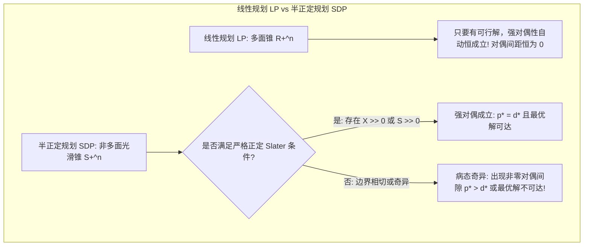

# Lec 24 半正定规划 II：SDP 强弱对偶性、隐式退化与非零对偶间距 (Semidefinite Optimization II)

> MIT 15.084J / 6.252J 非线性规划 · 讲义 24 · 授课教师：Prof. Robert Freund

## TL;DR

- SDP 弱对偶定理恒成立，但非多面锥结构导致可能出现非零对偶间距（$p^* > d^*$）！
- 斯莱特条件（存在严格正定内点 $X \succ 0$）充要保障了强对偶性与对偶最优解存在。
- 弱不可行性（Weak Infeasibility）与隐式秩亏揭示了非多面锥闭包性质破坏的深层病理。

## 1. SDP 对偶理论的建立与对称迹表达

在第 21 讲中，我们从广义锥规划视角推导了半正定规划的标准原对偶对：

$$\begin{aligned}
\text{(Primal SDP)} \quad & p^* = \min_{X \in \mathbb{S}^n} \quad \operatorname{tr}(C X) \quad \text{s.t.} \quad \operatorname{tr}(A_i X) = b_i, \; i=1,\dots,m, \quad X \succeq 0 \\
\text{(Dual SDP)} \quad & d^* = \max_{y \in \mathbb{R}^m} \quad b^T y \quad \text{s.t.} \quad \sum_{i=1}^m y_i A_i + S = C, \quad S \succeq 0
\end{aligned}$$

根据迹运算的线性性质：
$$\operatorname{tr}(C X) - b^T y = \operatorname{tr}\left( \left( \sum_{i=1}^m y_i A_i + S \right) X \right) - \sum_{i=1}^m y_i \operatorname{tr}(A_i X) = \operatorname{tr}(S X)$$

由于 $X \succeq 0$ 且 $S \succeq 0$，根据 Fejér 定理，两个半正定矩阵乘积的迹必然非负：
$$\operatorname{tr}(S X) \ge 0$$
因此，**弱对偶定理（Weak Duality）在 SDP 中无条件恒成立**：
$$p^* - d^* = \operatorname{tr}(S X) \ge 0$$

## 2. 震撼的病态反常：SDP 的非零对偶间距（Duality Gap > 0）

在第 10 讲学到的线性规划中，只要原对偶均可行，强对偶定理绝对保证 $p^* = d^*$。
然而，在半正定规划中，由于半正定矩阵锥 $\mathbb{S}_+^n$ 的边界是完全光滑弯曲的、拥有无穷多个极方向的非多面锥，线性规划的这种绝对确定性被无情打碎了！

考虑如下经典的 SDP 病态反例：

$$\begin{aligned}
\min_{X \in \mathbb{S}^2} \quad & X_{11} \\
\text{s.t.} \quad & 2 X_{12} = 1 \\
& X_{22} = 0 \\
& X = \begin{bmatrix} X_{11} & X_{12} \\ X_{12} & X_{22} \end{bmatrix} \succeq 0
\end{aligned}$$

分析这个原规划的可行域：
矩阵 $X \succeq 0$ 要求其主子式非负，即 $X_{11} X_{22} - X_{12}^2 \ge 0$。
约束强制要求 $X_{22} = 0$ 且 $X_{12} = 0.5$！
代入行列式：$X_{11} \times 0 - (0.5)^2 = -0.25 < 0$！
不论 $X_{11}$ 取多大，行列式永远为负！
因此：**原规划完全不可行（Infeasible），按惯例 $p^* = +\infty$！**

现在写出该问题的对偶 SDP：
$$\max_{y_1, y_2} \quad y_1 \quad \text{s.t.} \quad \begin{bmatrix} 1 & 0 \\ 0 & 0 \end{bmatrix} - y_1 \begin{bmatrix} 0 & 1 \\ 1 & 0 \end{bmatrix} - y_2 \begin{bmatrix} 0 & 0 \\ 0 & 1 \end{bmatrix} = \begin{bmatrix} 1 & -y_1 \\ -y_1 & -y_2 \end{bmatrix} \succeq 0$$
矩阵半正定要求左上角大于等于 0（满足 $1 \ge 0$），右上角与左下角使得行列式非负：$-y_2 - y_1^2 \ge 0 \implies y_2 \le -y_1^2$。
只要取 $y_1 = 0, y_2 = 0$，矩阵为 $\operatorname{diag}(1, 0) \succeq 0$，对偶完全可行！
在可行域内，$y_1$ 最大能取多大？显然只要令 $y_2 = -y_1^2$，任意实数 $y_1$ 都能让对偶可行！
因此：**对偶目标函数可以趋向 $+\infty$！对偶问题目标无界！**

在更隐蔽的反例中，甚至会出现：**原对偶均有界可行，但最优值满足 $p^* = 1$ 且 $d^* = 0$，产生永远无法闭合的非零对偶间隙！**

## 3. SDP 斯莱特条件：强对偶性的终极护城河

为了将 SDP 从病态奇异的深渊中拉回确定性世界，必须在矩阵空间中严格践行斯莱特内点条件：

::: definition SDP 严格可行性 (Strict Feasibility / Slater for SDP)
1. **原问题严格可行**：存在对称正定矩阵 $X_0 \succ 0$（严格正定，即所有特征值严格大于 0），满足 $\operatorname{tr}(A_i X_0) = b_i$（$\forall i=1,\dots,m$）；
2. **对偶问题严格可行**：存在对偶向量 $y_0 \in \mathbb{R}^m$，使得松弛矩阵严格正定：$S_0 = C - \sum y_{0i} A_i \succ 0$。
:::

::: theorem SDP 强对偶定理
1. 若原问题严格可行（满足原斯莱特条件），且对偶最优值有限（$d^* > -\infty$），则：
   **强对偶性严格成立（$p^* = d^*$），且对偶最优解必然存在！**
2. 若对偶问题严格可行（满足对偶斯莱特条件），且原最优值有限（$p^* < +\infty$），则：
   **强对偶性严格成立（$p^* = d^*$），且原最优解必然存在！**
3. 若原对偶**同时满足严格可行性**，则双方必然同时达到有限全局最优，对偶间隙严格为零（$\text{Gap} = 0$），且互补松弛条件 $\operatorname{tr}(S^* X^*) = 0 \iff S^* X^* = 0$ 精确成立！
:::

::: insight 光滑几何对多面体代数的冲击
从线性规划到半正定规划，优化理论经历了一场从“离散多面体”到“连续黎曼流形”的拓扑冲击。
多面锥的每一个面都是线性的，闭包性质天然保持；而半正定锥的圆润边界孕育了非零对偶间距的幽灵。
这并不是数学的缺陷，而是大自然在告诫我们：当我们追求更高阶的非线性表达力时，必须付出更严谨的几何代价。理解 SDP 的斯莱特内点，是在数值优化中防范不可逆退化的终极安全锁。
:::
