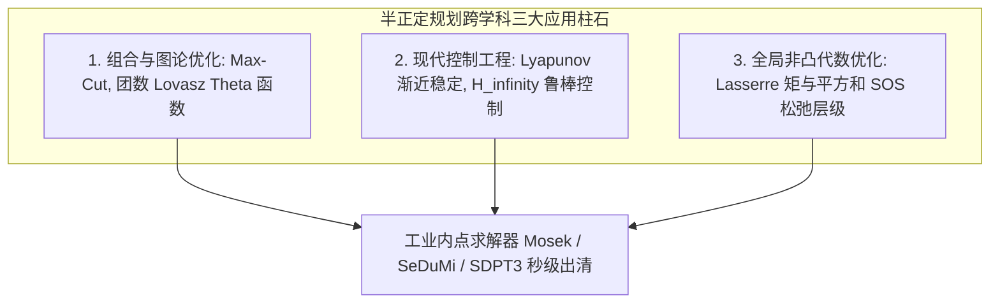

# Lec 25 半正定规划 III：组合优化多项式松弛与控制理论应用 (Semidefinite Optimization III)

> MIT 15.084J / 6.252J 非线性规划 · 讲义 25 · 授课教师：Prof. Robert Freund

## TL;DR

- SDP 作为 NP-hard 离散组合优化最锐利的凸多面体松弛外包络。
- 李雅普诺夫（Lyapunov）动力系统渐近稳定性通过线性矩阵不等式（LMI）实现充要判定。
- 矩与平方和多项式（Sum-of-Squares, SOS）松弛层级开创了全局非凸多项式优化新纪元。

## 1. 组合优化的终极降维打击：从图割到布尔二次规划

在整个运筹优化史上，**半正定规划（SDP）最辉煌的战果之一，就是为成百上千个经典的 NP-hard 组合优化难题提供了迄今为止理论保证最紧致的凸松弛工具**。

考虑通用的二值二次非凸规划（Binary Quadratic Programming, BQP）：
$$\max_{x \in \{-1, +1\}^n} \quad x^T Q x$$
在第 23 讲中我们见证的图最大割问题（Max-Cut），就是该问题的经典特例。

BQP 为什么困难？因为离散约束 $x_i \in \{-1, 1\}$ 导致可行解被分割在孤立的 $2^n$ 个零散顶点上。
SDP 松弛的哲学是：
1. 做矩阵提升（Matrix Lifting）：定义秩一外积矩阵 $X = x x^T$。
   显然，$X$ 必须是对称半正定矩阵（$X \succeq 0$），其对角元为 $X_{ii} = x_i^2 = 1$，且其秩为 1（$\operatorname{rank}(X) = 1$）；
2. 目标函数线性化：$x^T Q x = \operatorname{tr}(Q x x^T) = \operatorname{tr}(Q X)$；
3. **关键舍弃**：将唯一导致 NP 困难的非凸约束 $\operatorname{rank}(X) = 1$ 优雅地丢弃！

得到标准的 **SDP 凸松弛规划**：
$$\max_{X \in \mathbb{S}^n} \quad \operatorname{tr}(Q X) \quad \text{s.t.} \quad X_{ii} = 1, \; i=1,\dots,n, \quad X \succeq 0$$

这个 SDP 可以在多项式时间内解出！由于去掉了秩一约束，其最优解 $X^*$ 的目标值构成了原 NP-hard 离散极值的绝对理论上界。结合 Goemans-Williamson 随机超平面投影，直接锁定了 $0.878$ 的近似比奇迹。

## 2. 现代控制理论的通用语言：李雅普诺夫稳定性与 LMI

在航空航天、电力系统与自动驾驶控制中，系统的**动力学稳定性（Lyapunov Stability）**是生死攸关的核心指标。

考虑线性连续自治动力系统：
$$\dot{x}(t) = A x(t), \quad x(0) = x_0$$
根据俄罗斯数学家亚历山大·李雅普诺夫（Aleksandr Lyapunov）于 1892 年创立的稳定性理论，系统在原点渐近稳定，当且仅当存在一个二次能量函数 $V(x) = x^T P x$（$P \succ 0$），其沿系统轨迹的时间导数恒严格为负：
$$\dot{V}(x) = \dot{x}^T P x + x^T P \dot{x} = x^T (A^T P + P A) x < 0, \quad \forall x \ne 0$$

将此物理命题翻译为代数语言：
**系统全局渐近稳定，当且仅当存在对称正定矩阵 $P \in \mathbb{S}^n$ 满足如下李雅普诺夫线性矩阵不等式（LMI）**：
$$\begin{cases} P \succ 0 \\ A^T P + P A \prec 0 \end{cases}$$

在过去的经典控制理论中，工程师需要通过繁重的解析试凑或根轨迹法；
而在现代控制工程中，无论是求解状态反馈增益 $u = K x$、评估系统对抗扰动的 $H_\infty$ 范数增益、还是时滞系统的鲁棒镇定，全部被标准规约为一个包含十几个矩阵变量的联立 LMI 求解！内点法几毫秒内即可判定系统是否会发生震荡失稳。

## 3. 非凸多项式优化的终极范式：平方和多项式（Sum-of-Squares, SOS）

如果目标与约束是高次非凸多项式（例如 $p(x) = x_1^4 - 2 x_1^2 x_2 + x_2^4$），我们如何判定其全局非负性？

让·拉瑟尔（Jean-Bernard Lasserre）与巴勃罗·帕里洛（Pablo Parrilo）在 2000 年左右开创了基于代数几何实代数几何的**矩与平方和松弛（Moment-SOS Hierarchy）**：
一个多项式若能表示为若干个多项式的平方和（Sum-of-Squares, SOS）：
$$p(x) = \sum_{k} q_k(x)^2$$
则 $p(x) \ge 0$ 显然恒成立！

帕里洛证明了里程碑定理：
**一个 $2d$ 次多项式 $p(x)$ 是 SOS 多项式，当且仅当存在对称半正定矩阵 $Q \succeq 0$，使得：**
$$p(x) = v(x)^T Q v(x)$$
其中 $v(x) = [1, x_1, x_2, x_1^2, x_1 x_2, \dots, x_n^d]^T$ 为单项式基底向量！

这直接把极其抽象、属于判定性难题的非凸高次多项式全局极值，完全等价转化为了一个标准半正定规划（SDP）的求解！通过逐层提升松弛阶数 $d$，拉瑟尔层级（Lasserre Hierarchy）证明了非凸全局最优值以严格收敛的阶梯渐近逼近。

::: insight 凸松弛作为连通离散与连续的超对称理论
半正定规划在控制理论、组合图论与代数几何中的通吃能力，证明了其无与伦比的深层普适性。
它既能作为网兜，在离散的整数割点外围拉出一道紧致的连续外包络；又能作为透镜，把微分动力系统的能量消散聚焦为一个矩阵不等式。
从 19 世纪的李雅普诺夫到 20 世纪的卡马卡，再到 21 世纪的 Lasserre 阶梯，优化科学在此完成了从纯机械消元到深层数学拓扑结构的最高跨越。
:::
