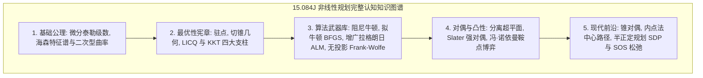

# Lec 26 非线性规划前沿扩展、流形优化与课程知识大贯通 (Extensions and Wrap-up)

> MIT 15.084J / 6.252J 非线性规划 · 讲义 26 · 授课教师：Prof. Robert Freund

## TL;DR

- 流形优化（Riemannian Optimization）将带有正交/球冠约束的优化升华至黎曼流形测地线。
- 交替方向乘子法（ADMM）以分布式算子分裂解耦大规模机器学习与图像重建。
- 全课 26 讲构筑起从微积分切空间、KKT 宪章、凸对偶几何到锥规划内点法的宏伟知识通途。

## 1. 优化理论的新疆域：黎曼流形优化（Riemannian Optimization）

在 15.084J 的终章时刻，我们站在非线性规划的最高峰，远眺现代数学优化的前沿演进。

传统的约束优化思路是：在欧氏空间 $\mathbb{R}^n$ 中行进，每走一步就用外罚法、增广拉格朗日乘子法或投影算子拼命把点拉回约束集合。
然而，在现代计算机视觉、主成分流形学习与深度学习中，约束往往具有极度光滑优美的几何流形结构：
- **Stiefel 流形（正交矩阵流形）**：$\operatorname{St}(p, n) = \{X \in \mathbb{R}^{n \times p} \mid X^T X = I_p\}$；
- **Grassmann 流形（线性子空间流形）**：所有 $p$ 维子空间构成的空间；
- **对称正定流形（SPD Manifold）**：具有黎曼度量双曲曲率的对称正定矩阵空间。

**黎曼流形优化（Optimization on Riemannian Manifolds）**颠覆了外在欧氏空间的视角：
**彻底丢弃所有的外在等式约束！把约束曲面本身视为一个弯曲的黎曼宇宙！**
1. **黎曼梯度（Riemannian Gradient）**：将欧氏梯度投影到流形当前的切空间（Tangent Space $T_x \mathcal{M}$）上；
2. **测地线收缩（Retraction）**：沿着切方向在流形上滑行，利用测地线指数映射将切向量平滑折叠回流形曲面上，实现无约束式的内生流形寻优。

## 2. 大规模分布式利器：交替方向乘子法（ADMM）

在海量工业数据时代，问题规模庞大到没有任何单台服务器能够装下全部矩阵。
斯蒂芬·博伊德（Stephen Boyd）等人复兴的**交替方向乘子法（Alternating Direction Method of Multipliers, ADMM）**，成为分布式优化领域的行业标准。

考虑目标解耦的凸优化问题：
$$\min_{x \in \mathbb{R}^n, z \in \mathbb{R}^m} \quad f(x) + g(z) \quad \text{s.t.} \quad A x + B z = c$$

构建增广拉格朗日函数：
$$\mathcal{L}_\rho(x, z, u) = f(x) + g(z) + u^T (A x + B z - c) + \frac{\rho}{2} \|A x + B z - c\|_2^2$$

ADMM 的三步更新极其灵动：
1. **$x$-极小化步**：$x_{k+1} = \arg\min_x \mathcal{L}_\rho(x, z_k, u_k)$（分布式节点并行执行）；
2. **$z$-极小化步**：$z_{k+1} = \arg\min_z \mathcal{L}_\rho(x_{k+1}, z, u_k)$（中央参数服务器汇总）；
3. **对偶乘子更新**：$u_{k+1} = u_k + \rho (A x_{k+1} + B z_{k+1} - c)$。

通过将联合优化拆分为高斯-赛德尔（Gauss-Seidel）式的两步交替轮换，ADMM 实现了**计算的完全局部化与通信的极简化**，广泛驱动着联邦学习（Federated Learning）、压缩感知与智能电网调度。

## 3. 全课大贯通与思想沉淀

回顾整个 15.084J 跨越 26 讲的壮阔旅程：
- **微观曲率**：我们在欧氏空间展开泰勒级数，用海森矩阵的特征值与瑞利商定义了山谷的平缓与险峻；
- **边界平衡**：我们从切锥的几何投影出发，推导出排除了奇异性干扰的 KKT 条件，见证了切空间与临界锥上二阶正定性的严格裁决；
- **工程解耦**：在外罚函数法条件数发散的危机面前，增广拉格朗日乘子法以有限罚参数超线性收敛力挽狂澜；Frank-Wolfe 以无投影的极点原子展示了次线性的极简智慧；
- **对偶宇宙**：在分离超平面的支撑下，斯莱特条件为我们推开了强对偶性的大门；原变量与对偶变量在冯·诺依曼的拉格朗日鞍面上达成了永恒的博弈均衡；
- **几何升维**：最终，从非负多面锥跃迁到半正定矩阵锥，我们在高维凸流形的中心路径上，以内点法和舒尔补彻底抹平了非线性的崎岖，锁定了计算复杂度的多项式圣杯。

::: insight 运筹理论的终章：用理性丈量有限世界
非线性规划是数学理性献给人类工程文明的最美礼物。
现实世界是不完美的——资源永远匮乏、设备永远受限、环境永远充满不确定性。
然而，优化理论从不向这种不完美妥协。它用严密的代数公理丈量每一寸约束边界，用对偶的影子价格为每一份稀缺要素公正加冕，用凸几何的引力通道穿透高维混沌。
走出 15.084J 的课堂，愿每一位运筹学者都能在浩瀚的工程决策宇宙中，以凸性为盾，以对偶为矛，永葆对客观规律与最优边界的崇高敬畏。
:::
