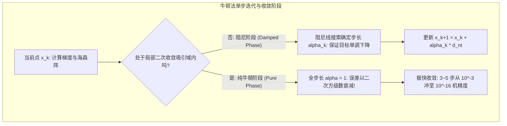

# Lec 3 牛顿法与阻尼步长：二次模型与局部二次收敛 (Newton's Method)

> MIT 15.084J / 6.252J 非线性规划 · 讲义 3 · 授课教师：Prof. Robert Freund

## TL;DR

- 牛顿法在每一步利用二阶泰勒展开构建局部二次模型并直接跃迁至其极值点。
- 纯牛顿步长无需超参数，在强凸极小点吸引子邻域内展现惊人的二次收敛率（Quadratic Convergence）。
- 远离极小点时海森不定导致方向发散，需引入 Armijo 阻尼回溯线搜索与正定修正。

## 1. 经典牛顿法的二次模型推导

在第 1 讲中，我们看到多元泰勒展开将非线性函数局部近似为二次型：
$$f(x + d) \approx m(d) = f(x) + \nabla f(x)^T d + \frac{1}{2} d^T \nabla^2 f(x) d$$

如果当前海森矩阵正定（$\nabla^2 f(x) \succ 0$），这个局部近似模型 $m(d)$ 是一个严格凸二次抛物面。我们可以直接令局部模型的导数为零，求出一步到位的最优下降向量：
$$\nabla_d m(d) = \nabla f(x) + \nabla^2 f(x) d = 0$$

由此，导出应用数学中最著名的迭代方向——**牛顿方向（Newton Direction）**：
$$d_{\text{nt}} = -\left[ \nabla^2 f(x) \right]^{-1} \nabla f(x)$$

::: definition 纯牛顿迭代法 (Pure Newton's Method)
从初始点 $x_0$ 开始，依次执行：
$$x_{k+1} = x_k + d_{\text{nt}}^{(k)} = x_k - \left[ \nabla^2 f(x_k) \right]^{-1} \nabla f(x_k)$$
:::

牛顿法拥有一个极其非凡的几何特性：**仿射不变性（Affine Invariance）**。如果对空间进行任意满秩线性坐标变换 $y = T x$，牛顿迭代在两个坐标系中的轨迹严格等价！它完全不受变量尺度不匹配（如一个变量是厘米、另一个是光年）的干扰。

## 2. 局部二次收敛定理（Local Quadratic Convergence）

当算法迭代点进入最优解 $x^*$ 附近的充分小邻域时，牛顿法展现出其他任何一阶算法无法比拟的暴力收敛速度：

::: theorem 牛顿法局部二次收敛定理
设 $f \in C^2$，在严格局部极小点 $x^*$ 处海森矩阵严格正定：$\nabla^2 f(x^*) \succeq m I > 0$，且海森矩阵在 $x^*$ 邻域内满足 Lipschitz 连续性：
$$\|\nabla^2 f(x) - \nabla^2 f(y)\| \le L \|x - y\|$$
则存在半径 $\delta > 0$，只要初始点满足 $\|x_0 - x^*\| < \delta$：
1. 纯牛顿法生成的序列 $\{x_k\}$ 严格收敛至 $x^*$；
2. 误差满足**二次收敛率（Quadratic Convergence Rate）**：
$$\|x_{k+1} - x^*\| \le \frac{L}{2m} \|x_k - x^*\|^2$$
:::

二次收敛在计算机浮点运算中意味着什么？
这意味着在收敛后期，**每迭代一步，解的有效有效数字精确位数翻一倍**！
第 1 步误差为 $10^{-2}$，第 2 步为 $10^{-4}$，第 3 步为 $10^{-8}$，第 4 步即可达到 $10^{-16}$（IEEE 双精度浮点数的硬件极限）！

## 3. 全局化与阻尼牛顿法（Damped Newton Method）

尽管纯牛顿法在收敛后期势如破竹，但在远离最优解的早期阶段，纯牛顿法极其脆弱：
1. 若海森矩阵非正定（存在负特征值），牛顿方向算出来可能是一个**上升方向**（指向极大值或鞍点）；
2. 即使海森正定，过大的步长可能直接跨过谷底，导致目标函数剧烈发散爆炸。

为了保证全局鲁棒收敛，必须引入**阻尼线搜索与海森正定修正**：

::: definition 阻尼回溯线搜索 (Backtracking Line Search with Armijo Rule)
更新方程引入步长因子 $\alpha_k \in (0, 1]$：$x_{k+1} = x_k + \alpha_k d_k$。
从 $\alpha = 1$ 出发，若当前点不满足 **Armijo 充分下降准则**：
$$f(x_k + \alpha d_k) \le f(x_k) + c_1 \alpha \nabla f(x_k)^T d_k \quad (c_1 \in (0, 0.5))$$
则按几何收缩率 $\alpha \leftarrow \rho \alpha$（$\rho \in (0, 1)$）回溯折半，直至满足准则。
同时，若海森矩阵不定，通过特征值截断或 Levenberg-Marquardt 正则化加上微小阻尼单位阵：$H_k = \nabla^2 f(x_k) + \tau I$（$\tau > 0$），强制矩阵正定。
:::

::: insight 二阶信息作为空间几何透镜
一阶梯度法只知道“脚下的哪个坡最陡”，就像一个高度近视的人在浓雾中只看脚下一米；
而牛顿法利用二阶海森矩阵，在瞬间洞悉了周围整个谷底的曲率椭圆。它用海森矩阵的逆，把扭曲狭窄的香蕉形山谷在数学上直接拉伸变形为一个完美的圆形盆地，然后一箭射向圆心。这种“用二阶曲率纠偏空间度量”的数学思想，是高阶优化最优雅的注脚。
:::
