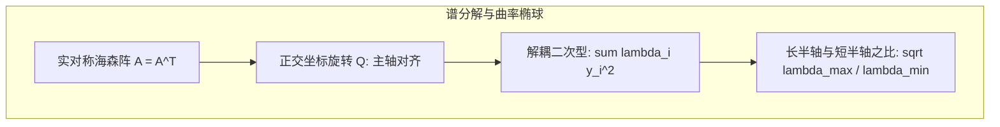

# Lec 4 二次型理论与 Rayleigh 商：特征值极值与曲率椭圆 (Quadratic Forms)

> MIT 15.084J / 6.252J 非线性规划 · 讲义 4 · 授课教师：Prof. Robert Freund

## TL;DR

- 二次型 $q(x) = x^T A x$ 将对称矩阵的特征谱几何化为高维椭球等值面。
- 瑞利商（Rayleigh Quotient）建立了二次型取值极值与最大/最小特征值的全纯对应。
- 条件数 $\kappa(A) = \lambda_{\max} / \lambda_{\min}$ 刻画了优化曲面的狭窄扁平度，决定了一阶算法的物理极限。

## 1. 对称矩阵二次型与正交谱分解

在非线性优化中，二次函数 $f(x) = \frac{1}{2} x^T A x - b^T x + c$ 不仅是多元泰勒展开的二阶近似代理，更是研究优化算法收敛极限的标准微观试验场。

设 $A \in \mathbb{R}^{n \times n}$ 为实对称矩阵（$A = A^T$）。
根据线性代数的核心谱定理（Spectral Theorem），实对称矩阵必然存在一组正交正规特征向量基 $q_1, \dots, q_n$，使得矩阵可**正交对角化**：
$$A = Q \Lambda Q^T = \sum_{i=1}^n \lambda_i q_i q_i^T$$
其中 $Q = [q_1, \dots, q_n]$ 为正交矩阵（$Q^T Q = I$），$\Lambda = \operatorname{diag}(\lambda_1, \dots, \lambda_n)$ 为实特征值对角阵，且按从小到大排序：$\lambda_{\min} = \lambda_1 \le \lambda_2 \le \dots \le \lambda_n = \lambda_{\max}$。

通过坐标系正交旋转 $y = Q^T x$（保留欧氏长度 $\|y\|_2 = \|x\|_2$），原本交织复杂的二次型被瞬间完全解耦：
$$x^T A x = (Q y)^T A (Q y) = y^T (Q^T A Q) y = y^T \Lambda y = \sum_{i=1}^n \lambda_i y_i^2$$

如果所有特征值 $\lambda_i > 0$（矩阵正定），等值面 $x^T A x = 1$ 在高维空间中是一个超椭球面，其主轴方向由特征向量 $q_i$ 严格锁定，半轴长度恰好为 $1 / \sqrt{\lambda_i}$！

## 2. 瑞利商定理（Rayleigh Quotient）

在任意非零向量 $x \ne 0$ 上，如何定量度量二次型在不同方向上的曲率拉伸？

::: definition 瑞利商 (Rayleigh Quotient)
对于对称矩阵 $A$，定义其在非零向量 $x \in \mathbb{R}^n \setminus \{0\}$ 处的**瑞利商**为：
$$R_A(x) = \frac{x^T A x}{x^T x} = \frac{x^T A x}{\|x\|_2^2}$$
:::

::: theorem 瑞利-里兹定理 (Rayleigh-Ritz Theorem)
对于实对称矩阵 $A$，瑞利商在整个空间中的取值被其最大特征值与最小特征值严格夹逼：
$$\lambda_{\min} \le R_A(x) \le \lambda_{\max}, \quad \forall x \ne 0$$
并且等号分别在对应的特征向量处严格取得：
$$\min_{x \ne 0} \frac{x^T A x}{x^T x} = \lambda_{\min} = R_A(q_1), \qquad \max_{x \ne 0} \frac{x^T A x}{x^T x} = \lambda_{\max} = R_A(q_n)$$
:::

更广义的柯朗-费雪极大极小定理（Courant-Fischer Minimax Theorem）进一步证明，中间特征值 $\lambda_k$ 可以通过在 $k$ 维子空间上的极大极小极大完全刻画。

## 3. 条件数（Condition Number）与优化几何扁平度

对于正定矩阵 $A \succ 0$，定义其**谱条件数（Condition Number）**：
$$\kappa(A) = \frac{\lambda_{\max}(A)}{\lambda_{\min}(A)} \ge 1$$

条件数在几何物理上具有极其残酷的直观解释：
- 当 $\kappa(A) = 1$ 时，所有特征值全部相等，等值线是一个完美的超球面。无论从哪里出发，负梯度方向精确直奔圆心，一阶梯度法 1 步即可完全收敛！
- 当 $\kappa(A) \gg 1$ 时（例如 $\kappa = 10^4$），等值面演变成一个极其狭窄陡峭、两端极其漫长的“细长峡谷”。沿着峡谷峭壁方向的梯度极其巨大，而沿着谷底向最优解行进的梯度极其微弱！

::: insight 谱理论揭示一阶算法的物理宿命
很多工程人员困惑于为什么最速下降法在某些问题上会发生剧烈的“之字形（Zig-zag）”横跳震荡。
二次型理论告诉我们：梯度的方向只取决于局部的坡度，而与全局最优解的真实方向无关。当条件数恶化时，最速梯度方向几乎百分之百与通往最优解的主轴互相垂直！
特征值谱分解彻底剥开了算法收敛的物理底裤：**算法收敛慢，不是算法不努力，而是问题的空间几何结构在根本上是扭曲的**。这直接催生了预条件共轭梯度法（Preconditioned CG）与牛顿矩阵缩放技术的诞生。
:::
