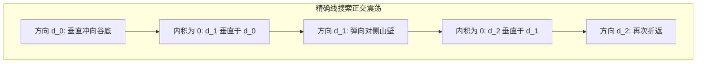

# Lec 5 最速下降梯度法与 Armijo 回溯线搜索 (Steepest Descent Method)

> MIT 15.084J / 6.252J 非线性规划 · 讲义 5 · 授课教师：Prof. Robert Freund

## TL;DR

- 最速下降法沿欧氏范数下局部一阶下降最快的负梯度方向（$-\nabla f$）前行。
- 精确线搜索导致相邻两次迭代的搜索方向严格正交垂直，产生剧烈的“之字形”震荡。
- 收敛速度被海森条件数锁定为线性收敛，阻尼 Armijo 回溯线搜索保障全局可实现性。

## 1. 局部最速方向的严谨推导

在连续优化中，最自然、直观的寻优策略是**最速下降法（Method of Steepest Descent / Gradient Descent）**，由著名数学家柯西（Augustin-Louis Cauchy）于 1847 年提出。

在当前点 $x_k$ 处，考虑沿任意单位方向 $d$（$\|d\|_2 = 1$）的前进：
$$\lim_{\alpha \to 0^+} \frac{f(x_k + \alpha d) - f(x_k)}{\alpha} = \nabla f(x_k)^T d$$
我们要寻找使得目标函数边际下降率最大的方向：
$$\min_{\|d\|_2 = 1} \quad \nabla f(x_k)^T d$$
根据柯西-施瓦茨不等式（Cauchy-Schwarz Inequality）：
$$\nabla f(x_k)^T d \ge -\|\nabla f(x_k)\|_2 \|d\|_2 = -\|\nabla f(x_k)\|_2$$
当且仅当方向向量与梯度向量反向共线时取得最小值！
因此，在标准欧氏度量下，局部最速下降方向**唯一确定为负梯度方向**：
$$d_k = -\nabla f(x_k)$$

```mermaid
flowchart LR
    A[当前点 x_k] -->|计算梯度向量| B[确定最速下降方向 d_k = -nabla f(x_k)]
    B -->|回溯线搜索 Armijo| C[确定充分下降步长 alpha_k]
    C -->|状态更新| D[x_k+1 = x_k + alpha_k * d_k]
    D -->|若梯度范数 < epsilon| E[判定收敛至驻点]
```

## 2. 精确线搜索下的相邻正交性与之字形（Zig-zagging）病态

设每一步采用**精确线搜索（Exact Line Search）**确定最优步长：
$$\alpha_k = \arg\min_{\alpha > 0} \phi(\alpha) = \arg\min_{\alpha > 0} f(x_k + \alpha d_k)$$

令导数为零：
$$\phi'(\alpha_k) = \nabla f(x_k + \alpha_k d_k)^T d_k = \nabla f(x_{k+1})^T d_k = 0$$
因为 $d_{k+1} = -\nabla f(x_{k+1})$，上述微积分极值条件立即导出一个令人哭笑不得的几何铁律：
$$d_{k+1}^T d_k = 0$$
**在精确线搜索下，任意相邻两次迭代的搜索方向必然严格正交（成 90 度直角）！**

在条件数很差的细长椭圆山谷中，算法第一步从一侧崖壁狠狠冲向谷底；到达谷底最低点后，由于下一步必须与当前方向垂直，算法只能调转 90 度折向对侧崖壁！
算法在两侧陡峭的崖壁之间以极高的频率做激烈的之字形（Zig-zag）横跳，每一步都在走弯路，向前推进的有效位移极其缓慢。



## 3. 二次型收敛定理与 Kantorovich 不等式

对于正定二次型目标函数 $f(x) = \frac{1}{2} x^T A x$，最速下降法的收敛速度被著名数学家坎托罗维奇（L. V. Kantorovich）给出的理论界严密锁定：

::: theorem 坎托罗维奇不等式与最速下降线性收敛率
设 $A$ 为对称正定矩阵，其谱条件数为 $\kappa = \lambda_{\max} / \lambda_{\min}$。
最速下降法在精确线搜索下的函数误差满足几何级数递减（线性收敛）：
$$\frac{f(x_{k+1}) - f^*}{f(x_k) - f^*} \le \left( \frac{\kappa - 1}{\kappa + 1} \right)^2$$
:::

仔细考察这个压缩因子 $\rho = \left( \frac{\kappa - 1}{\kappa + 1} \right)^2$：
- 若 $\kappa = 1$（圆形等值线）：$\rho = 0$，1 步直接命中圆心；
- 若 $\kappa = 100$（常见工业问题）：$\rho = (99/101)^2 \approx 0.9608$！每迭代一步，误差仅仅缩小不到 $4\%$！要将误差缩小 1000 倍，需要耗费上千次矩阵乘法！

::: definition 不精确线搜索：Armijo 与 Wolfe 准则
在工程实践中，绝对严禁采用精确线搜索（不仅极度耗时，还会强行诱发正交横跳）。
工业界统一采用**不精确回溯线搜索（Inexact Backtracking Line Search）**，通过维持 **Armijo 准则**（保证目标充分下降）与 **曲率准则（Curvature Condition）**：
$$\nabla f(x_k + \alpha d_k)^T d_k \ge c_2 \nabla f(x_k)^T d_k \quad (0 < c_1 < c_2 < 1)$$
迫使步长不至于过小，有效阻断了正交震荡死锁。
:::

::: insight 廉价计算与缓慢进展的工程权衡
最速下降法是计算机科学中最廉价、也最顽固的算法。
它的单步计算开销几乎为零——仅需算一次一阶梯度，无需任何矩阵分解与海森求逆，在万亿参数的大语言模型（LLM）反向传播训练中几乎是唯一具备内存可扩展性的基底算法。
然而，在经典连续优化中，必须时刻清醒认识到其线性收敛受制于条件数的物理上限。理解最速下降的缺陷，正是通往共轭梯度法（CG）与拟牛顿法（BFGS）的必由之路。
:::
