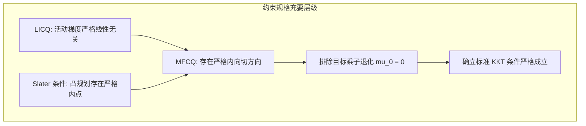

# Lec 7 约束优化最优性条件 II：KKT 条件与约束规格（LICQ / Slater） (KKT Conditions)

> MIT 15.084J / 6.252J 非线性规划 · 讲义 7 · 授课教师：Prof. Robert Freund

## TL;DR

- KKT（Karush-Kuhn-Tucker）条件是非线性不等式约束优化的最高宪章。
- 约束规格（LICQ / Slater）排除了几何奇异切锥，强制保证目标乘子 $\mu_0 = 1$。
- 四大支柱（一阶驻点、原可行性、对偶非负性、互补松弛）统领所有现代工业求解器。

## 1. 约束规格（Constraint Qualifications, CQ）的物理本质

在第 6 讲中我们看到，Fritz John 条件为了追求绝对普遍性，容忍了目标乘子 $\mu_0 = 0$ 的病态现象。但在实际运筹与工程应用中，我们必须百分之百确保：**最优性条件中必须真真切切地包含目标函数的梯度 $\nabla f(x^*)$！**

为了确保几何切锥 $T_\Omega(x^*)$ 能够被约束函数的一阶线性化切锥（Linearized Tangent Cone）完整无漏地代数重构，数学家制定了**约束规格（Constraint Qualifications, CQ）**：

::: definition 常用三大约束规格
设可行域 $\Omega = \{x \mid g_i(x) \le 0, i=1,\dots,m, \; h_j(x) = 0, j=1,\dots,l\}$，当前最优解为 $x^*$，活动集为 $A(x^*)$：
1. **线性无关约束规格 (LICQ, Linear Independence CQ)**：
   所有活动约束的梯度向量在 $x^*$ 处是**线性无关的**：
   $$\{\nabla g_i(x^*) \mid i \in A(x^*)\} \cup \{\nabla h_j(x^*) \mid j = 1,\dots,l\} \quad \text{线性无关}$$
   这是判定力最强、求解器最偏爱的规格，它保证了对偶乘子 $(\mu, \lambda)$ **存在且严格唯一**！
2. **曼加萨里安-弗罗莫维茨约束规格 (MFCQ, Mangasarian-Fromovitz CQ)**：
   等式约束梯度线性无关，且存在一个严格内向可行方向 $d$ 使得 $\nabla g_i(x^*)^T d < 0$（$\forall i \in A(x^*)$）。MFCQ 充要保证了对偶乘子集合非空且紧致有界！
3. **凸规划斯莱特条件 (Slater's Condition)**：
   若所有约束函数均为凸函数、等式均为仿射函数，只要存在一个**严格内点（Strictly Feasible Point）** $\bar{x}$ 使得：
   $$g_i(\bar{x}) < 0, \quad \forall i=1,\dots,m \quad \text{且} \quad h_j(\bar{x}) = 0$$
   则在全域任意边界点处，强约束规格必然成立！
:::

## 2. 划时代的里程碑：KKT 条件（Karush-Kuhn-Tucker）

当系统满足任意一种约束规格时，弗里茨·约翰条件中的 $\mu_0$ 必然严格为正（$\mu_0 > 0$）。将其归一化（令 $\mu_0 = 1$），我们正式迎来现代应用数学皇冠上的明珠——**KKT 条件（KKT Necessary Optimality Conditions）**！

由哈罗德·库恩（Harold Kuhn）与阿尔伯特·塔克（Albert Tucker）于 1951 年正式公布（后来发现威廉·卡鲁什 William Karush 早在 1939 年硕士论文中就已独立证明）：

::: theorem Karush-Kuhn-Tucker (KKT) 一阶必要条件
设 $x^*$ 是局部极小点，且在 $x^*$ 处满足约束规格（如 LICQ 或 Slater）。
定义拉格朗日函数（Lagrangian Function）：
$$L(x, \mu, \lambda) = f(x) + \sum_{i=1}^m \mu_i g_i(x) + \sum_{j=1}^l \lambda_j h_j(x)$$
则存在拉格朗日乘子向量 $\mu^* \in \mathbb{R}^m$ 与 $\lambda^* \in \mathbb{R}^l$，使得以下四组条件**同时成立**：
1. **驻点条件（Stationarity）**：
   $$\nabla_x L(x^*, \mu^*, \lambda^*) = \nabla f(x^*) + \sum_{i=1}^m \mu_i^* \nabla g_i(x^*) + \sum_{j=1}^l \lambda_j^* \nabla h_j(x^*) = 0$$
2. **原问题可行性（Primal Feasibility）**：
   $$g_i(x^*) \le 0, \quad \forall i = 1, \dots, m \qquad h_j(x^*) = 0, \quad \forall j = 1, \dots, l$$
3. **对偶可行性（Dual Feasibility）**：
   $$\mu_i^* \ge 0, \quad \forall i = 1, \dots, m$$
4. **互补松弛性（Complementary Slackness）**：
   $$\mu_i^* g_i(x^*) = 0, \quad \forall i = 1, \dots, m$$
:::

## 3. 凸规划中的充分性奇迹

在通用非凸优化中，KKT 条件仅仅是局部极小值的一阶**必要条件**；
然而，如果优化问题属于**凸规划（Convex Program）**（即目标函数 $f$ 为凸，所有不等式约束 $g_i$ 均为凸函数，等式约束 $h_j$ 为仿射函数），KKT 条件瞬间晋升为**充要条件（Necessary and Sufficient Condition）**！

::: theorem 凸优化 KKT 充分条件
设优化问题为凸规划。若存在三元组 $(x^*, \mu^*, \lambda^*)$ 满足上述四条 KKT 条件，则：
**$x^*$ 必然是该约束优化问题的全局最优解（Global Minimizer）！**
:::

::: example 线性规划与二次规划的 KKT 具象化
考虑带不等式的凸二次规划（QP）：$\min \frac{1}{2} x^T Q x + c^T x$ s.t. $A x \ge b, x \ge 0$。
其 KKT 驻点条件直接展开为线性互补系统（Linear Complementarity Problem, LCP）：
$Q x + c - A^T \mu - \nu = 0, \; \mu^T (A x - b) = 0, \; \nu^T x = 0$。
这展示了 KKT 如何将高度非线性的几何切平面，完全降解为可以用主元消元法求解的精巧代数联立系统！
:::

::: insight KKT 条件是运筹文明的大宪章
人类所有的现代非线性求解器（包括 SNOPT, Ipopt, KNITRO），其底层代码本质上都在日夜不停地做同一件事：**解出满足 KKT 四大条件的那个点**。
它不仅是数学分析的结晶，更是力的平衡：在物理世界中，若将物体置于约束曲面上，物体的受力（负梯度 $-\nabla f$）必然与来自各个活动壁面的支持反作用力（$\sum \mu_i \nabla g_i$）达到精准的零合力矢量平衡！互补松弛更是经济学自由度与稀缺价格的终极裁决。理解了 KKT，就掌握了支配整个约束优化宇宙的核心法典。
:::
