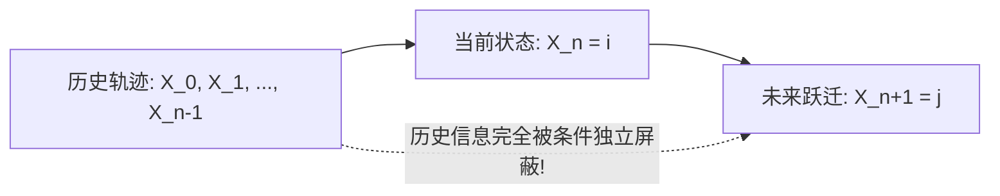

# Lec 21 离散时间马尔可夫链 I：无记忆转移与 Chapman-Kolmogorov 方程 (Markov Chains I)

> MIT 15.085J / 6.436J 概率论基础 · 讲义 21 · 授课教师：Prof. John Tsitsiklis / Devavrat Shah

## TL;DR

- 马尔可夫性质（Markov Property）确立了“未来在给定现在的条件下严格独立于过去”。
- 转移概率矩阵 $P$ 编码了离散状态空间上的全部转移动力学拓扑。
- 查普曼-科尔莫哥洛夫方程（Chapman-Kolmogorov）证明了 $n$ 步转移概率等于矩阵幂运算 $P^n$。

## 1. 过去与未来的有条件割裂：马尔可夫性（Markov Property）

在第 3 讲中我们学习了事件独立性。然而在真实物理系统（如粒子布朗扩散、棋盘走子、服务器队列调度、排队叫号）中，系统的状态显然随时间演进高度相关，完全独立的假设彻底失效。

为了在保留历史相关性的同时维持数学的可解性，俄国数学大师安德雷·马尔可夫（Andrey Markov）在 1906 年提出了划时代的**马尔可夫性质（Markov Property）**：

设随机过程 $\{X_n\}_{n \ge 0}$ 的状态空间为一个至多可数的离散集合 $S$（记状态为 $i, j, k \in S$）。

::: definition 强/弱马尔可夫链 (Markov Chain)
随机过程 $\{X_n\}_{n \ge 0}$ 称为一个**离散时间马尔可夫链（Discrete-Time Markov Chain, DTMC）**，若对任意时刻 $n \ge 0$ 以及任意状态序列 $i_0, i_1, \dots, i_{n-1}, i, j \in S$（满足条件事件概率大于零），均满足**一阶历史无记忆性**：
$$\mathbb{P}(X_{n+1} = j \mid X_n = i, \; X_{n-1} = i_{n-1}, \; \dots, \; X_0 = i_0) = \mathbb{P}(X_{n+1} = j \mid X_n = i)$$
:::

仔细品味这一定理的物理哲学：
**“现在（$X_n = i$）一旦被完全确知，未来（$X_{n+1} = j$）的状态演化，与系统是如何一步步走到现在的漫长历史（$X_0, \dots, X_{n-1}$）完全彻底独立！”**
过去的所有信息，已经被全息压缩并凝固在了当前这一瞬间的状态标签之中。

## 2. 转移概率矩阵与图拓扑表示

当转移概率不随绝对物理时间 $n$ 漂移时，称马尔可夫链是**时间齐次的（Time-Homogeneous）**：
$$p_{ij} = \mathbb{P}(X_{n+1} = j \mid X_n = i) = \mathbb{P}(X_1 = j \mid X_0 = i)$$

将所有状态之间的单步转移概率排列为矩阵，得到**随机转移矩阵（Stochastic Transition Matrix）**：
$$P = \begin{bmatrix}
p_{11} & p_{12} & \dots & p_{1M} \\
p_{21} & p_{22} & \dots & p_{2M} \\
\vdots & \vdots & \ddots & \vdots \\
p_{M1} & p_{M2} & \dots & p_{MM}
\end{bmatrix}$$

转移矩阵必须恪守两大公理刚性：
1. **元素非负**：$p_{ij} \ge 0$；
2. **行和归一（全概率行守恒）**：每一行代表从当前状态出发的所有可能去向，行和恒等于 1：
$$\sum_{j \in S} p_{ij} = 1, \quad \forall i \in S$$
满足该性质的非负方阵称为**随机矩阵（Stochastic Matrix）**。

在几何图论上，齐次马尔可夫链百分之百等价于一个**带权有向状态转移图（Directed State Graph）**：节点代表状态，有向边 $(i, j)$ 的权重代表转移概率 $p_{ij}$。

## 3. 查普曼-科尔莫哥洛夫方程（Chapman-Kolmogorov Equation）

如果系统从状态 $i$ 出发，经过 $n$ 步跳跃后到达状态 $j$，其概率是多少？
记 $n$ 步转移概率为：
$$p_{ij}^{(n)} = \mathbb{P}(X_{n+m} = j \mid X_m = i)$$

西德尼·查普曼（Sydney Chapman）与柯尔莫哥洛夫证明了随机过程的核心代数积分方程：

::: theorem 查普曼-科尔莫哥洛夫方程 (Chapman-Kolmogorov)
对于任意步数拆分 $m, n \ge 0$ 以及任意状态对 $i, j \in S$：
$$p_{ij}^{(m+n)} = \sum_{k \in S} p_{ik}^{(m)} p_{kj}^{(n)}$$
:::

证明基于全概率公式：从 $i$ 走 $m+n$ 步到达 $j$，系统在中间时刻 $m$ 必然处于某个特定的中继状态 $k \in S$。穷举所有互斥的中继状态 $k$ 并根据马尔可夫性展开条件乘积，等式立即获证。

用纯线性代数的语言审视该方程：
右端的求和式 $\sum_k p_{ik}^{(m)} p_{kj}^{(n)}$，正是矩阵乘法的标准定义！
由此，直接推导出震惊科学界的**矩阵幂定理**：

::: theorem 矩阵幂表示定理
设齐次马氏链的单步转移矩阵为 $P$。
则其 $n$ 步转移概率矩阵 $P^{(n)} = [p_{ij}^{(n)}]$ **精确等于单步转移矩阵 $P$ 的 $n$ 次代数矩阵乘方**：
$$P^{(n)} = P^n = \underbrace{P \times P \times \dots \times P}_{n \text{ 次}}$$
设初始时刻的状态概率分布行向量为 $\pi_0 = [\mathbb{P}(X_0 = 1), \dots, \mathbb{P}(X_0 = M)]$。
则第 $n$ 步后的全局概率状态分布为：
$$\pi_n = \pi_0 P^n$$
:::

::: insight 动力系统的矩阵代数解耦
马尔可夫链是概率论向线性动力系统的最高献礼。
原本随着时间推进、组合路径爆炸的无穷树状随机历史，在马尔可夫性质的提纯下，被压缩成了固定的行向量与转移矩阵的相乘。
预测系统在任意未来时刻的概率，退化为了纯粹的矩阵特征值分解（Spectral Decomposition）：$P^n = Q \Lambda^n Q^{-1}$。
这种将复杂的随机历史坍缩为状态矩阵幂运算的代数美学，是整个 Google PageRank 搜索排名与现代强化学习（MDP）的算法源泉。
:::
