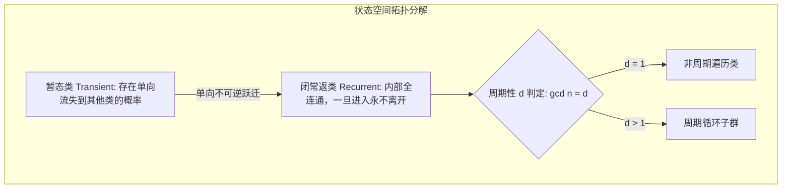

# Lec 22 离散时间马尔可夫链 II：常返、暂态与不可约分解 (Markov Chains II)

> MIT 15.085J / 6.436J 概率论基础 · 讲义 22 · 授课教师：Prof. John Tsitsiklis / Devavrat Shah

## TL;DR

- 互通关系（Communication $i \leftrightarrow j$）将状态空间严格等价划分为不相交的连通类。
- 常返状态（Recurrent）必然以概率 1 无穷多次重返，暂态（Transient）终将永远告别。
- 有限不可约马氏链的全部状态必然全为常返状态，排除了系统的渐近能量消亡。

## 1. 状态拓扑与互通类划分（Communicating Classes）

在第 21 讲中，我们建立了马尔可夫链的单步转移矩阵 $P$。然而，一个真实的复杂网络（如互联网超链接拓扑、生物基因突变图谱）内部可能包含死胡同、陷阱节点、孤立环岛与单向阀门。

为了解构马氏链的宏观骨架，必须从图论可达性建立等价关系：

::: definition 可达性与互通关系 (Communication)
1. **可达（Accessible, 记为 $i \to j$）**：若存在有限步数 $n \ge 0$，使得从状态 $i$ 出发到达 $j$ 的概率严格大于零：$p_{ij}^{(n)} > 0$；
2. **互通（Communicate, 记为 $i \leftrightarrow j$）**：若双方彼此可达，即 $i \to j$ 且 $j \to i$。
:::

数学上极易证明：**互通关系 $\leftrightarrow$ 是一个严格的等价关系（满足自反性、对称性与传递性）！**
因此，互通关系将整个状态空间 $S$ 唯一、无交集地划分为若干个**互通等价类（Communicating Classes）**。

::: definition 不可约马氏链 (Irreducible Markov Chain)
若整个状态空间 $S$ 仅包含**唯一一个互通类**（即任意两个状态 $i, j \in S$ 均可相互到达：$i \leftrightarrow j$），则称该马尔可夫链是**不可约的（Irreducible）**。
若一个类一旦进入就再也无法离开，称该类为**闭类（Closed Class）**；若闭类仅含单个状态，称为**吸收状态（Absorbing State）**。
:::

## 2. 宿命的二分法：常返性（Recurrence）与暂态性（Transience）

如果一个粒子从状态 $i$ 出发，它在未来的岁月里究竟会“一次又一次无限次地回来”，还是“迟早彻底迷失、再也不回来”？

定义粒子从状态 $i$ 出发、**首达时刻（First Hitting Time）**为：
$$T_i = \min \{n \ge 1 \mid X_n = i\}$$
定义其**终将重返状态 $i$ 的首达概率**：
$$f_{ii} = \mathbb{P}(T_i < \infty \mid X_0 = i) = \sum_{n=1}^\infty \mathbb{P}(T_i = n \mid X_0 = i)$$

根据首达概率 $f_{ii}$，马尔可夫状态被严格二分为两大截然不同的物理命运：

::: definition 常返与暂态
1. **常返状态（Recurrent State）**：若 $f_{ii} = 1$。
   即系统从 $i$ 出发，**以 $100\%$ 的确定性必然在有限时间内重返 $i$**！
   根据强马尔可夫性，一旦重返，试验从头开始；因此，系统将以概率 1 重返状态 $i$ **不可数无穷多次**（发生次数为 $+\infty$）！
2. **暂态 / 瞬态（Transient State）**：若 $f_{ii} < 1$。
   即系统每一次重返都有正概率 $1 - f_{ii} > 0$ 彻底逃逸。重返次数服从几何分布，总访问次数期望有限：
   $$\mathbb{E}[\text{访问次数} \mid X_0 = i] = \frac{1}{1 - f_{ii}} < \infty$$
   系统迟早会在某一步后，**永远告别状态 $i$，再也不回首！**
:::

::: theorem 期望访问级数判据
状态 $i$ 是常返的，当且仅当其 $n$ 步自转移概率级数**发散**：
$$\sum_{n=1}^\infty p_{ii}^{(n)} = \infty$$
状态 $i$ 是暂态的，当且仅当级数**收敛**：$\sum_{n=1}^\infty p_{ii}^{(n)} < \infty$。
:::

## 3. 类的集体性质与有限状态链的终局

常返与暂态绝不是单个孤立节点的特异功能，它是整个互通类的**集体性质（Class Property）**：

::: theorem 类性质传递定理
若状态 $i$ 与状态 $j$ 互通（$i \leftrightarrow j$）：
1. 若 $i$ 是常返的，则 $j$ **必然也是常返的**；
2. 若 $i$ 是暂态的，则 $j$ **必然也是暂态的**！
并且，它们拥有完全相同的**周期（Period）**！
:::

::: theorem 有限状态不可约链的核心定理
设马尔可夫链拥有有限个状态（$|S| < \infty$）且是不可约的。
则：**所有的状态必然百分之百全都是常返状态（Recurrent）！不可能存在任何暂态！**
:::

证明基于鸽巢原理：粒子总是在这有限个节点之间跳跃。如果所有状态都是暂态，那么在有限步之后，粒子对每一个节点的访问次数都将停滞，粒子将无处可去！因此有限不可约系统的能量永远在常返连通网络中闭环循环。

::: insight 拓扑不可逆性与热力学时间之箭
马尔可夫链的状态分类向我们展示了随机世界中微观可逆与宏观不可逆的共存：
暂态类就像物理系统中的高能亚稳态，随着时间推移，概率质量如水银泻地般单向不可逆地流泻进闭常返类；
而在常返类内部，系统又恢复了庞加莱重现（Poincaré Recurrence）的永恒轮回。
理解了常返与暂态的类分解，我们就具备了为任何高维复杂网络绘制“渐近动力学收敛图谱”的终极透视眼。
:::
