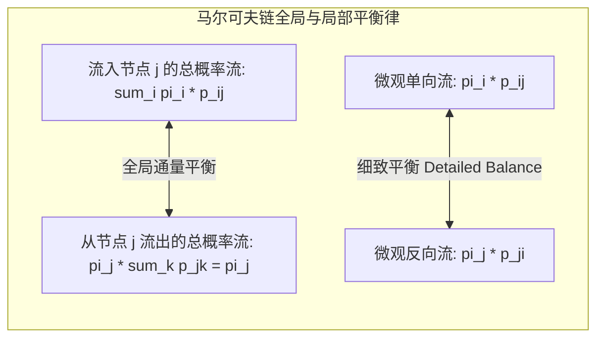

# Lec 23 离散时间马尔可夫链 III：平稳分布与大数遍历定理 (Markov Chains III: Ergodicity)

> MIT 15.085J / 6.436J 概率论基础 · 讲义 23 · 授课教师：Prof. John Tsitsiklis / Devavrat Shah

## TL;DR

- 平稳分布（Stationary Distribution）$\pi = \pi P$ 刻画了马氏链长期的全局统计平衡态。
- 细致平衡条件（Detailed Balance）是时间可逆性与 MCMC 采样算法的母体公式。
- 遍历定理（Ergodic Theorem）证明不可约非周期链的时间轨道平均严格等于空间统计期望！

## 1. 永恒的统计平衡：平稳分布（Stationary Distribution）

在第 21 讲中，系统经过 $n$ 步后的状态分布由行向量 $\pi_n = \pi_0 P^n$ 给出。
如果系统运行了足够长的时间（$n \to \infty$），这个分布是否会摆脱初始状态 $\pi_0$ 的影响，沉淀为一个恒定不变的稳态？

::: definition 平稳分布 / 不变测度 (Stationary Distribution)
概率行向量 $\pi = (\pi_1, \pi_2, \dots)$ 称为马尔可夫链的**平稳分布（Stationary Distribution / Invariant Measure）**，若满足：
1. 规范概率测度：$\pi_j \ge 0$ 且 $\sum_{j \in S} \pi_j = 1$；
2. **矩阵不动点守恒方程**：
$$\pi = \pi P \iff \pi_j = \sum_{i \in S} \pi_i p_{ij}, \quad \forall j \in S$$
:::

平稳分布的物理图像极其深刻：
若系统在时刻 0 从分布 $\pi$ 出发（即按 $\pi$ 的比例在各节点放置粒子群），那么经过一次单步随机跳转后，各个节点汇聚而来的总概率质量依然严格保持为 $\pi$！
宏观的概率流在动态平衡中实现了绝对的稳态静止。

## 2. 细致平衡条件与时间可逆性（Detailed Balance & Reversibility）

如何高效求解庞大转移矩阵的平稳分布 $\pi$？
直接解联立方程 $\pi(I - P) = 0$ 在高维时计算极其沉重。在很多物理对称系统（如热力学粒子扩散、Metropolis-Hastings 蒙特卡洛 MCMC 算法）中，系统满足更苛刻的微观对称性——**细致平衡（Detailed Balance）**：

::: theorem 细致平衡条件 (Detailed Balance Equations)
设马氏链转移矩阵为 $P$。若存在概率分布向量 $\pi$，使得对**任意两个状态对 $(i, j)$**，均满足微观双向流量等价：
$$\pi_i p_{ij} = \pi_j p_{ji}, \quad \forall i, j \in S$$
则 $\pi$ **必然是该马氏链的平稳分布（$\pi = \pi P$）**！满足细致平衡的马氏链被称为**时间可逆马尔可夫链（Time-Reversible Markov Chain）**。
:::

证明仅需对 $i$ 求和：
$$\sum_{i \in S} \pi_i p_{ij} = \sum_{i \in S} \pi_j p_{ji} = \pi_j \sum_{i \in S} p_{ji} = \pi_j \cdot 1 = \pi_j$$
全局通量守恒自发成立！

## 3. 马尔可夫大数定理：遍历极限定理（Ergodic Theorem）

马尔可夫链最震撼人类工程界的顶峰定理，是**遍历定理（The Ergodic Theorem）**与极限分布收敛定理。

首先排除周期的振荡干扰：状态 $i$ 的**周期（Period）**定义为所有可能返回步数的最大公约数 $d(i) = \gcd\{n \ge 1 \mid p_{ii}^{(n)} > 0\}$。若 $d = 1$，称该链为**非周期的（Aperiodic）**。

::: theorem 马尔可夫极限分布收敛定理
设离散马氏链是**不可约的（Irreducible）、非周期的（Aperiodic）、且存在平稳分布 $\pi$（正常返 Positive Recurrent）**。
则不论系统的初始状态 $X_0 = i$ 是什么，当时间趋向无穷大时：
1. **转移概率矩阵幂逐行收敛于平稳向量**：
$$\lim_{n \to \infty} p_{ij}^{(n)} = \pi_j, \quad \forall i, j \in S$$
即矩阵 $P^n$ 变成了一个所有行都完全相同的高秩退化矩阵！系统彻底“遗忘”了最初是从哪一个节点出发的！
2. **平均重返时间倒数律（Kac 定理）**：
   从状态 $i$ 出发首次返回 $i$ 的期望时间（Mean Recurrence Time），恰好等于平稳概率的倒数：
   $$\mathbb{E}[T_i \mid X_0 = i] = \frac{1}{\pi_i}$$
:::

::: theorem 强遍历定理 (Ergodic Theorem for Markov Chains)
在上述不可约遍历马氏链中，对于任意实值报酬函数 $f: S \to \mathbb{R}$（满足 $\sum |f(i)| \pi_i < \infty$），**时间轨道平均（Time Average）必然以概率 1 严格收敛于空间统计平均（Ensemble Space Average）**：
$$\lim_{n \to \infty} \frac{1}{n} \sum_{k=0}^{n-1} f(X_k) \xrightarrow{a.s.} \sum_{j \in S} f(j) \pi_j = \mathbb{E}_\pi[f(X)]$$
:::

这就是统计物理学中大名鼎鼎的“遍历假说（Ergodic Hypothesis）”在现代数学中的严格形式化证明！

::: insight 时间与空间的最高握手
遍历定理向我们揭示了随机过程中最不可思议的奇迹：
想要计算一个高维复杂系统在全空间稳态下的空间期望值 $\mathbb{E}_\pi[f(X)]$，你根本不需要去遍历那数以万亿计的全部状态节点；
你只需要在这个网络里放出一只随机游走的微观粒子，让它沿着时间轴漫步。只要时间足够漫长，这只粒子在时间轴上的积分平均，就会毫无误差地精准测算出全宇宙空间统计总和！
这就是整个现代贝叶斯后验计算、MCMC 采样算法与强化学习 Policy Evaluation 的理论发动机。
:::
