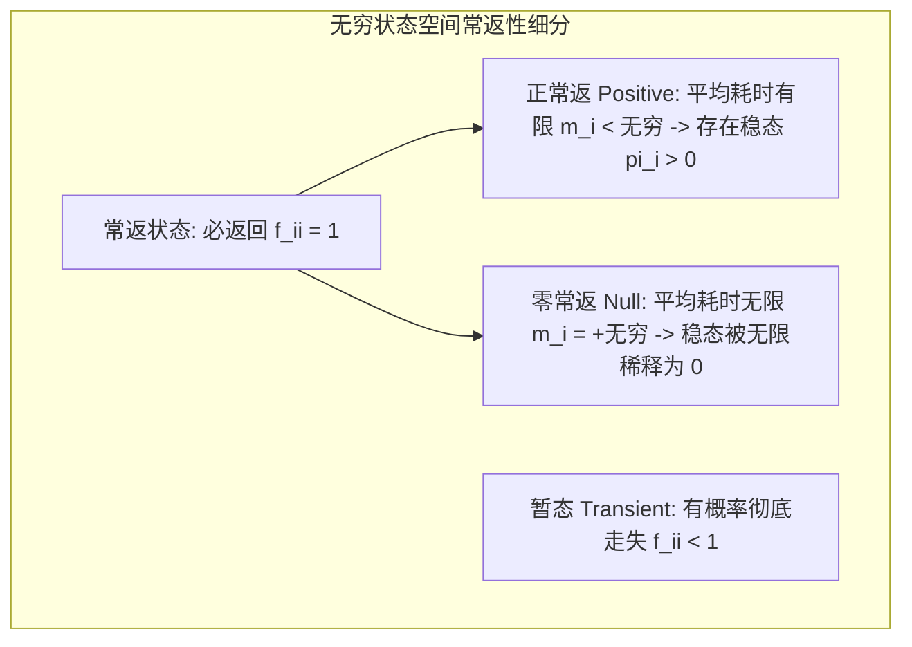

# Lec 24 可数无穷状态链与连续时间马尔可夫跳跃过程 (Infinite Chains & Continuous Time)

> MIT 15.085J / 6.436J 概率论基础 · 讲义 24 · 授课教师：Prof. John Tsitsiklis / Devavrat Shah

## TL;DR

- 可数无穷状态链孕育了零常返（Null Recurrent）怪兽：重返概率为 1 但平均返回时间为无穷大！
- 一维与二维对称随机游走是常返的（波利亚定理 Polya），三维空间逃逸为暂态。
- 连续时间马尔可夫链（CTMC）由无穷小生成元速率矩阵 $Q$ 与柯尔莫哥洛夫微分方程统治。

## 1. 无限维度的异化：零常返性（Null Recurrence）

在第 22 讲中，有限状态不可约马氏链的状态只有一种命运：全部是正常返的。
然而，当状态集合扩展至**可数无穷多个（$|S| = \infty$）**时（例如一维整数格点 $\mathbb{Z}$ 上的随机游走、银行排队系统中等待客户数 $0, 1, 2, \dots$），常返状态内部爆发了惊人的分化！

::: definition 正常返与零常返
设状态 $i$ 是常返的（$f_{ii} = 1$），定义平均首次重返时间：$m_i = \mathbb{E}[T_i \mid X_0 = i]$。
1. **正常返（Positive Recurrent）**：若平均返回时间为有限实数：$m_i < \infty$。此时存在合法的非退化平稳分布，且 $\pi_i = 1 / m_i > 0$；
2. **零常返（Null Recurrent）**：若平均返回时间为无穷大：$m_i = +\infty$！
   粒子虽然以 $100\%$ 的概率必然会返回状态 $i$，但由于状态空间无限辽阔，它在浩瀚宇宙中漫游漂泊得太远，导致**期望返回时间耗时正无穷大！** 此时系统不存在任何严格归一化的概率平稳分布（所有节点的平稳测度被无限摊薄为 0）！
:::

::: theorem 波利亚随机游走定理 (Polya's Random Walk Theorem)
考察 $d$ 维整数格点 $\mathbb{Z}^d$ 上的标准简单对称随机游走（在每个点等概率走向 $2d$ 个相邻格点）：
1. 在一维（$d=1$）和二维（$d=2$）空间中，随机游走是**零常返的（Null Recurrent）**！粒子必然无穷多次返回原点！
2. 在三维及以上（$d \ge 3$）空间中，随机游走**突变为暂态（Transient）**！粒子在三维空间中拥有正概率彻底逃逸到无穷远处，永远不再回头！
:::
数学家角谷静夫曾做出著名的诗意评述：“喝醉的人总能找到回家的路（一维与二维），但喝醉的鸟在三维天空将永远迷失。”

## 2. 连续时间马尔可夫链（Continuous-Time Markov Chains, CTMC）

将离散的时钟脉冲打碎，让状态跳跃可以在实数时间轴 $t \in [0, \infty)$ 上的任意纳秒瞬间随机发生，我们就进入了**连续时间马尔可夫链（CTMC）**。

在连续时间中，马尔可夫无记忆性要求：系统在当前状态 $i$ 停留的持续时间（Holding Time $\tau_i$），必须满足连续随机变量的唯一无记忆分布——**指数分布（Exponential Distribution）**！
$$\tau_i \sim \operatorname{Exp}(q_i)$$
其中 $q_i > 0$ 称为状态 $i$ 的**跃迁速率（Transition Rate）**。

::: definition 无穷小生成元矩阵 (Infinitesimal Generator / Q-Matrix)
定义转移速率矩阵 $Q = [q_{ij}]$：
- 对角外元素（$i \ne j$）：$q_{ij} \ge 0$，代表系统在状态 $i$ 处单位时间内跳跃到状态 $j$ 的**瞬时速率**；
- 对角线元素：$q_{ii} = -\sum_{j \ne i} q_{ij} = -q_i \le 0$，使得每一行的元素代数和恒等于 0：
$$\sum_{j \in S} q_{ij} = 0, \quad \forall i \in S$$
:::

矩阵 $Q$ 完全类似于微积分中的一阶导数算子！

## 3. 柯尔莫哥洛夫微分方程与稳态通量守恒

记连续时间的转移概率矩阵函数为 $P(t) = [p_{ij}(t)]$，其中 $p_{ij}(t) = \mathbb{P}(X_t = j \mid X_0 = i)$。
柯尔莫哥洛夫推导出了著名的矩阵微分动力学系统：

::: theorem 柯尔莫哥洛夫微分方程 (Kolmogorov Differential Equations)
1. **正向微分方程（Forward Equation）**：
$$\frac{d P(t)}{dt} = P(t) Q$$
2. **反向微分方程（Backward Equation）**：
$$\frac{d P(t)}{dt} = Q P(t)$$
在初值 $P(0) = I$ 下，解为标准的**矩阵指数映射（Matrix Exponential）**：
$$P(t) = e^{Q t} = I + Q t + \frac{Q^2 t^2}{2!} + \dots$$
:::

对正向方程两边令 $t \to \infty$（此时导数 $\frac{d\pi}{dt} = 0$ 达到平衡），立即导出连续时间马氏链的**稳态代数平衡方程**：
$$\pi Q = 0 \quad \text{且} \quad \sum_{j \in S} \pi_j = 1$$
其分量展开形式极其优雅：
$$\sum_{i \ne j} \pi_i q_{ij} = \pi_j q_j$$
**流入节点 $j$ 的瞬时绝对概率速率总和，精确等于从节点 $j$ 流出的瞬时绝对概率速率总和！**
这就是统领整个现代通信排队论（$M/M/1, M/M/k$ 队列模型）的底层主干方程。

::: insight 速率微元化解了离散步长的桎梏
从离散步长跃迁至连续时间，是随机过程从差分方程向微分方程的大跃进。
无穷小生成元 $Q$ 将复杂的矩阵乘方 $P^n$ 提炼为了李代数切空间中的无穷小流动 $e^{Qt}$。
无论是电话网络呼叫的泊松到达、高频订单薄在微秒级的成交撮合、还是生物种群的生死跃迁过程（Birth-Death Process），连续时间马氏链用一组优雅的线性微分系统，完美捕获了物理世界流体般的随机脉动。
:::
