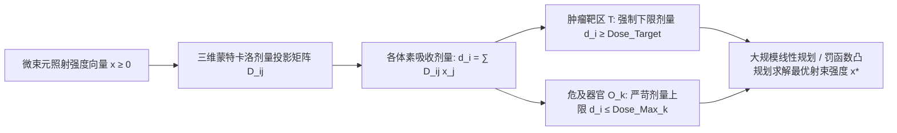

# Lec 1 放射治疗中的优化建模与计算前沿 (Radiation Therapy Optimization and Computation)

> MIT 15.094J 鲁棒系统优化建模与计算 (Systems Optimization: Models and Computation) · 授课教师：Prof. Dimitris Bertsimas / Robert Freund

## TL;DR

- 调强放射治疗（IMRT）通过逆向辐射剂量规划将肿瘤消融与周围健康危及器官保护统一建模。
- 束流段强度（Bixels）与剂量投影矩阵展现了数万级稠密矩阵的大规模线性与凸优化挑战。
- 多准则 Pareto 最优曲面为肿瘤靶区致死剂量与周围危及器官组织耐受极限提供了权衡决断。

## 医疗健康中的运筹计算前沿

在现代医学物理与肿瘤放射肿瘤学中，调强放射治疗（Intensity-Modulated Radiation Therapy, IMRT）被公认为 20 世纪下半叶最重要的医疗技术革命之一。

传统的放射治疗采用简单的均匀辐射野，高能 X 射线光子在穿透人体杀伤深层肿瘤组织的同时，无可避免地会对沿途经过的正常健康人体组织、脊髓、心脏及视神经造成严重的辐射损伤，导致放疗并发症甚至器官功能衰竭。
IMRT 的核心思想是**逆向治疗规划（Inverse Treatment Planning）**：
临床医生首先在 CT 三维断层扫描切片上圈定肿瘤靶区（Tumor Volume, PTV）以及周围的关键危及器官（Organs at Risk, OAR）；随后借助运筹数学规划算法，倒推计算出医用直线加速器（LINAC）多叶准直器（MLC）在各个射束入射角度下的最佳微束流强度分布！

麻省理工学院 15.094J（跨院系代码与新加坡-MIT 联盟 SMA 5223 联合开设）开篇即以放射治疗这一拯救生命的崇高应用，展开大规模系统优化建模与计算的大门。

## 逆向辐射剂量物理与数学表述

人体内部被三维离散化为成千上万个微观立方体体素（Voxels $i \in \mathcal{V}$）。
体素被严格划分为两类互斥集合：
- $\mathcal{T} \subset \mathcal{V}$：肿瘤靶区体素集合（Target Voxels）；
- $\mathcal{O}_k \subset \mathcal{V}$：第 $k$ 个危及器官体素集合（如脑干、脊髓、直肠壁，危及器官类 $k = 1, \dots, K$）。

直线加速器从 $B$ 个不同空间角度发射高能射线束，每束射线被多叶准直器细分为数千个微射线束元（Beamlets / Bixels $j \in \mathcal{B}$）。
- **决策变量**：$x_j \ge 0$ 表示微束元 $j$ 的辐射照射强度（Beamlet Intensity）。
- **剂量转移矩阵（Dose Deposition Matrix）**：$D_{ij} \ge 0$ 表示单位强度的微束元 $j$ 在体素 $i$ 中沉降的物理辐射剂量（单位：Gy，通过蒙特卡洛光子输运模拟离线预计算得到）。
体素 $i$ 接受到的实际物理吸收总剂量为严格的线性叠加：
$$
d_i(x) = \sum_{j \in \mathcal{B}} D_{ij} x_j = (D x)_i
$$

## 剂量容积直方图与约束转化 (Dose-Volume Constraints)

临床医生不仅要求单点最高剂量，更关切**剂量容积直方图（Dose-Volume Histogram, DVH）**：例如“危及器官中受照射剂量超过 45 Gy 的组织体积比例不得超过 20%”。
这种体积百分比约束在数学上属于极其复杂的 0-1 混合整数逻辑。
在实际临床高速逆向规划中，为了在数分钟内完成优化，通常将其转化为**分段线性凸罚函数规划**：

$$
\begin{aligned}
\min_{x \ge 0} \quad & F(x) = \sum_{i \in \mathcal{T}} w_i \left(\max(0, L_i - d_i(x))\right)^2 + \sum_{i \in \mathcal{T}} w_i' \left(\max(0, d_i(x) - U_i)\right)^2 \\
& + \sum_{k=1}^K \sum_{i \in \mathcal{O}_k} w_{k, i} \left(\max(0, d_i(x) - U_k^{\text{OAR}})\right)^2
\end{aligned}
$$
其中 $L_i, U_i$ 为肿瘤靶区的处方剂量下限与上限，$U_k^{\text{OAR}}$ 为危及器官的最大容许耐受阈值。
通过引入辅助变量，该凸二次规划可以直接无损转化为大型二次规划（QP）或高效连续内点法求解！

## 大规模计算挑战：稀疏性与内存压缩

该模型的规模极其惊人：体素数量 $|\mathcal{V}|$ 通常在 $10^5$ 到 $10^6$ 级别，微束元数量 $|\mathcal{B}|$ 在 $10^4$ 级别。
完整的剂量矩阵 $D$ 包含数十亿个浮点数，完全存放在计算机内存中需要数十 GB，普通的通用求解器会直接爆内存。
MIT 团队揭示了算法加速的两大物理几何洞察：
1. **空间截断与稀疏化（Spatial Truncation）**：微束元只对其几何射束锥体及微小侧向散射邻域内的体素产生非零剂量，将微小散射剂量（$< 10^{-4}$）安全置零后，矩阵稀疏度可达 98% 以上；
2. **多叶准直器叶片行进几何约束（MLC Leaf Sequencing）**：求出连续束流强度 $x^*$ 后，必须将其分解为满足叶片物理运动速度、相邻叶片防碰撞与互锁咬合的离散时间切片开闭序列。

::: pitfall 忽视病人器官呼吸微小位移导致脱靶
在肺部与肝脏放疗中，患者的呼吸运动会导致肿瘤与危及器官产生数厘米的三维周期性位移。若采用确定性优化，极度陡峭的高剂量边缘会在位移瞬间错杀正常组织并造成肿瘤脱靶。现代高端 IMRT 必须结合**四维 CT（4D-CT）与鲁棒不确定集优化（Robust Optimization）**。
:::

::: insight 运筹算法是临床医生手术刀上的数学准星
在放射肿瘤科的暗室里，数学规划不再是纸面上的冷冰冰定理，而是直接决定一位癌症患者生存几率与术后生活质量的生命之绳。
**通过将数百万微观体素的辐射生化反应严谨投射为高维凸多面体，优化算法在纳米尺度上为光子束流绘制出了最精密的击杀弹道**。这种将运筹学用于守护人类生命健康的实践，彰显了应用数学最崇高的神圣尊严。
:::
