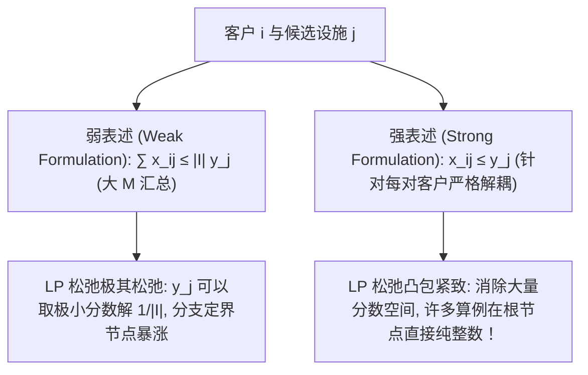

# Lec 10 供应链分销系统规划与多级选址模型 (Facility Location and Distribution Systems)

> MIT 15.094J 鲁棒系统优化建模与计算 (Systems Optimization: Models and Computation) · 授课教师：Prof. Dimitris Bertsimas / Robert Freund

## TL;DR

- 多级分销系统规划统筹工厂、中央枢纽（Hubs）与前置配送中心的网络拓扑。
- 未限制产能（UFL）与带产能限制（CFL）选址问题展示了强弱松弛表述的巨大收敛差异。
- 聚集效应（Agglomeration）与枢纽位置模型（Hub Location）刻画了客运与货运网络轴辐结构（Hub-and-Spoke）。

## 大陆级实体经济的物流骨架映射

在现代全球制造与跨国零售帝国（如亚马逊、沃尔玛、苹果供应链）的运营架构中，每年数十万亿元货值的商品在地理空间中高速穿梭。
分销系统的网络拓扑结构（Distribution Network Topology），直接决定了企业营运资本的沉淀规模与客户履约交付时效：
- 若设施数量太少，虽然建厂固定折旧资产极低，但干线与末端配送距离漫长，客户收货需要等待数日；
- 若设施过度密集铺设，虽然实现了“半日达”甚至“小时达”，但海量仓库的固定租金与安全库存将迅速拖垮集团现金流。

麻省理工学院 15.094J 聚焦**多级设施选址（Multi-Echelon Facility Location）与枢纽轴辐网络（Hub-and-Spoke Networks）**的运筹建模与大规模求解。

## 经典设施选址模型的强弱表述对决

设存在候选分拨中心集合 $\mathcal{J}$（开办固定成本为 $f_j$），客户需求点集合 $\mathcal{I}$（需求量为 $d_i$）。
从设施 $j$ 向客户 $i$ 配送单位货物的运费为 $c_{ij}$。
定义决策变量：
- $y_j \in \{0, 1\}$：是否在地点 $j$ 建设设施；
- $x_{ij} \in [0, 1]$：客户 $i$ 的需求由设施 $j$ 履约供应的比例。

### 1. 弱表述模型 (Weak Formulation)
$$
\begin{aligned}
\min \quad & \sum_{j \in \mathcal{J}} f_j y_j + \sum_{i \in \mathcal{I}} \sum_{j \in \mathcal{J}} d_i c_{ij} x_{ij} \\
\text{s.t.} \quad & \sum_{j \in \mathcal{J}} x_{ij} = 1, \quad \forall i \in \mathcal{I} \\
& \sum_{i \in \mathcal{I}} x_{ij} \le |\mathcal{I}| y_j, \quad \forall j \in \mathcal{J} \quad (\text{大 M 汇总汇总约束}) \\
& y_j \in \{0, 1\}, \quad x_{ij} \ge 0
\end{aligned}
$$

### 2. 强表述模型 (Strong Formulation)
将汇总约束彻底粉碎，为**每一对具体的客户与设施**建立微观排他约束：
$$
x_{ij} \le y_j, \quad \forall i \in \mathcal{I}, \forall j \in \mathcal{J}
$$

::: theorem [强表述在多面体几何上的绝对降维打击]
虽然强表述将约束数量从 $|\mathcal{J}|$ 条增加到了 $|\mathcal{I}| \times |\mathcal{J}|$ 条，但它在连续 LP 松弛空间的几何表现发生了质的飞跃：
在弱表述中，只要某个设施开通比例 $y_j = \frac{1}{|\mathcal{I}|}$，就能放行该设施为全网所有客户供货，导致连续松弛下界极其虚高松散；
而在强表述中，若客户要从设施 $j$ 获得全部供应（$x_{ij} = 1$），$y_j$ 必须硬性取值为 $1$！
**强表述的连续松弛多面体极点极其贴近真正的纯整数凸包，现代商用求解器在强表述下求解数千个城市的选址问题通常比弱表述快上万倍！**
:::

## 枢纽轴辐式网络设计 (Hub-and-Spoke Networks)

在航空客运网络（如达美航空以亚特兰大为枢纽、汉莎航空以法兰克福为枢纽）与快递干线网络（如 FedEx 孟菲斯超级枢纽、顺丰鄂州枢纽）中，物流与人流并非在任意两个城市之间直接开通直达航班，而是采用**轴辐式架构（Hub-and-Spoke）**。

所有的支线流量（Spoke Flows）首先汇聚到少数几个巨型核心枢纽（Hubs），在枢纽之间利用大型宽体货机或万吨列车进行**满载干线转运（规模经济折让系数 $\alpha \in (0, 1)$）**，再由枢纽分拨至最终目的地。

设 $w_{ij}$ 为从起源地 $i$ 到目的地 $j$ 的总运输量。
选定 $p$ 个城市作为核心枢纽（$p$-Hub Median Problem）。
定义指派决策 $z_{ik} = 1$（若支线城市 $i$ 连接至核心枢纽 $k$）。
任意一对城市 $(i, j)$ 之间的单位运输成本为：
$$
C_{ijk m} = c_{ik} + \alpha c_{km} + c_{mj}
$$
其中 $k, m$ 分别为 $i$ 与 $j$ 所接入的核心枢纽。
模型通过二次分配逻辑，不仅决定**哪 $p$ 个城市升格为超级枢纽**，更统筹优化了全网数百万条航线的转运路由组合。

::: pitfall 忽视枢纽拥堵引起的非线性排队延误
在轴辐网络中，随着全网流量疯狂向少数几个核心枢纽聚集，枢纽机场跑道与分拣中心极易陷入严重的非线性排队拥堵（Congestion Delays）。如果模型只考虑干线规模经济 $\alpha$ 而没有对枢纽施加非线性排队拥堵惩罚，算出的最优方案在实际运营中会频繁发生大面积航班延误与快件瘫痪。
:::

::: insight 选址是制造网络空间拓扑的凝固
厂房与枢纽一旦选址浇筑水泥，就将在未来数十年内成为不可逆的物理现实。
多级选址模型向我们展示：**最优秀的供应链设计，绝不是孤立地追求某个仓库的地价便宜，而是从全局空间网络几何的角度，将固定资本开支、干线规模经济与末端时效在多面体凸包中做最精妙的对角线平衡**。这是运筹学在地理经济学中最深刻的印记。
:::
