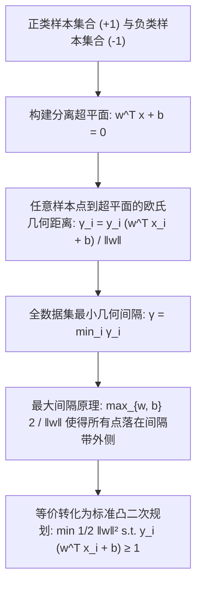

# Lec 12 模式分类与线性可分支持向量机 (Pattern Classification: Linearly Separable SVMs)

> MIT 15.094J 鲁棒系统优化建模与计算 (Systems Optimization: Models and Computation) · 授课教师：Prof. Dimitris Bertsimas / Robert Freund

## TL;DR

- 支持向量机（SVM）将模式分类问题转化为寻找最大几何间隔（Maximum Margin）分离超平面。
- 几何间隔与代数权向量二范数倒数成正比、直接导出凸二次规划（QP）标准型。
- KKT 互补松弛条件严格证明了只有极少数落于边界上的支持向量（Support Vectors）真正决定决策边界。

## 机器学习与数学规划的惊人汇合

在 1990 年代以前，计算机科学中的人工智能（主要是人工神经网络）与应用数学中的运筹数学规划被视为两条平行演进、互不交集的学术轨道。
然而，弗拉基米尔·瓦普尼克（Vladimir Vapnik）在统计学习理论（Statistical Learning Theory）的基础上创立的**支持向量机（Support Vector Machines, SVM）**，以前所未有的数学纯度，在机器学习与凸二次规划之间搭建起了一座震撼世界的宏伟桥梁。

麻省理工学院 15.094J 将数据驱动的分类问题直接置于凸多面体几何的聚光灯下：**分类器的泛化能力，本质上就是寻找两个凸包之间具有最大几何分离间隙的黄金超平面！**

## 几何间隔与最大化间隔原理 (Maximum Margin)

设给定训练样本集 $\mathcal{D} = \{(x_i, y_i)\}_{i=1}^n$，其中特征向量 $x_i \in \mathbb{R}^d$，类别标签为二分类离散值 $y_i \in \{-1, +1\}$。
定义超平面方程为：
$$
w^T x + b = 0
$$
其中 $w \in \mathbb{R}^d$ 为超平面的法向量，$b \in \mathbb{R}$ 为截距偏置项。

如果训练数据集是**线性可分的（Linearly Separable）**，意味着存在超平面能够将正类与负类样本毫无错误地完全隔开。
然而，能够完美切开样本的超平面有不可数无穷多个！
- 哪一个超平面才是最优秀的？
- 哪一个超平面对未来未见过的未知测试样本具有最强的抗噪泛化能力？

根据统计学习结构风险最小化准则（SRM），超平面的抗震荡泛化误差界直接取决于其两侧的**几何安全间隔（Geometric Margin）**：
任意点 $x_i$ 到超平面的欧几里得垂直距离为：
$$
\text{dist}(x_i, H) = \frac{|w^T x_i + b|}{\|w\|_2} = \frac{y_i (w^T x_i + b)}{\|w\|_2}
$$
我们希望最大化所有样本点中距离超平面最近的那一个点的距离（即最大化最小边际间隔 $\gamma$）：
$$
\max_{w, b} \quad \min_{i=1, \dots, n} \frac{y_i (w^T x_i + b)}{\|w\|_2}
$$

## 标准凸二次规划 (QP) 等价变换

注意到：将超平面方程两边同乘以任意正标量 $k > 0$，超平面本身在几何空间中毫无变化。
我们对法向量施加规范化缩放（Canonical Scaling），强制要求距离超平面最近的样本点满足：
$$
\min_{i=1, \dots, n} y_i (w^T x_i + b) = 1
$$
此时，正负样本边界线被精确锁定在：
$$
w^T x + b = +1 \quad (\text{正类边界})
$$
$$
w^T x + b = -1 \quad (\text{负类边界})
$$
两边界线之间的总物理间隔宽度为：
$$
\text{Margin} = \frac{1 - (-1)}{\|w\|_2} = \frac{2}{\|w\|_2}
$$
**最大化物理间隔 $\frac{2}{\|w\|_2}$，在数学上严格等价于最小化其倒数的平方 $\frac{1}{2}\|w\|_2^2$！**

由此推导出标准**硬间隔支持向量机二次规划（Hard-Margin SVM QP）**：
$$
\begin{aligned}
\min_{w, b} \quad & \frac{1}{2} w^T w = \frac{1}{2}\|w\|_2^2 \\
\text{s.t.} \quad & y_i (w^T x_i + b) \ge 1, \quad \forall i = 1, \dots, n
\end{aligned}
$$
目标函数是严格凸二次型，约束是线性不等式，这是一个拥有全局唯一最优解的标准凸规划！

## KKT 条件与支持向量的诞生

为每个样本约束指定拉格朗日乘子 $\alpha_i \ge 0$。拉格朗日函数为：
$$
\mathcal{L}(w, b, \alpha) = \frac{1}{2} w^T w - \sum_{i=1}^n \alpha_i \left[y_i (w^T x_i + b) - 1\right]
$$
根据我们在第 23 讲推导的 KKT 一阶平稳性条件：
$$
\nabla_w \mathcal{L} = w - \sum_{i=1}^n \alpha_i y_i x_i = 0 \implies w^* = \sum_{i=1}^n \alpha_i y_i x_i
$$
$$
\frac{\partial \mathcal{L}}{\partial b} = -\sum_{i=1}^n \alpha_i y_i = 0 \implies \sum_{i=1}^n \alpha_i y_i = 0
$$

考察至关重要的**互补松弛性（Complementary Slackness）**：
$$
\alpha_i \left[y_i (w^T x_i + b) - 1\right] = 0, \quad \forall i = 1, \dots, n
$$
这导致了一个震撼人类机器学习史的伟大代数事实：
- **对于绝大多数远离边界的样本点**：$y_i (w^T x_i + b) > 1$，由互补松弛性，其乘子**必须严格为零**：$\alpha_i = 0$！
- **只有那些极其濒临危险、紧紧贴在间隔带边界上的极少数最关键样本点**：$y_i (w^T x_i + b) = 1$，其乘子才能严格为正：$\alpha_i > 0$！

::: definition [支持向量 (Support Vectors)]
那些对应乘子 $\alpha_i > 0$ 的极少数样本点 $x_i$，被称为**支持向量（Support Vectors）**！
由 $w^* = \sum_{i \in \text{SV}} \alpha_i y_i x_i$ 可知：
**全宇宙整个高维分类超平面的法向量，完完全全只由这几个极少数的支持向量单独决定！**
即使我们在数据集中随意删除或新增上百万个远离边界的普通样本点，最终的分类超平面都不会发生一丝一毫的移动！
:::

::: pitfall 忽视训练样本存在离群点（Outliers）导致硬间隔无可行解
若数据集中存在噪声或正负类别发生重叠，硬间隔约束 $y_i(w^T x_i + b) \ge 1$ 会导致可行域为空（`INFEASIBLE`）。这正是下一讲必须引入松弛变量软间隔（Soft-Margin）的根本原因。
:::

::: insight 支持向量是高维模式识别中最极致的稀疏代表
在海量大数据时代，人们容易被数以亿计的样本数据淹没。
支持向量机展现了令人屏息的数学纯净度：**大自然并不关心那 99.9% 毫无争议的平庸平庸数据，它把所有的战略注意力与判定杠杆，全部聚焦在正负两派阵营交火最激烈的锋线哨兵（支持向量）身上**。这种极致的稀疏性，正是凸对偶理论赋予机器学习的最高礼物。
:::
