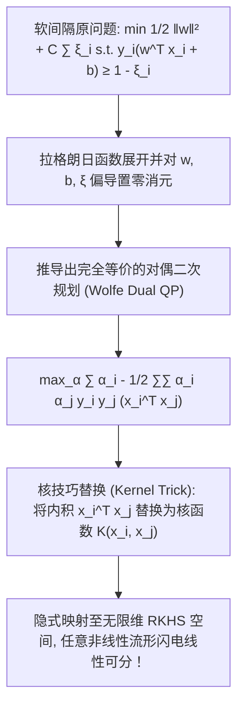

# Lec 13 模式分类与二次规划：软间隔与对偶核映射 (Pattern Classification and Quadratic Problems)

> MIT 15.094J 鲁棒系统优化建模与计算 (Systems Optimization: Models and Computation) · 授课教师：Prof. Dimitris Bertsimas / Robert Freund

## TL;DR

- 软间隔引入松弛变量（Slack Variables）容忍不可避免的离群样本与重叠噪声。
- 对偶二次规划将原空间复杂的显式特征内积转化为纯粹的核矩阵（Kernel Matrix）评估。
- Mercer 定理严格保证了高维乃至无限维再生核希尔伯特空间（RKHS）的隐式无损嵌入。

## 走出理想国：面对不可分世界与噪声冲击

在上一讲中，线性硬间隔支持向量机展现了纯粹的几何对称之美。
然而，在现实工业级工业大数据与生物医学分类中，**数据几乎永远不可能是严格线性可分的**：
- 传感器采集存在不可避免的测量随机高斯噪声与离群坏点（Outliers）；
- 正负样本在原始特征空间中呈现复杂的非线性交织分布（例如环形分布或多峰流形）。

面对这种现实，如果坚守硬间隔，模型将直接报错无解；如果强行用复杂的超高维多项式过度拟合，又会引发灾难性的**过拟合（Overfitting）**。
瓦普尼克与科尔纳（Cortes & Vapnik, 1995）通过引入**软间隔松弛（Soft Margin）**与**核方法技巧（Kernel Trick）**，彻底奠定了现代非线性模式识别的完整大厦。

## 软间隔二次规划与松弛变量 (Soft-Margin SVM)

为了容忍不可分样本与离群噪点，我们为每一个训练样本 $i$ 引入一个非负**松弛变量（Slack Variable）** $\xi_i \ge 0$：
$$
y_i (w^T x_i + b) \ge 1 - \xi_i, \quad \forall i = 1, \dots, n
$$
物理意义极其直观：
- 若 $\xi_i = 0$：样本点完全落在正确的安全间隔带之外（完美分类）；
- 若 $0 < \xi_i \le 1$：样本点虽然落在了间隔带内部，但依然位于超平面正确的一侧；
- 若 $\xi_i > 1$：样本点彻底穿透超平面，发生了**实际误分类（Misclassification）**！

我们在目标函数中权衡两大事项：**最大化几何间隔（$\frac{1}{2}\|w\|^2$）**与**惩罚松弛误差总和（$\sum \xi_i$）**：

标准软间隔**C-SVM 二次规划原问题（Primal Problem）**：
$$
\begin{aligned}
\min_{w, b, \xi} \quad & \frac{1}{2} w^T w + C \sum_{i=1}^n \xi_i \\
\text{s.t.} \quad & y_i (w^T x_i + b) \ge 1 - \xi_i, \quad \forall i = 1, \dots, n \\
& \xi_i \ge 0, \quad \forall i = 1, \dots, n
\end{aligned}
$$
其中惩罚参数 $C > 0$ 调节了结构风险与经验风险的博弈：$C$ 越大，对误分类的惩罚越严苛（边界越硬）；$C$ 越小，容忍更多微小误差，间隔带越宽阔稳健。

## Wolfe 对偶二次规划与盒式约束 (Box Constraints)

构建拉格朗日函数，引入乘子 $\alpha_i \ge 0$ 与 $\mu_i \ge 0$：
$$
\mathcal{L}(w, b, \xi, \alpha, \mu) = \frac{1}{2}\|w\|^2 + C \sum_{i=1}^n \xi_i - \sum_{i=1}^n \alpha_i [y_i(w^T x_i + b) - 1 + \xi_i] - \sum_{i=1}^n \mu_i \xi_i
$$
分别对原变量求偏导置零：
$$
\nabla_w \mathcal{L} = 0 \implies w = \sum_{i=1}^n \alpha_i y_i x_i
$$
$$
\frac{\partial \mathcal{L}}{\partial b} = 0 \implies \sum_{i=1}^n \alpha_i y_i = 0
$$
$$
\frac{\partial \mathcal{L}}{\partial \xi_i} = 0 \implies C - \alpha_i - \mu_i = 0 \implies \alpha_i \le C \quad (\text{因为 } \mu_i \ge 0)
$$
将上述关系代回拉格朗日函数消去原变量，即得出著名的**SVM 对偶二次规划（Dual QP）**：

::: theorem [SVM Wolfe 对偶二次规划标准型]
$$
\begin{aligned}
\max_{\alpha} \quad & Q(\alpha) = \sum_{i=1}^n \alpha_i - \frac{1}{2} \sum_{i=1}^n \sum_{j=1}^n \alpha_i \alpha_j y_i y_j \langle x_i, x_j \rangle \\
\text{s.t.} \quad & \sum_{i=1}^n \alpha_i y_i = 0 \\
& 0 \le \alpha_i \le C, \quad \forall i = 1, \dots, n \quad (\text{盒式边界约束 Box Constraints})
\end{aligned}
$$
:::

### 对偶表述的惊天优势
仔细观察对偶目标函数：**原始样本特征向量 $x_i$ 竟然完完全全只以两两点积（Inner Product $\langle x_i, x_j \rangle$）的形式出现！**
这直接催生了改变现代人工智能版图的核技巧。

## 核方法技巧与 Mercer 定理 (The Kernel Trick)

若原始空间 $\mathbb{R}^d$ 线性不可分，我们可以通过一个非线性映射 $\phi(x): \mathbb{R}^d \to \mathcal{H}$ 将样本投射到一个极高维乃至无限维的特征 Hilbert 空间 $\mathcal{H}$ 中，使得样本在高维空间中变得完全线性可分。

然而，在高维空间中直接计算显式坐标 $\phi(x)$ 会发生维度爆炸。
**核技巧的核心**：我们根本不需要知道高维映射 $\phi(x)$ 的具体解析公式，只要定义一个**核函数（Kernel Function）** $K(x, z)$，使其等于高维空间的内积：
$$
K(x, z) = \langle \phi(x), \phi(z) \rangle_{\mathcal{H}}
$$

::: theorem [Mercer 充要定理 (Mercer's Theorem)]
一个连续对称核函数 $K: \mathbb{R}^d \times \mathbb{R}^d \to \mathbb{R}$ 能够对应某个高维 Hilbert 空间中的合法内积，**当且仅当对于任意有限样本点集，其核矩阵（Gram Matrix）$G_{ij} = K(x_i, x_j)$ 是半正定矩阵（Positive Semidefinite, PSD）**！
:::

常用经典核函数：
1. **高斯径向基核（RBF / Gaussian Kernel）**：
$$
K(x, z) = \exp\left(-\gamma \|x - z\|^2\right)
$$
它在数学上对应了一个**无限维的再生核希尔伯特空间（RKHS）**！
2. **多项式核（Polynomial Kernel）**：$K(x, z) = (x^T z + c)^d$。

分类器对新未知测试样本 $x$ 的预测公式瞬间化为极简求和：
$$
f(x) = \text{sign}\left(\sum_{i \in \text{SV}} \alpha_i y_i K(x_i, x) + b\right)
$$

::: pitfall 盲目设置过大的 RBF 宽度参数 γ 导致过拟合
若将高斯核参数 $\gamma$ 设得过大，每个支持向量周围的高斯基函数将退化为极窄的“针尖”，使得模型在训练集上达到 100% 精度，而在测试集上彻底失去泛化能力。超参数 $(C, \gamma)$ 必须通过严谨的 K-折交叉验证（Cross-Validation）联合网格搜索。
:::

::: insight 核技巧是在无限维空间中优雅漫步的代数魔术
如果有人告诉你：他可以在包含无穷多个坐标的无限维空间中做几何切割，同时每一步计算只需要纳秒级的算力，普通人会认为这是天方夜谭。
而支持向量机与核方法证实了这一数学奇迹：**通过将对偶二次规划与 Mercer 半正定核无缝嵌套，运筹学让我们无需真正涉足无限维度的恐怖深渊，只需在低维空间轻轻计算一个指数点积，就完成了对无限高维非线性世界的完美主宰**。
:::
