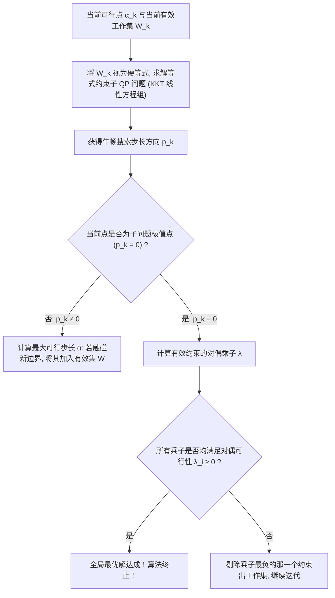
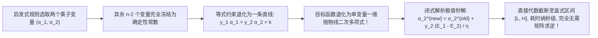

# Lec 14 大规模二次优化求解算法：有效集与原对偶内点法 (Solution Methods for Large-Scale Quadratic Optimization)

> MIT 15.094J 鲁棒系统优化建模与计算 (Systems Optimization: Models and Computation) · 授课教师：Prof. Dimitris Bertsimas / Robert Freund

## TL;DR

- 大规模二次规划（QP）面临半正定稠密 Gram 矩阵带来的内存与求逆计算瓶颈。
- 有效集法（Active-Set Methods）通过动态维护活动约束工作集实现有限步极值跳跃。
- 原对偶内点法（Primal-Dual IPM）与 SMO 分解算法构成了驱动工业级支持向量机的高效算力引擎。

## 驱动机器学习的大规模二次优化引擎

在前面两讲中，我们推导出了软间隔支持向量机与核方法的标准二次规划对偶形式：
$$
\min_{\alpha} \quad \frac{1}{2}\alpha^T Q \alpha - \mathbf{1}^T \alpha \quad \text{s.t.} \quad y^T \alpha = 0, \quad 0 \le \alpha \le C
$$
其中二次项 Hessian 矩阵元素为 $Q_{ij} = y_i y_j K(x_i, x_j)$。

当训练样本数量 $n$ 达到工业级规模（例如 $n = 100,000$ 到 $1,000,000$ 级别）时：
- 核矩阵 $Q$ 是一个 $n \times n$ 的**全稠密矩阵（Dense Matrix）**（非零元比例几乎为 100%）；
- 存储该矩阵需要 $10^5 \times 10^5 \times 8 \text{ 字节} = 80 \text{ GB}$ 连续内存；若 $n = 10^6$，则需要不可承受的 **8 TB 内存**！
- 传统的直接矩阵求逆或全牛顿法步长需要 $\mathcal{O}(n^3)$ 复杂度，单次迭代需要数天。

麻省理工学院 15.094J 深入非线性与二次优化的算法腹地，全面解析**有效集法（Active-Set）**、**原对偶内点法（IPM）**与著名的 **SMO 序列最小优化算法**。

## 有效集法核心机制 (Active-Set Methods)

有效集法是单纯形法在连续二次规划上的直接推广。其核心思想是：**在每一次迭代中，推测哪些不等式约束在最优解处是严格取等号的（即有效工作集 Working Set $\mathcal{W}$）**。

在每个子迭代步中，求解仅含等式约束的 KKT 线性鞍点系统：
$$
\begin{bmatrix}
Q & A_{\mathcal{W}}^T \\
A_{\mathcal{W}} & 0
\end{bmatrix}
\begin{bmatrix}
p \\
\lambda
\end{bmatrix}
=
\begin{bmatrix}
-(Q \alpha + g) \\
0
\end{bmatrix}
$$
有效集法的最大优势在于：**支持秒级热启动（Warm-Start）**！如果我们在外部添加了一条新约束或微调了参数，利用上一轮迭代的有效集基，通常只需几步迭代即可重新收敛。

## 原对偶路径跟踪内点法 (Primal-Dual Interior-Point Methods)

对于中大规模问题（$n \le 20,000$），**原对偶内点法（IPM）**是收敛速度最快、理论保证最强的多项式时间算法。

通过在目标函数中加入对数障碍项（Log-Barrier）以替代盒式约束 $0 \le \alpha \le C$：
$$
\min \quad \frac{1}{2}\alpha^T Q \alpha - \mathbf{1}^T \alpha - \mu \sum_{i=1}^n \ln(\alpha_i) - \mu \sum_{i=1}^n \ln(C - \alpha_i)
$$
随着扰动参数 $\mu \downarrow 0$，其最优解轨迹在多胞形内部勾勒出一条无限光滑的解析曲线——**中心路径（Central Path）**。

在每一次迭代中，算法对原对偶 KKT 残差系统应用牛顿-拉夫逊（Newton-Raphson）展开，求解修正的正规方程组（Normal Equations）：
$$
\left(Q + D_{\alpha}^{-1} + D_{C-\alpha}^{-1}\right) \Delta \alpha = r_{\text{dual}}
$$
由于采用了预测-校正器（Mehrotra Predictor-Corrector），原对偶内点法通常**在严格确定的 20 到 40 步迭代之内，无论维度多大，均能精确收敛至机器双精度容差极限！**

## 突破内存封印：Platt 序列最小优化算法 (SMO)

当样本量突破十万级、甚至无法在内存中存下核矩阵的一角时，内点法由于需要分解 $n \times n$ 矩阵而宣告失效。
1998 年微软研究院约翰·普莱特（John Platt）提出了运筹优化与机器学习史上的封神之作——**SMO 算法（Sequential Minimal Optimization）**。

### 极端坐标下降法（Extreme Coordinate Descent）
SMO 提出了极致的极小化理念：既然求解大矩阵太慢，**我们每次迭代能不能只优化最少数量的变量？**
由于 SVM 存在全局等式约束 $\sum_{i=1}^n y_i \alpha_i = 0$：
- 若只更新 1 个变量 $\alpha_1$，根据等式约束，其取值被其余变量完全锁死，根本无法变动；
- 因此，**最小的优化子集必须且仅需包含 2 个变量！**

在固定其他 $n-2$ 个变量为常数的前提下，关于选中的对偶变量 $(\alpha_1, \alpha_2)$ 的优化问题，退化为一条线段上的**一维单变量二次规划**！
其无约束最优步长可以直接通过一元微积分**闭式解析公式（Closed-Form Analytic Solution）**光速写出：
$$
\alpha_2^{\text{new, unconstrained}} = \alpha_2^{\text{old}} + \frac{y_2 (E_1 - E_2)}{\eta}
$$
其中 $E_i = f(x_i) - y_i$ 为当前误差，$\eta = 2 K(x_1, x_2) - K(x_1, x_1) - K(x_2, x_2)$ 为核曲率。
随后只需将该解修剪截断在盒式边界 $[L, H]$ 之内，并在微秒内更新截距项 $b$！

整个 SMO 算法根本不需要任何矩阵求逆库，代码极其精悍，支持动态按需核计算与缓存（Kernel Caching），在支持向量机被写入 LIBSVM 库并风靡全球的过程中立下了头号汗马功劳。

::: pitfall 启发式工作集挑选不当导致 SMO 算法慢收敛
SMO 算法的速度完全依赖于选取的两个变量是否严重违反 KKT 条件。若盲目随机挑选变量对，算法会在后期遭遇漫长的“拖尾振荡”。必须采用基于违规程度最大化（Maximal KKT Violation）的双层循环启发式筛选机制。
:::

::: insight 极致的化简是超越复杂的最高智慧
面对超大规模全稠密二次规划，很多算法流派试图动用更庞大的超级计算机集群去强行分解十万阶矩阵；
而 SMO 算法展示了大师级的算法直觉：**既然大矩阵求逆是苦海，不如退回原点，用最朴素的一元抛物线极值，每次只解两个变量**。在几万次纳秒级的一元跳跃中，全系统如涓涓细流自发汇聚为全局最优。这种举重若轻的算法美学，是每一位系统优化工程师终身追求的境界。
:::
