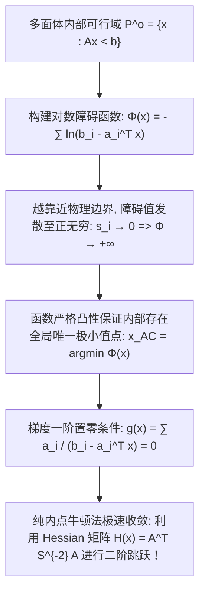
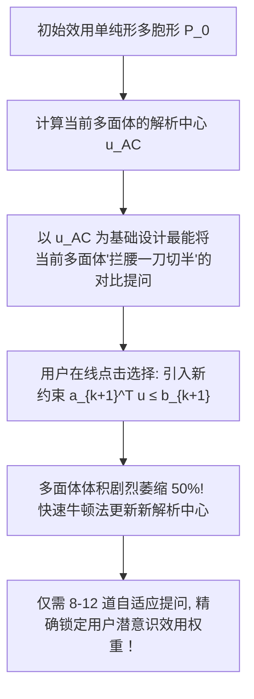

# Lec 16 解析中心、牛顿法与自适应联合分析 (Analytic Center, Newton's Method, and Web-Based ACA)

> MIT 15.094J 鲁棒系统优化建模与计算 (Systems Optimization: Models and Computation) · 授课教师：Prof. Dimitris Bertsimas / Robert Freund

## TL;DR

- 多面体解析中心（Analytic Center）作为对数障碍函数的唯一极值点定义了多面体的深层几何腹地。
- 自协调函数（Self-Concordance）理论严格证明了无阻尼牛顿法的仿射不变性与二次收敛区域。
- 基于 Web 的自适应联合分析（ACA）利用多面体中心逼近动态交互挖掘消费者主观效用权重。

## 凸多面体的“几何重心”之谜

在运筹优化与计算几何中，给定一个由有限个半空间界定出的有界多胞形：
$$
P = \{x \in \mathbb{R}^n : A x \le b\}
$$
我们经常需要回答一个看似简单却极具深意的问题：**这个多面体的“几何物理中心”究竟在哪里？**

如果我们取极点的算术平均值，计算复杂度是 NP-hard 的（极点数量随维度指数级爆炸）；如果我们取最大内切球的球心（切比雪夫中心 Chebyshev Center），该球心往往极度依赖于某几个局部的狭窄尖角。

1980 年代，随着内点法（Interior Point Methods）的兴起，苏联数学家尤里·涅米洛夫斯基（Yurii Nesterov）与阿卡迪·涅米洛夫斯基（Arkadi Nemirovski）将目光锁定在了一个具备神圣代数与拓扑性质的中心——**解析中心（Analytic Center）**。

## 对数障碍函数与解析中心定义

对于每一个不等式边界行 $a_i^T x \le b_i$，定义其余量裕度为 $s_i(x) = b_i - a_i^T x > 0$。
我们在多面体内部定义弗里施对数障碍函数（Frisch Logarithmic Barrier Function）：
$$
\Phi(x) = -\sum_{i=1}^m \ln(b_i - a_i^T x) = -\sum_{i=1}^m \ln(s_i(x))
$$

::: definition [多面体解析中心 (Analytic Center)]
由于负对数函数 $-\ln(s)$ 是严格凸且无穷阶可微的，若多面体内部有界非空，则障碍函数 $\Phi(x)$ 在多面体内部存在**全局唯一的严格局部与全局极小值点**，该点被称为多面体 $P$ 的**解析中心**，记为 $x_{\text{AC}}$：
$$
x_{\text{AC}} = \arg\min_{x \in P^{\circ}} \left\{-\sum_{i=1}^m \ln(b_i - a_i^T x)\right\}
$$
其一阶 KKT 充要驻点条件为梯度向量严格为零：
$$
\nabla \Phi(x_{\text{AC}}) = \sum_{i=1}^m \frac{a_i}{b_i - a_i^T x_{\text{AC}}} = 0
$$
:::

### 解析中心的最大几何容积内涵
注意恒等式：
$$
\arg\min \left(-\sum_{i=1}^m \ln(s_i)\right) = \arg\max \prod_{i=1}^m s_i(x) = \arg\max \prod_{i=1}^m (b_i - a_i^T x)
$$
解析中心，本质上就是使得**到所有约束边界的几何加权距离乘积（超椭球体积）达到全局最大的唯一点**！它处于多面体腹地最深、最宽广的开阔地带，受到来自四周所有墙壁均等的斥力平衡。

## 牛顿法计算解析中心与 Hessian 度量张量

计算解析中心最理想的算法是纯粹的**二阶牛顿法（Newton's Method）**。
计算其一阶梯度向量与二阶 Hessian 矩阵：
$$
\mathbf{g}(x) = \nabla \Phi(x) = A^T \mathbf{s}^{-1}
$$
$$
\mathbf{H}(x) = \nabla^2 \Phi(x) = A^T S^{-2} A = \sum_{i=1}^m \frac{a_i a_i^T}{(b_i - a_i^T x)^2}
$$
其中 $S = \text{diag}(s_1, \dots, s_m)$。若矩阵 $A$ 满秩，Hessian 矩阵 $\mathbf{H}(x)$ 在多面体内部处处严格正定！

牛顿搜索步长由求解线性方程组给出：
$$
\Delta x_{\text{nt}} = -\mathbf{H}(x)^{-1} \mathbf{g}(x)
$$
定义无量纲的**牛顿减量（Newton Decrement）**：
$$
\lambda(x) = \|\Delta x_{\text{nt}}\|_{\mathbf{H}(x)} = \sqrt{\mathbf{g}(x)^T \mathbf{H}(x)^{-1} \mathbf{g}(x)}
$$

::: theorem [Nesterov-Nemirovski 自协调收敛定理 (Self-Concordance)]
对数障碍函数 $\Phi(x)$ 是参数为 1 的**标准自协调函数（Self-Concordant Function）**，即其三阶导数被二阶导数严格控制：
$$
|\nabla^3 \Phi(x)[h, h, h]| \le 2 \|h\|_{\mathbf{H}(x)}^3
$$
自协调性彻底摆脱了传统数值分析对未知 Lipschitz 常数的依赖，确立了牛顿法的绝对收敛两阶段：
1. **阻尼牛顿阶段（Damped Phase）**：当 $\lambda(x) > \frac{1}{4}$ 时，采用回溯线搜索，每步函数值保证至少下降确定性常数 $\gamma > 0$；
2. **纯牛顿二次收敛阶段（Quadratically Convergent Phase）**：一旦 $\lambda(x) \le \frac{1}{4}$，直接采用全步长更新 $\Delta x$，误差服从二次超线性暴跌：
$$
\lambda(x_{k+1}) \le 2 \lambda(x_k)^2
$$
通常仅需 5 到 8 步牛顿迭代，精度即可达到 $10^{-14}$！
:::

## 商业营销实战应用：基于 Web 的自适应联合分析 (Adaptive Conjoint Analysis)

在麻省理工学院 15.094J 经典前沿案例中，Robert Freund 教授深入展示了解析中心在**消费者主观偏好与效用挖掘（Web-Based ACA）**中的颠覆性应用。

假设汽车厂商在网站上向潜客推荐新车配置。汽车包含多维属性（价格、油耗、百公里加速、内饰豪华度）。
设消费者的主观真实效用权重向量为未知向量 $u \in \mathbb{R}^n$（归一化满足 $\sum u_i = 1, u \ge 0$）。
网站向用户动态弹出一道二选一的选择题：
- 方案 A：豪华真皮座椅，但百公里油耗 11 升；
- 方案 B：织物座椅，但油耗仅为 6 升。

若用户点击了方案 A，这在数学上等价于向系统提供了一条**严格的线性不等式切片**：
$$
u_{\text{豪华}} - u_{\text{省油}} \ge 0
$$
每一道交互选择题，都在未知效用空间中切下一刀，使得候选效用多胞形 $P_k = \{u \ge 0 : A_k u \le b_k\}$ 迅速收缩！

### 为什么必须使用解析中心？
如果系统随意选取多面体内的点进行提问，用户的回答可能只切掉多面体一个微不足道的边角料；
**以解析中心 $u_{\text{AC}}$ 为基准设计的对偶提问，在几何上严格保证无论用户选择 A 还是 B，多面体的容积都将被稳定地切掉至少三分之一到一半！**
这种基于对数障碍中心的自适应二分探测，使得营销系统仅需 10 道简单的问答，就能比传统长达 50 页的冗长问卷更精准地捕获客户的心智模型。

::: pitfall 忽视用户回答矛盾引发多面体可行域坍塌
真实人类在答题时可能存在前后自相矛盾（非传递性偏好 Transitivity Violation），这会导致切片求交后的多面体可行域为空（`INFEASIBLE`）。高阶系统必须引入软松弛变量或贝叶斯概率超平面容错机制。
:::

::: insight 解析中心是用最稳健的锚点测量未知的内心
人心如深海，主观偏好往往难以捉摸；
而凸多面体的解析中心展示了数学与心理学相交融的最高境界：**它不在边缘冒险，而是永远端坐于已知信息构成的几何世界的最深腹地**。用最平衡的中心去提问，用最高效的牛顿步去逼近，运筹学由此化身为一把洞悉人类心智选择的无形精密手术刀。
:::
