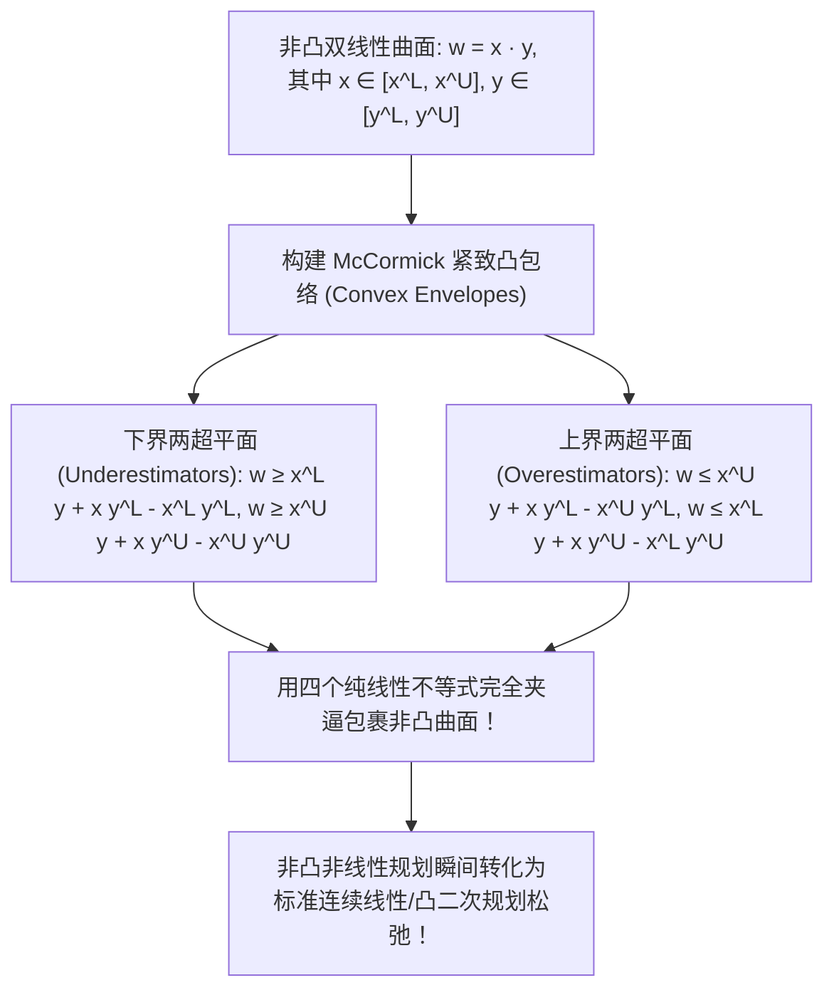
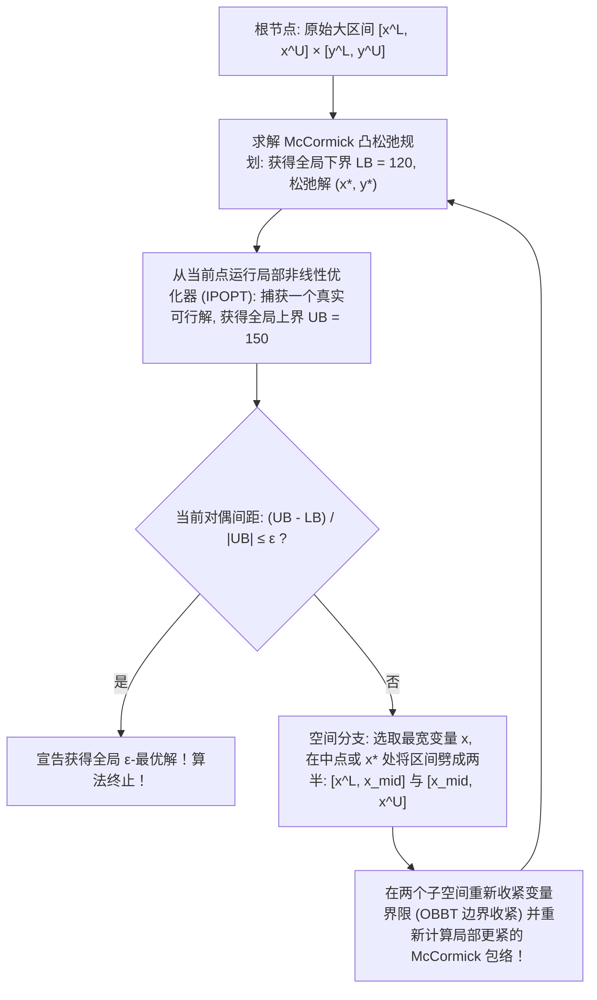

# Lec 18 非凸优化挑战与全局优化空间分支定界 (Non-Convex Optimization and Global Bounds)

> MIT 15.094J 鲁棒系统优化建模与计算 (Systems Optimization: Models and Computation) · 授课教师：Prof. Dimitris Bertsimas / Robert Freund

## TL;DR

- 非凸优化普遍面临多局部最优、鞍点震荡与 NP-hard 计算复杂性壁垒。
- McCormick 凸凹包络（Convex/Concave Envelopes）通过对双线性乘积项无损外包放缩构建凸下界松弛。
- 空间分支定界法（Spatial Branch-and-Bound）在连续变量空间递归剖分实现全局 $\epsilon$-最优收敛。

## 跌入险峰：非凸性的黑暗森林

在前面的课程中，凸优化的优良性质让我们享受了“局部最优即全局最优”的巨大红利。
然而，在现实工业世界中，绝大多数高价值的物理与经济系统本质上是**极其险恶的非凸系统（Non-Convex Systems）**：
- 交流电力系统最优潮流（AC-OPF）：包含复杂的三角函数有功无功潮流耦合；
- 蛋白质三维结构折叠预测：分子间 Lennard-Jones 势能曲面包含数万个虚假局部极小值；
- 供应链混合采购折扣：包含非线性的阶梯计价与规模经济凹函数。

面对非凸问题，普通的梯度下降法或内点法犹如在浓雾笼罩的黄山峡谷中盲目前行，几乎必然被困在某个半山腰的浅坑（局部极值）中。
我们如何才能在数学上确立一个**无可辩驳的绝对全局最优性保证（Global Optimality Certificate）**？

麻省理工学院 15.094J 深入非凸优化领域最顶尖的计算架构——**空间分支定界法（Spatial Branch-and-Bound, sBB）与 McCormick 凸包络松弛**。

## 双线性乘积项与 McCormick 凸包络 (McCormick Envelopes)

非凸优化中最常见、最基础的非线性元凶是两个连续变量的**双线性乘积项**：
$$
w = x \cdot y, \quad \text{其中 } x \in [x^L, x^U], \quad y \in [y^L, y^U]
$$
三维曲面 $z = x y$ 是一个典型的马鞍面（Saddle Surface），其 Hessian 矩阵的特征值一正一负，具有严重的非凸非凹性！

1976 年，Garth P. McCormick 提出了非线性规划历史上最著名的**下凸上凹四面包络定理**：

::: theorem [McCormick 凸凹包络定理]
在矩形超立方体定义域 $[x^L, x^U] \times [y^L, y^U]$ 上，双线性项 $w = x y$ 的最大紧致凸下界（Convex Underestimator）与最小紧致凹上界（Concave Overestimator）由以下四个线性不等式唯一且完备地给出：
$$
\begin{aligned}
w &\ge x^L y + x y^L - x^L y^L \quad (\text{下界面 1}) \\
w &\ge x^U y + x y^U - x^U y^U \quad (\text{下界面 2}) \\
w &\le x^U y + x y^L - x^U y^L \quad (\text{上界面 1}) \\
w &\le x^L y + x y^U - x^L y^U \quad (\text{上界面 2})
\end{aligned}
$$
这四个平面在几何上构成了双线性曲面在给定边界范围内的**凸包（Convex Hull）**！
:::

## 空间分支定界算法架构 (Spatial Branch-and-Bound, sBB)

有了 McCormick 凸包络，我们可以通过将所有非凸非线性项替换为其凸包络，在任意局部子空间中求得一个**绝对刚性的全局下界（Lower Bound, LB）**！在经典的整数规划分支定界中，分支动作仅仅发生在离散变量的取值裂变上（例如 $x \le 0$ 或 $x \ge 1$）；然而，在非凸连续规划中，所有的决策变量在物理上都是连续流动的实数。

为了将局部凸松弛的误差逼近至零，空间分支定界算法必须在**连续变量的空间区间（Continuous Hyper-Boxes）上进行递归几何剖分**。凸包络与真实非凸曲面之间的理论最大几何误差间隙严格受限于局部区间的包围盒跨度：
$$
\text{Gap} \le \frac{1}{4}(x^U - x^L)(y^U - y^L)
$$
随着算法在空间上不断切开变量区间，每个子空间对应的长方体体积呈指数级萎缩，局部 McCormick 线性平面的夹逼精度急剧提升：

在整个空间搜索树的演进过程中，算法通过双向夹逼确保理论收敛：
1. **全局上界的更新（Upper Bound, UB）**：在每一个活跃节点上，算法利用当前的连续松弛解作为热启动初始点，调用高性能局部非线性求解器（如 IPOPT 或 KNITRO）执行局部梯度内点搜索。一旦在当前子空间内部捕获到一个满足全部真实非凸物理约束的可行解，若其原目标值低于已知历史最优，立即刷新全局上界；
2. **全局下界的提升与节点剪除（Lower Bound & Pruning）**：整个搜索树的全局有效下界由所有尚未探索的未灭活叶子节点中的最小松弛值所绝对锁定。如果某个子节点的局部凸松弛下界已经超过了当前的全局上界（$LB_k \ge UB - \epsilon$），这意味着该子空间内部哪怕达到理论极限也无法产生超越现存最优解的可能，该连续长方体子空间将被直接永久剪枝废弃！随着树深增加，区间宽度趋近于零，上下界在有限迭代内精准闭合。

## 基于优化的边界收紧技术 (Optimization-Based Bound Tightening, OBBT)

在空间分支定界树向下深挖时，区间的边界越狭窄，McCormick 割平面就越锋利，收敛就越迅猛。
现代顶尖全局求解器（如 BARON、SCIP）在每个节点执行极其强大的**边界收紧技术（OBBT）**：
在当前的凸松弛约束下，分别对每一个变量求解微型的辅助线性规划：
$$
x_i^{\text{new}, L} = \min \{x_i : \text{当前凸松弛约束}\}
$$
$$
x_i^{\text{new}, U} = \max \{x_i : \text{当前凸松弛约束}\}
$$
通过这一技术，大量的无效虚空空间在分支前被自动切除，将原本需要搜索百万节点的空间树极速缩减至几百个节点以内！

::: pitfall 忽视分母接近零时的数值爆炸
在处理分式非凸项 $\frac{x}{y}$ 时，若变量 $y$ 的定义域跨越零点（包含负数与正数），分母除零会导致整个 McCormick 松弛彻底失效。必须在空间分支初始阶段强制在 $y = 0$ 处落下一刀，将正负区间完全物理割裂。
:::

::: insight 空间分支定界是用凸性切片网捕非凸深渊的巨网
非凸世界虽然充满迷雾，但绝非不可攻克的禁区。
空间分支定界算法向我们展现了人类理性的坚韧：**它不盲从任何局部的虚假繁荣，而是用一道道严密的 McCormick 凸包络铸造出坚不可摧的下界铁笼；随着空间区间的不断剖分切碎，误差间隙被无限挤压归零，真正的全局最优解最终在铁笼的收缩中无可遁形**。这是运筹学战胜复杂性的史诗级胜利。
:::
