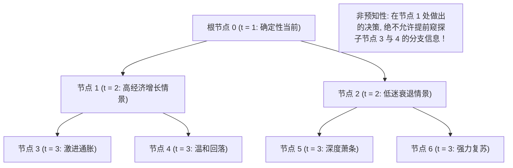

# Lec 19 随机线性优化与多阶段情景树补偿模型 (Stochastic Linear Optimization and Scenario Recourse)

> MIT 15.094J 鲁棒系统优化建模与计算 (Systems Optimization: Models and Computation) · 授课教师：Prof. Dimitris Bertsimas / Robert Freund

## TL;DR

- 多阶段随机规划（Multistage Stochastic Programming）将未来不确定性展开为分层情景树（Scenario Trees）。
- 非预知性约束（Non-Anticipativity Constraints）在数学上公理化捍卫了决策的历史因果律。
- L-Shaped 算法通过将大规模情景解耦为并行子问题并向主问题回传 Benders 割实现超高效求解。

## 从二阶段到多阶段：时间维度的链式展开

在第 12 讲中，我们探讨了经典的二阶段随机规划模型（事前承诺与事后补偿）。
然而，在现实工业运营与能源电力系统中，**不确定性的揭晓与决策的制定绝不是一次性终结的，而是沿着时间轴呈动态多阶段连续展开的（Multistage Dynamics）**：
- **水利水电大坝调度**：水库调度员在春季制定蓄水防汛策略；到了夏季，面对实际降雨降雪融水，调整水轮机发电与灌溉泄洪；到了秋季，再根据最新的冬季电网负荷预测决定储能储备；
- **供应链原材料套期保值**：企业每周根据大宗商品期货价格的最新走势，逐批动态调整长协锁定量与现货敞口采购。

**多阶段随机线性规划（Multistage Stochastic Linear Programming, MSLP）**构成了处理多期动态随机决策的理论高地。

## 情景树的拓扑几何与信息流演变

设决策时间跨度为 $t = 1, 2, \dots, T$。
在每一个时间段，大自然揭晓一组随机向量 $\xi_t = (c_t, A_t, b_t)$。
未来全部可能发生的不确定历史轨迹，在数学上被离散化表述为一棵**情景树（Scenario Tree）** $\mathcal{T}$：

情景树的节点集合记为 $\mathcal{V}$。对于任意非根节点 $n \in \mathcal{V}$：
- $t(n)$ 表示该节点所处的物理时间段；
- $a(n)$ 表示该节点的唯一父节点（Unique Ancestor Node）；
- $p_n$ 表示从根节点行进到达该节点的无条件联合发生概率。

## 非预知性约束的数学公理 (Non-Anticipativity Constraints)

在多阶段建模中，最核心的物理因果律公理是**非预知性（Non-Anticipativity）**：
**如果两个不同情景在时刻 $t$ 之前拥有完全相同的历史观测路径（即它们在情景树上汇聚于同一个节点 $n$），那么决策者在时刻 $t$ 做出的物理决策必须完全相同！**

在以树节点为索引用语中，非预知性被极其优雅地天然隐式满足：
我们直接将决策变量定义在树节点上——$x_n \ge 0$ 表示在情景树节点 $n$ 处执行的行动决策向量！
多阶段随机规划在全情景树上的宏伟确定性等价规划表述为：
$$
\begin{aligned}
\min \quad & \sum_{n \in \mathcal{V}} p_n c_n^T x_n \\
\text{s.t.} \quad & A_n x_n + B_n x_{a(n)} = b_n, \quad \forall n \in \mathcal{V} \setminus \{0\} \\
& A_0 x_0 = b_0 \\
& x_n \ge 0, \quad \forall n \in \mathcal{V}
\end{aligned}
$$
其中 $B_n$ 为将父节点 $a(n)$ 的状态结转传递至当前节点 $n$ 的跨期动态转移矩阵。

## L-Shaped 算法的大规模并行求解机制

当时间段 $T \ge 5$、每阶段分支数为 4 时，情景树的叶子节点数高达 $4^5 = 1024$ 个；当 $T \ge 10$ 时，节点数突破百万级。
直接调用单一求解器求解上述巨型规划会导致内存爆炸。

苏联与西方运筹学者（Van Slyke & Wets, 1969）提出了经典的 **L-Shaped 算法（Benders 分解在随机系统中的终极特化）**：
1. **主问题（Master Problem）**：仅求解第一阶段根节点的不可逆决策 $x_0$ 以及各个子情景树分支的未来期望补偿成本代理变量 $\theta_k$；
2. **完全并行的子问题池（Parallel Scenario Subproblems）**：固定第一阶段决策 $\bar{x}_0$。各个子情景树相互之间完全独立解耦！可以将其分发至上千台服务器核心并行异步求解；
3. **割平面向上回传反馈**：
   - 若某个子问题在当前 $\bar{x}_0$ 下由于原材料短缺导致不可行，求解器生成一条**极射线可行性割（Feasibility Cut）**回传给主问题，强行切除当前非法的 $\bar{x}_0$；
   - 若所有子问题均可行，利用对偶最优解生成一条**支撑超平面最优性割（Optimality Cut）**：
$$
\theta \ge \sum_{s \in \mathcal{S}} p_s \left(\pi_s^T h_s - \pi_s^T T_s x_0\right)
$$
主子问题交替震荡，在有限轮次内严格收敛至全局最优期望解！

::: pitfall 忽视情景树分支爆炸导致的内存瘫痪
完全重树的分支数是指数级发散的。面对跨越数十年的超长周期决策（如国家电网碳中和路径规划），必须结合**马尔可夫决策过程（MDP）与随机对偶动态规划（SDDP, Stochastic Dual Dynamic Programming）**，利用凹值函数切割在状态空间中展开。
:::

::: insight 随机规划是因果律在跨期多阶段中的神圣契约
在小说中，主人公若能窥探未来，便能随意改变过去；
而现实世界的残酷与庄严在于：时间之箭不可逆转，决策必须在迷雾中前行。
**多阶段随机规划与非预知性约束，是人类在数学上为“在不知道明天的前提下，如何为后天的全部可能负责”这一深刻哲学命题给出的最完美解答**。它让系统在充满变数的时空中，永远保持向阳而生的韧性。
:::
