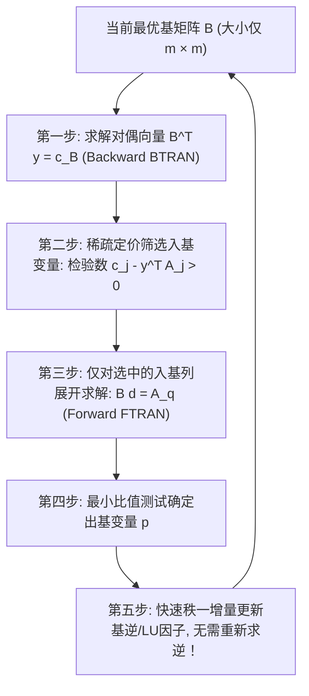

# Lec 2 单纯形法的大规模计算加速与稀疏基逆更新 (Simplex Computational Effectiveness & Basis Updates)

> MIT 15.094J 鲁棒系统优化建模与计算 (Systems Optimization: Models and Computation) · 授课教师：Prof. Dimitris Bertsimas / Robert Freund

## TL;DR

- 经典单纯形表的显式全矩阵求逆在万维工业大规模稀疏模型下遭遇计算灾难。
- 修正单纯形法（Revised Simplex）通过仅维护基矩阵 $B$ 实现了大规模内存解耦。
- Product Form of Inverse（PFI）与 Forrest-Tomlin LU 动态更新将单步主元迭代加速数千倍。

## 经典单纯形法在工业级规模下的瓶颈

在教科书的运筹学教学中，单纯形法通常以**全矩阵单纯形表（Simplex Tableau）**的形式呈现：每一轮主元变换，都需要对一个大小为 $m \times (n+m)$ 的庞大二维表格执行高斯-若尔当（Gauss-Jordan）全行初等消元。

当问题规模上升到工业级系统（例如包含 $m = 100,000$ 个约束、$n = 500,000$ 个变量的供应链或电网优化）时：
1. **显式内存溢出**：全单纯形表需要存储 $10^5 \times 6 \times 10^5 = 6 \times 10^{10}$ 个双精度浮点数，需要数百 GB 连续内存；
2. **稀疏性彻底破坏（Fill-In Disaster）**：工业实际模型的约束矩阵 $A$ 极其稀疏（非零元通常不足 0.1%）。然而，一旦盲目进行全矩阵高斯消元，原本为 0 的位置会迅速被非零实数填满（严重填入 Fill-In），使得算法在第几轮迭代后就因算力崩溃而彻底卡死！

麻省理工学院 15.094J 深入计算机体系结构与数值代数底层，系统传授驱动 CPLEX 与 Gurobi 等现代顶级商用求解器的**修正单纯形架构与稀疏基逆动态维护技术**。

## 修正单纯形法的惰性计算架构 (Revised Simplex Method)

修正单纯形法（Revised Simplex）的核心哲学是**惰性求值（Lazy Evaluation）**：
我们**绝不维护庞大的全矩阵单纯形表**，我们仅仅维护一个大小仅为 $m \times m$ 的基矩阵 $B$ 及其逆矩阵 $B^{-1}$ 的某种紧凑因式分解形式！

在每一轮迭代中：
1. **BTRAN 求解（Backward Transformation）**：求解线性方程组 $B^T y = c_B$。由于只需要计算一个 $m$ 维向量 $y$，耗时仅与 $B$ 的非零元个数成正比；
2. **稀疏定价（Pricing）**：在稀疏列集合中计算检验数 $\bar{c}_j = c_j - y^T A_j$。一旦找到违反最优性条件的入基列 $q$，立即停止；
3. **FTRAN 求解（Forward Transformation）**：**仅仅为选中的这一列 $A_q$ 展开计算单纯形更新列**：求解方程组 $B d = A_q$；
4. **最小比值测试**：依据 $d$ 与当前基解 $x_B$ 确定出基变量 $p$；
5. **增量基逆更新**：在矩阵中仅用列 $A_q$ 替换原来的第 $p$ 列，形成新基 $B_{\text{new}}$。

## 基逆乘积形式 (Product Form of Inverse, PFI)

在新旧两轮基矩阵之间，$B_{\text{new}}$ 仅仅改变了第 $p$ 列，其余 $m - 1$ 列完全相同。在数值代数上，这意味着 $B_{\text{new}} = B \cdot E$，其中 $E$ 是一个**初等 Eta 矩阵（Elementary Eta Matrix）**：
$$
E = \begin{bmatrix}
1 & & \eta_1 & & \\
& \ddots & \vdots & & \\
& & \eta_p & & \\
& & \vdots & \ddots & \\
& & \eta_m & & 1
\end{bmatrix}
$$
根据初等矩阵求逆法则，其逆矩阵 $E^{-1}$ 同样是一个具有极简形式的初等稀疏矩阵：
$$
E^{-1} = \begin{bmatrix}
1 & & -\eta_1 / \eta_p & & \\
& \ddots & \vdots & & \\
& & 1 / \eta_p & & \\
& & \vdots & \ddots & \\
& & -\eta_m / \eta_p & & 1
\end{bmatrix}
$$

::: theorem [基逆的乘积链式展开]
经历 $k$ 轮主元迭代后，当前的基逆矩阵无需任何显式求逆，直接表示为一系列初等 Eta 矩阵的链式乘积：
$$
B_k^{-1} = E_k^{-1} E_{k-1}^{-1} \dots E_2^{-1} E_1^{-1} B_0^{-1}
$$
:::
每一次求解方程组，只需将向量从右向左依次穿过这串极度稀疏的 Eta 向量列表，运算量仅为微秒级！

## 工业界巅峰：Forrest-Tomlin 稀疏 LU 动态更新

随着主元迭代轮数增加，Eta 链条会越来越长，内存占用增加且浮点舍入误差累积。现代高性能求解器普遍采用**稀疏三角 LU 分解（$B = L U$）**：
- **周期性重新因子化（Reinversion）**：每隔 50-100 轮主元迭代，调用 Markowitz 最小度数法则对当前基矩阵重新执行一次全矩阵稀疏 LU 三角分解，彻底清除数值误差并压缩内存；
- **Forrest-Tomlin 动态行旋转更新**：在两轮迭代之间，当某列被替换时，上三角矩阵 $U$ 会出现尖刺（Spike）。Forrest-Tomlin 算法通过对尖刺行与下游行进行精妙的高斯行轮换，仅用 $\mathcal{O}(m)$ 运算量即可在纳秒内重新将矩阵还原为完美上三角形式！

::: pitfall 忽视小主元导致的数值不稳定与死循环
在主元选取时，如果主元系数极小（如 $10^{-10}$），除以该主元会导致机器浮点精度灾难性损失，使得单纯形法陷入严重的数值死循环。商业级求解器均引入**阈值部分选主元（Threshold Partial Pivoting）**与 Harris 双精度最小比值容差测试。
:::

::: insight 计算工程是数学理论从纸面通向现实的钢铁桥梁
许多纯数学家轻视数值计算中的稀疏矩阵与数据结构，认为那只是“代码细节”。
而 15.094J 明确指出：**如果没有稀疏 LU 更新、BTRAN/FTRAN 惰性分解与 Markowitz 选主元，单纯形法就只能永远停留在教科书中处理 5 个变量的玩具模型，根本不可能解决今日支撑现代文明电网调度与全球航线规划的百万维现实大题**。算法工程的深度，同样是一座令人叹为观止的科学高峰。
:::
